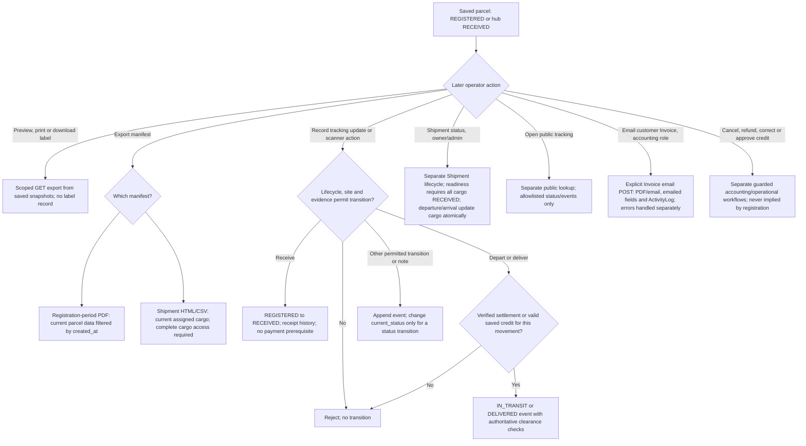

# Motionmate Logistics parcel registration: current-state audit

Audit date: **12 November 2026**. Source baseline: working tree based on commit `79f5dd4`, including existing uncommitted template edits.

This is a **read-only application audit**, with this report as the sole authorized file addition. It describes implementation inspected in this checkout, not a deployed environment. No Django command, test runner, browser fixture, application request, database query/write, migration, provider operation, commit, push or deployment was performed. Tests below were inspected, not executed. Runtime database configuration, deployed static assets, rendered responsiveness, actual payment custody and email delivery were not verified.

Instructions read: root `AGENTS.md` and `.agents/skills/motionmate-ui/SKILL.md` (Audit mode; Logistics; parcel entry and continuation routes). The user's explicit request authorizes saving this document despite the skill's default no-artifact rule. Relevant registration, hub intake, location access, financial access, mobile UX and invoice/payment documentation was consulted and checked against code. Phoenix wizard source/examples were consulted read-only. Services is outside this audit's change scope; shared CRM/billing code was read only where Logistics calls it.

Pre-existing modified files were preserved: `src/templates/inheritance/dashboard_parent.html`, `src/templates/logistics/includes/dashboard_snapshot.html`, `src/templates/logistics/parcel_form.html`, and `src/templates/logistics/scan.html`. Findings therefore describe the **current working tree**, including the edited parcel form, rather than pristine HEAD.

The key boundary is the first successful parcel POST: it already saves the parcel and its registration history. Charges, invoice creation/issuance, optional customer receipts, shipment assignment and manifests are separate actions afterward. At an authorized current hub, that first POST also records physical receipt. Selecting a Client does not automatically make that Client the saved sender or recipient.

## 1. Current-state flowcharts

### 1.1 Entry, first save and optional continuation

Solid arrows describe the ordinary guided path; dashed arrows describe optional navigation. Each write still checks its own authorization. The payment decision is a browser/session navigation gate, not a financial prerequisite for shipment assignment.

```mermaid
flowchart TD
  subgraph ENTRY[Before parcel registration is saved]
    A["Open Register Parcel: sidebar, dashboard, list, Client or shipment screen"] --> B{"Authenticated active Business, parcels/tracking write access, owner/admin/staff?"}
    B -->|No| DENY["Login/setup/subscription redirect or permission denial"]
    B -->|Yes| C{"GET client parameter supplied?"}
    C -->|Invalid or outside Business| MISSING["404: Client unavailable"]
    C -->|Valid or absent| D["Step 1: choose Client and describe package"]
    D --> E{"Existing Client?"}
    E -->|Yes| F["Select tenant Client from searchable dropdown"]
    E -->|No, creation permitted| G["Add Client modal: six required fields"]
    E -->|No, creation unavailable| BLOCK["Cannot save without a Client; authorized colleague/setup needed"]
    G --> H{"CRM form and client capacity valid?"}
    H -->|No| GERR["400 field fragment or request error; parcel draft stays in page"]
    GERR --> G
    H -->|Yes| I["Save Client independently; 201 fragment; select Client in parcel draft"]
    F --> J["Step 2: transport mode, origin/destination territory and optional facilities"]
    I --> J
    J --> K["Step 3: optional physical, sender/recipient, transport, documents and handling details"]
    K -.-> PF["Optional explicit sender prefill GET; copy empty draft fields only"]
    PF -.-> K
    K --> L["Step 4: review; Register Parcel or Register and continue"]
    L --> V{"Form, model, subscription, role, site and quota checks pass?"}
    V -->|Invalid values or retry conflict| ERR["Bound form with errors; no parcel saved by this attempt"]
    ERR --> D
    V -->|Permission or work-site failure| FORBID["403; transaction rolls back"]
    V -->|Yes| HUB{"Authorized current HUB, or explicit save_and_receive=1?"}
    HUB -->|Hub intake requested and authorized| HS["Atomic register_and_receive_parcel: REGISTERED event then RECEIVED event"]
    HUB -->|Ordinary registration| NS["Atomic register_parcel: parcel plus REGISTERED event"]
    HS --> SAVED["FIRST SAVE COMPLETE: tracking code, parcel, history and applicable usage ledger saved"]
    NS --> SAVED
    HS -.->|Receipt failure| ERR
  end

  SAVED --> CONT{"continue_registration=1?"}
  CONT -->|No| DETAIL["Parcel detail: saved status, label, history and follow-up actions"]
  CONT -->|Yes| GUIDE
  DETAIL -.->|Continue Registration| GUIDE

  subgraph POST[AFTER first save: separately saved continuation]
    GUIDE["Rebuild five-step continuation from persisted evidence and actor scope"] --> FIN{"Finance action available and wanted?"}
    FIN -->|Add charge| CH["Separate Add Charge form: service or custom; quantity and price"]
    CH --> CHV{"Valid charge, scope, quota-independent charge checks and retry identity?"}
    CHV -->|No| CH
    CHV -->|Yes| CHS["Save LogisticsCharge and frozen Parcel coverage; return to continuation"]
    CHS --> INV["Select pending same-Client charges; new Invoice or authorized draft"]
    INV --> IV{"Selection, binding, scope, currency and tax valid?"}
    IV -->|No| INV
    IV -->|Yes| IDS["Save DRAFT Invoice/lines or append lines; recalculate totals"]
    IDS --> ISS{"Issue Invoice now?"}
    ISS -->|Yes, authorized| IS["POST issue: lifecycle SENT plus ActivityLog; no email or collection"]
    IS --> PAY
    ISS -->|Defer| PAY
    FIN -->|Already billed, unavailable or defer| PAY
    PAY["Invoice and payment step"] --> PD{"Authorized payment decision"}
    PD -->|Continue without receipt| SKIP["Store session navigation choice only"]
    PD -->|Record; eligible issued Invoice required| RF["Receipt form: amount, method, optional reference, optional existing allocations"]
    RF --> RV{"Receipt valid, within balance and authorized?"}
    RV -->|No| RF
    RV -->|Yes| RS["Save InvoicePayment, ActivityLog and applicable allocation shares; session choice"]
    PD -->|No decision permission| COL["Authorized-colleague message; no finance write"]
    SKIP --> SH
    RS --> SH
    COL -.-> SH
    SH{"Shipment choice after save"} -->|Assign suggested existing shipment| AS["POST assign with Shipment UUID and expected revision"]
    AS --> AV{"Work site, roles, subscription, states, billing Client, mode and revision valid?"}
    AV -->|No| AE["Validation error or permission denial; parcel remains saved"]
    AE --> SH
    AV -->|Yes| ASS["Save Parcel.shipment; update Shipment revision, history and retry receipt"]
    SH -->|Owner/admin creates shipment| NEW["Separate Shipment form; guided Parcel must remain selected"]
    NEW --> NEWV{"Shipment creation and assignment both valid?"}
    NEWV -->|No| NEW
    NEWV -->|Yes| NEWS["Atomic DRAFT Shipment creation and Parcel assignment"]
    SH -->|Assign later| LATER["POST later: redirect only; no deferral record"]
    SH -.->|Browse all shipments| BROWSE["Shipment list then detail/assignment; returns to Shipment detail"]
    ASS --> SUM["Summary: saved records, remaining tasks, clearance and label links"]
    NEWS --> SUM
    LATER --> SUM
  end

  DETAIL -.-> NEXT["Later operations, exports and communications: separate diagram below"]
  SUM -.-> NEXT
```

The diagram groups checks for readability. The ordinary form also validates before choosing the save service; the services recheck persisted authority under locks. `save_and_receive=1` outside an authorized hub fails with 403, rather than enabling receipt. JavaScript normally requires review before submission; a valid direct POST/no-JavaScript submission can save without visiting those presentation steps. Invalid Client query parameters are 404; valid selected Client values survive a bound-form validation failure. Sources: `src/apps/logistics/views.py:383`, `src/apps/logistics/parcel_services.py:168`, `src/apps/logistics/registration_views.py:140`, `src/static/assets/js/parcel-wizard.js:182`.

### 1.2 Separate actions after registration

There is **no automatic registration email, SMS, WhatsApp message, payment collection, manifest creation, shipment creation, departure or delivery** in the inspected save path. Registration/receipt public messages become tracking history; Django success messages are feedback for the operator. Invoice issuance sets `SENT` but does not send email. The explicit email action is separate. Sources: `src/apps/logistics/parcel_services.py:220`, `src/apps/logistics/test_parcel_intake.py:91`, `src/apps/billings/services.py:230`, `src/apps/billings/views.py:832`, `src/apps/logistics/shipment_services.py:492`.

## 2. Screens/actions and data written

1. **Open registration — GET `/logistics/parcels/register/` (`logistics_parcel_register`).** Entrypoints exist in the sidebar, dashboard, parcel list, Client parcel panel, and empty shipment-assignment screens. The Client panel and continuation's “Register another Parcel for this Client” pass `?client=<id>`. Shipment empty-state registration links do not carry a shipment identifier; registering from them does not attach the parcel. The current Business resolver uses a valid session membership or the oldest active membership fallback. Authentication, module write access and owner/admin/staff roles gate the form; work-site authority is enforced by the save service. A fresh hidden registration UUID is generated. **Domain writes: none.** Sources: `src/taskio/urls.py:150`, `src/apps/logistics/urls.py:118`, `src/apps/businesses/utils.py:125`, `src/templates/logistics/includes/client_parcels.html:7`, `src/templates/logistics/shipment_detail.html:97`, `src/apps/logistics/views.py:390`.

2. **Entry step 1 — Client & package.** Select one existing tenant Client and enter `package_description`. The select loads the entire tenant queryset, ordered by first name/last name/PK, with name/company/email labels; Choices supplies browser-side searching, not a remote Client lookup API. Inactive Clients are not excluded by this queryset. With no Clients, an informational message asks for the first Client; saving still requires a Client. Registration deliberately omits `quantity`; new parcels use model default **1**. **Writes: none until a client-modal POST or final parcel POST.** Sources: `src/apps/logistics/forms.py:620`, `src/static/assets/js/logistics-workflows.js:60`, `src/templates/logistics/parcel_form.html:41`, `src/apps/logistics/models.py:756`.

3. **Optional Add Client modal.** Visible only with CRM write access, client-management role capability and a writable workspace. POST `/crm/staff/clients/create/` (`staff_client_create`) with `workflow=parcel`, CSRF and prefix `new_client-`. This is the HTML-fragment path, not `/crm/staff/clients/quick-create/`. Six required fields are listed below. The backend rechecks Logistics/parcels/tracking access, validates fields and client capacity, locks the capacity scope, and saves the Client in the resolved Business. A **201 selected-option fragment** lets JavaScript add/select it without navigating the parcel form. A **400 field fragment** replaces only modal fields and retains invalid input; an unexpected response/network failure displays a generic message. **Writes: Client, independently committed before any parcel save; no Parcel or parcel event.** Default Client identity/contact/address settings also apply. Canceling the parcel later does not undo this Client. Sources: `src/templates/logistics/includes/client_modal.html:4`, `src/apps/crm/views.py:1275`, `src/apps/crm/forms.py:494`, `src/static/assets/js/logistics-workflows.js:228`, `src/apps/logistics/test_workflows.py:42`.

4. **Entry step 2 — Route.** Select configured transport mode and origin/destination countries/territories; optionally select company facilities. Origin country/facility default from the actor's active current work location. A new staff origin selector contains only that current facility. Destination facilities include all active tenant facilities, without granting the actor permission to operate there. Choosing a destination facility can populate its country; changing country/mode filters dependent facilities and references. Disabled hidden `origin`/`destination` text fields ignore posted replacements and are derived from facility name or country display name. No GPS, customer-address geocoding, tariff route or staff assignment is created. **Writes: none.** Sources: `src/apps/logistics/location_forms.py:96`, `src/apps/logistics/location_forms.py:124`, `src/apps/logistics/location_forms.py:185`, `src/static/assets/js/logistics-workflows.js:85`.

5. **Entry step 3 — Optional details.** An “Additional details” disclosure contains the internal/reference fields and six tabs: Physical details, Sender, Recipient, Transport, Documents and value, Handling and notes. Values remain in the same HTML form between steps/tabs. Sender prefill is an explicit button, available with CRM read entitlement: GET `/logistics/parcels/shipping-prefill/?client=<id>` rechecks parcel write/CRM read scope and returns Client-derived values; JavaScript copies only empty sender fields. No equivalent recipient-prefill button is currently rendered. Sender/recipient names, contacts and addresses are independent parcel snapshots, optional even when labels are later printed. **Writes: none.** Sources: `src/apps/logistics/forms.py:369`, `src/templates/logistics/parcel_form.html:75`, `src/templates/logistics/parcel_form.html:99`, `src/apps/logistics/label_views.py:103`, `src/apps/logistics/shipping_labels.py:58`.

6. **Entry step 4 — Review and first save.** JavaScript builds a text-only summary from entered fields; Back/Edit links change visibility, and Enter advances instead of saving until Review. Final buttons are **Register & continue** (`continue_registration=1`) and **Register Parcel**. Both POST the same form. The view/form and services validate current tenant/client ownership, input values, retry payload, role/subscription/site and capacity. At an authorized hub both buttons call `register_and_receive_parcel`, even if the primary button did not post `save_and_receive`. Outside that hub path, ordinary registration calls `register_parcel`.

   **Writes in the atomic transaction:** one `Parcel` with resolved Business/Client, immutable generated tracking code, metadata, creator and timestamps; one immutable `ParcelEvent` of type STATUS, `REGISTERED`, with actor, operating site where available, public message and registration UUID. Hub intake also appends a `RECEIVED` event using a UUID derived from the registration key, updates `current_status`/`updated_at`, and requires origin to equal the receiving hub. For capacity-managed Logistics tiers, creation also updates the subscription's `logistics_monthly_usage` ledger. It does not create charges/invoices/shipments/handling assignments. An identical authorized retry returns saved results; changed payload/actor/key collision is rejected. Hub receipt failure rolls the entire parcel/history transaction back. A new registration UUID is not a logical duplicate detector for a physically identical parcel. Sources: `src/static/assets/js/parcel-wizard.js:38`, `src/apps/logistics/views.py:401`, `src/apps/logistics/parcel_services.py:168`, `src/apps/logistics/parcel_services.py:234`, `src/apps/businesses/usage_limits.py:286`.

7. **First-save result — parcel detail or continuation.** With `continue_registration=1`, redirect to `/logistics/parcels/<id>/registration/`; otherwise redirect to `/logistics/parcels/<id>/`. Detail exposes Continue Registration, copy tracking, label preview/print/download, authorized Client/billing links, scoped shipment links and event history. Label generation is on demand from saved snapshots; later Client edits do not refill saved shipping fields. Long/unprintable label content can produce a handled **422** even when registration succeeded. **Writes: none from these GET projections/exports.** Sources: `src/apps/logistics/views.py:426`, `src/templates/logistics/parcel_detail.html:29`, `src/apps/logistics/label_views.py:52`, `src/apps/logistics/shipping_labels.py:42`.

8. **AFTER SAVE — continuation's saved Parcel/Charges steps.** The page has five panels: Parcel, Charges, Invoice & payment, Shipment, Summary. It calls `resolve_parcel_workflow` from persisted operational/financial evidence and fresh actor scope. Financial actions include Add Charge and Create invoice/Add to existing invoice when executable; a same-Client “register another” shortcut supports combining several parcels later. The saved Parcel panel's “Review Parcel details” actually opens the edit form; that edit saves to detail, not back to continuation. The entry wizard and this continuation do not save a general wizard-step model. **Writes: none on GET.** Sources: `src/apps/logistics/registration_views.py:282`, `src/apps/logistics/workflow_summary.py:1274`, `src/templates/logistics/parcel_registration.html:16`, `src/apps/logistics/views.py:344`.

9. **AFTER SAVE — Add Charge.** GET/POST `/logistics/parcels/<id>/billing/charge/?registration=1`. Choose an existing active `BusinessService` or a custom charge, billing quantity and optional/specified unit price. Service price is suggested, not a weight/volume tariff; declared value is not freight price. Custom requires description and unit price. Currency comes from Business at creation. Saving returns to continuation; repeat for additional charges. **Writes:** `LogisticsCharge` snapshots (Client/target/service/description/quantity/price/currency/reference/logical identity/retry UUID/creator), `LogisticsChargeParcel` coverage row(s), and `coverage_recorded_at`. No Invoice is created by Add Charge. Exact retry reuses the charge; a fresh UUID cannot duplicate an active logical obligation with the same purpose/occurrence. Sources: `src/apps/logistics/billing_views.py:108`, `src/apps/logistics/billing_forms.py:16`, `src/apps/logistics/billing_services.py:82`, `src/apps/logistics/billing_services.py:178`.

10. **AFTER SAVE — create Invoice or append to draft.** GET/POST `/logistics/parcels/<id>/billing/invoice/?registration=1`. Current parcel's uninvoiced, nonvoid charges are preselected; other authorized same-Client parcel charges may be combined. At least one selected charge must belong to the current parcel. The optional Invoice selector offers authorized same-Client drafts; blank means create a new draft. Service checks all selected sources and existing draft siblings, one Client, frozen coverage, active bindings, currency/tax and legacy/cancellation integrity. **Writes:** a new shared billing `Invoice` in DRAFT plus creation `ActivityLog`, or additions to an existing DRAFT; `InvoiceLine` rows linked to `charge_source`, service and Parcel/Shipment; initial compatibility `LogisticsCharge.invoice_line` linkage; recalculated subtotal/tax/total; applicable invoice monthly usage when a new Invoice consumes capacity. Existing bindings are reused on a valid replay, including after issuance. Tax uses saved Invoice basis; new invoices use the current Business rate unless reissue history requires its saved rate. Sources: `src/apps/logistics/billing_forms.py:82`, `src/apps/logistics/billing_views.py:173`, `src/apps/logistics/billing_services.py:236`, `src/apps/billings/services.py:80`.

11. **AFTER SAVE — review/issue Invoice.** The continuation shows related authorized Invoices, balances/payment presentation where permitted, and issue buttons for eligible drafts. POST to the continuation with `action=issue` and related `invoice` ID calls `change_invoice_status(..., status="SENT")` under locks. **Writes:** Invoice lifecycle status/timestamp and status `ActivityLog`; lines/saved totals stay protected. A repeated issue of SENT/PAID is harmless under the service transition rules. This does not email the Invoice, record money, collect through Stripe, or grant clearance by itself. Staff may issue only a complete, writable Parcel-only Invoice within financial/location scope; accounting roles retain wider scope. Sources: `src/apps/logistics/registration_views.py:73`, `src/apps/logistics/registration_views.py:157`, `src/apps/billings/services.py:230`, `src/apps/logistics/financial_access.py:107`.

12. **AFTER SAVE — explicit payment decision/optional receipt.** Authorized actors choose **Record payment received** or **Continue without recording a payment**, with no default choice in a fresh session. Record is disabled without an eligible issued Invoice with a known positive balance. The first eligible Invoice can be selected automatically; `?payment=<invoice-id>` selects another authorized related Invoice and invalid/unavailable choices are denied. The form defaults to CASH and full outstanding Invoice balance. Existing shared-Invoice balances are full Invoice balances, not an invented share for this parcel; cancellation allocation fields can appear only when saved allocation evidence already exists.

   POST `action=payment, decision=continue` stores `parcel_payment_decision_<business>_<parcel> = "continue"` in the session and redirects to Shipment. **No financial/domain record is written.** Session persistence itself depends on the configured session backend. POST `decision=record` validates the receipt and invokes the shared locked receipt service. **Writes:** immutable `InvoicePayment` RECEIPT, its `ActivityLog`, applicable `InvoiceReceiptShare` allocations, and session navigation choice `record`. No automatic Invoice lifecycle change is made by recording the receipt. Overpayment, wrong currency, conflicting retry/reference, invalid/legacy evidence and unauthorized Invoice scope fail; submitted fields and UUID stay on the error form. CASH, BANK_TRANSFER and ONLINE are offered in this Logistics form; reference is optional and a blank generates `RECEIPT-<UUID>`. No external verification field is shown; an older VERIFIED_ONLINE form value is normalized to ordinary ONLINE. None of these choices collects funds. Sources: `src/apps/logistics/registration_forms.py:14`, `src/apps/logistics/registration_views.py:140`, `src/apps/logistics/registration_views.py:322`, `src/apps/billings/payment_forms.py:9`, `src/apps/billings/payment_services.py:302`, `src/apps/billings/cancellation_services.py:617`.

13. **AFTER SAVE — assign an existing Shipment.** Suggested choices are the newest **25** scoped DRAFT/READY shipments matching both explicit route facilities, or case-insensitive route text when that parcel side has no facility. Shipments with charges belonging to a different Client are excluded. Actor must have assignment authority, write modules, an eligible REGISTERED/RECEIVED parcel, current operating scope and no existing shipment. POST `action=assign` includes shipment ID, UUID and expected shipment revision. The service rechecks authority, both records' operating scope, lifecycle, concurrency, billed Client and known transport-mode compatibility. **Writes:** `Parcel.shipment`/`updated_at`; Shipment revision, write-receipt map, operation-history assignment entry and timestamp. It does **not** change parcel status, copy transport references, create freight, or expand frozen charge membership. Route equality is a suggestion filter, not a service invariant. Sources: `src/apps/logistics/registration_views.py:94`, `src/apps/logistics/registration_views.py:201`, `src/apps/logistics/shipment_services.py:381`, `src/apps/logistics/shipment_services.py:223`.

14. **AFTER SAVE — create Shipment, browse or defer.** Owner/admin “Create Shipment with this Parcel” opens `/logistics/shipments/create/?parcel=<id>&registration_parcel=<id>` with route/mode/Parcel preselected. The guided Parcel cannot be omitted/substituted. **Writes:** new DRAFT `Shipment` with generated reference, timestamps/creator/UUID/revision/history, applicable usage ledger, and assignment in one transaction. If assignment fails, the new Shipment rolls back while the already-saved parcel remains. A stale GET for an already-assigned parcel resumes continuation. Staff cannot create/manage/remove/status-change shipments, but can perform authorized assignments. “Browse all Shipments” goes to `shipments/?parcel=<id>`, then Shipment detail and its assignment POST; this alternate path returns to Shipment detail and does not preserve the guided return parameter. “Assign later” POST redirects to `?summary=1`; **no assignment or durable deferral/completion flag is saved**. Sources: `src/apps/logistics/shipment_policy.py:7`, `src/apps/logistics/shipment_views.py:179`, `src/apps/logistics/shipment_services.py:243`, `src/apps/logistics/shipment_views.py:301`, `src/templates/logistics/shipment_list.html:58`, `src/apps/logistics/registration_views.py:217`.

15. **AFTER SAVE — summary, labels and manifests.** Summary is a projection, not an approval step. A parcel can have a summary while charges, issuance, receipts or transport remain incomplete. Existing assignment or `?summary=1` requests summary display; JavaScript may still require a payment decision in that session. Labels can be previewed/downloaded immediately after initial save, with no payment prerequisite. There is no Parcel→Manifest FK or manifest-creation action in registration. Shipment HTML/CSV manifest is a current cargo snapshot, requiring shipment/manifests entitlement and access to all cargo. Separate `/logistics/parcels/manifest/` generates an on-demand registration-period PDF using business-local calendar dates and `Parcel.created_at`; it can include unassigned parcels. Both export paths read current records; neither is an immutable dispatch manifest or a registration write. Sources: `src/apps/logistics/registration_views.py:403`, `src/static/assets/js/parcel-wizard.js:195`, `src/apps/logistics/shipment_services.py:565`, `src/apps/logistics/manifest_views.py:19`, `src/apps/logistics/manifest_pdf.py:25`.

16. **LATER OPERATIONS — receive/move/deliver, communications and accounting.** Parcel detail/update and scanner actions append tracking events through the same services. REGISTERED can become RECEIVED/HOLD/CANCELLED; subsequent transitions are listed below. Shipment readiness/departure requires nonempty cargo all RECEIVED; departure and arrival propagate Parcel events atomically. Departure/delivery services enforce settlement or valid movement-specific saved credit; a skip-payment decision, assigned shipment, SENT/PAID lifecycle flag or displayed summary alone does not authorize movement. Explicit Invoice email POST sends its PDF and updates email audit fields; invalid recipient/PDF/provider failure is handled there. Cancellation settlement, refunds, corrections and credit approval are separate guarded flows, not registration steps. Sources: `src/apps/logistics/views.py:454`, `src/apps/logistics/parcel_services.py:314`, `src/apps/logistics/credit_services.py:287`, `src/apps/logistics/shipment_services.py:492`, `src/apps/billings/views.py:832`.

## 3. Field inventory

R = required; O = optional; C = conditional; S = server-supplied/noneditable. These describe the **current new-parcel HTML flow**; direct service compatibility and historical edits can differ. Unless stated otherwise, optional text defaults empty, nullable measurements/dates default null, and form text is stripped. Optional metadata becomes required only if a submitted value must satisfy its type/range/relationship checks.

### 3.1 Parcel entry: Client, package and route

| Field / control | Required/default | Source and validation | Purpose |
| --- | --- | --- | --- |
| `client` | R; blank unless valid `?client=` | ModelChoice of all Clients in current Business, ordered first/last/PK; same-tenant relation rechecked under lock; includes inactive rows | Owner/customer and billing Client, independent of sender/recipient snapshots |
| `package_description` | R | Free text, max 1000 | Parcel contents/description, labels/operations |
| `mode_of_transport` | C: R if profile has configured modes; sole mode preselected; otherwise blank Unknown | Persisted `LogisticsProfile.transportation_modes`, intersection with SEA/AIR/ROAD/RAIL enum; service validates configured modes | Operational transport classification, reference applicability and later assignment compatibility |
| `origin_country_code`, `destination_country_code` | C: explicitly R when operating-country choices exist; route clean still needs country or facility to derive each side | ISO alpha-2 choices from offline `pycountry`, restricted to Business country plus active tenant-facility countries; facility/country consistency and operating territory checked | Geographic route; not sender/recipient address country |
| `origin_location` | O at form level; C required to equal current site when operating policy requires one | Active tenant facilities; staff new-origin choices limited to current site; default from current assignment; lock-time origin/site rule | Origin company facility and operating authority |
| `destination_location` | O | All active tenant facilities; filtered by selected destination country; cross-tenant/inactive-new choices rejected | Optional company destination; selection creates no grant |
| `origin`, `destination` | S in this form; required text on model | Disabled hidden fields, derived from facility name or selected country name; model max 255 | Compatibility/display route text, not freely typed in current form |
| `quantity` | S = **1** on registration; absent from registration form | `PositiveIntegerField`, min 1; remains editable through later metadata form | Operational count used by shipment manifest; separate from charge quantity |
| `internal_reference` | O | Free text, max 100; no uniqueness/deduplication check | Staff/customer reference |
| `origin_reference_code`, `destination_reference_code` | O; blank None | Offline `data/location_references.json` via `reference_choices`; same territory and PORT for SEA/AIRPORT for AIR; no matching port/airport choice for ROAD/RAIL | Optional verified route reference |

Sources: `src/apps/logistics/forms.py:465`, `src/apps/logistics/forms.py:620`, `src/apps/logistics/models.py:722`, `src/apps/logistics/location_forms.py:47`, `src/apps/logistics/location_reference.py:13`, `src/apps/logistics/location_reference.py:103`, `src/apps/logistics/shipment_transport.py:9`.

### 3.2 Optional parcel metadata

| Fields | Required/default | Source and validation | Purpose |
| --- | --- | --- | --- |
| `weight_kg` | O/null | Decimal(10,3), >= 0 | Known weight; no freight computation |
| `dimensions` | O | Free text <=100; units not parsed | Legacy descriptive dimensions |
| `length_cm`, `width_cm`, `height_cm` | O/null, each independently | Decimal(10,2), >=0.01; no all-three requirement | Structured dimensions; not auto-converted into volume |
| `volume_m3` | O/null | Decimal(10,3), >=0; entered independently of dimensions | Operational volume; no automatic formula |
| `hs_code`, `marks_numbers` | O | Free text <=100 each; no HS catalogue/format rule | Customs identification/marks |
| `sender_name`, `recipient_name` | O | Free text <=255 each | Independent person/company snapshots; recipient hint says optional contact different from linked Client |
| `sender_contact`, `recipient_contact` | O | Free text <=100 each; no phone/email-specific validation | Phone/contact snapshot |
| `sender_address_line_1`, `sender_address_line_2`, `recipient_address_line_1`, `recipient_address_line_2` | O/null | Free text <=255 each | Structured shipping street/address |
| `sender_city`, `sender_region`, `recipient_city`, `recipient_region` | O/null | Free text <=100 each | Shipping locality; no district/route coupling |
| `sender_postal_code`, `recipient_postal_code` | O/null | Free text <=32 each; no geography-specific pattern | Shipping postal information |
| `sender_address`, `recipient_address` | O | Legacy multiline text <=1000 each; label uses structured street where supplied and legacy text as fallback | Compatibility shipping address; can coexist with structured fields |
| `sender_country_code`, `recipient_country_code` | O | Searchable all-ISO country/territory selector; exact recognized name/code can normalize; new values must be valid ISO; saved legacy sender codes preserved compatibly on edits | Shipping-party countries, independent from route territory |
| `sender_tax_id` | O | Free text <=100; no jurisdictional rule | Sender customs/tax identifier |
| `vessel_name` | O; configured Sea default where applicable | Text <=255, or configured Business vessel-name dropdown; saved/ad-hoc values retained; new nonempty value requires SEA | Vessel snapshot; not inherited later from assigned shipment |
| `voyage_no`, `imo_no` | O | Text <=100; new nonempty values require SEA; no IMO checksum validation | Sea transport references |
| `port_load_unlocode`, `port_discharge_unlocode` | O | Current form replaces legacy text with optional verified reference dropdown filtered by route territory/mode; model text max100 | Loading/discharge references, distinct from parallel route references |
| `master_bl_no`, `house_bl_no` | O | Text <=100; new nonempty values require SEA | Sea document references |
| `issue_date` | O/null | Valid date via date input; no prohibition on future dates/cross-date rule | Document issue date |
| `declared_value` | O/null | Decimal(12,2), >=0; label uses Business currency; Parcel has no declared-value currency snapshot | Customs/declared value; does not create a charge |
| `incoterms` | O | Free text <=100; not a fixed Incoterms dropdown | Commercial terms snapshot |
| `fragile_goods`, `biodegradable_goods` | O/false | Boolean checkboxes; unchecked false | Handling flags; no extra required fields |
| `expiry_date` | O/null | Valid date; no future-only rule and no dependency on biodegradable checkbox | Optional expiry information |
| `internal_notes` | O | Free text <=2000; excluded from public tracking | Workspace-only handling/operational notes |

Sources: `src/apps/logistics/models.py:757`, `src/apps/logistics/models.py:904`, `src/apps/logistics/forms.py:526`, `src/apps/logistics/shipment_transport.py:41`, `src/apps/logistics/business_defaults.py:6`, `src/apps/logistics/shipping_labels.py:42`. Sea-only groups are hidden **and disabled** by JavaScript when the mode is not SEA, retaining browser values for switching back; the service rejects new incompatible values if submitted directly. Most metadata-specific service validation errors are added as parcel-form nonfield errors by the view, even if the service's error dictionary names a field (`src/apps/logistics/views.py:415`).

### 3.3 Inline Client modal

All six fields are required by `QuickClientForm` because the underlying Client fields are not blankable. There is no Company/Individual selector here.

| Prefixed field | Required | Validation/source | Purpose |
| --- | --- | --- | --- |
| `new_client-first_name` | R | Text <=80 | Contact first name |
| `new_client-last_name` | R | Text <=80 | Contact last name |
| `new_client-company_name` | R | Text <=120 | Company label; also required for a person created through this modal |
| `new_client-email` | R | Django email syntax, model EmailField; no tenant email uniqueness constraint in Client | Contact/Invoice recipient and dropdown search |
| `new_client-phone` | R | Text <=40, no format-specific rule | Contact/prefill |
| `new_client-street_address` | R | Text <=255 | CRM street/prefill |
| `workflow` | Hidden literal `parcel` | Selects guarded fragment branch | Keeps this request in the Logistics inline flow |
| CSRF token | R | Standard middleware validation | Request protection |

The endpoint supplies Business; Client model defaults include `client_type=BUSINESS`, active status, `is_active=True`, country `Sint Maarten`, postal code `N/A`, contact preference EMAIL and consent true. District/country/postal code cannot be selected in this modal. Those defaults can later appear in explicit sender prefill. Prefill uses Client display name (name plus company), phone else email, street, district display, optional postal code (N/A omitted), and exact country code. It does not copy values automatically on Client selection. Sources: `src/apps/crm/forms.py:494`, `src/apps/crm/models.py:534`, `src/apps/crm/views.py:1280`, `src/apps/logistics/shipping_labels.py:58`.

### 3.4 Hidden/server fields and submit controls

| Field / value | Contract |
| --- | --- |
| Parcel `idempotency_key` | Required valid hidden UUID; stored on REGISTERED event, not a Parcel retry column; exact actor/payload retry only |
| `csrfmiddlewaretoken` | Required on each mutation form; absent/invalid CSRF is rejected before view logic |
| `continue_registration=1` | Submit button chooses post-save continuation redirect; not persisted workflow state |
| `save_and_receive=1` | Secondary hub-save submit flag; primary hub action also receives by server-side site detection; cannot bypass hub authorization |
| `business`, `created_by`, `created_at`, `updated_at`, `tracking_code` | Server-owned; tracking code globally unique, random V2 bearer secret with collision retry; ownership/client/code immutable after creation |
| `current_status`, `shipment`, `location_review_required` | Server/domain fields; status REGISTERED then optionally RECEIVED; initial shipment null; route review flag computed from evidence |
| Continuation `action` | `issue`, `payment`, `assign`, `later`; unknown action becomes validation error |
| `invoice`, `shipment` IDs | Positive scoped IDs, not arbitrary return URLs; related Invoice/tenant/financial or operational scope rechecked |
| Shipment `idempotency_key`, `expected_revision` | Required UUID + positive loaded revision for assignment form; stale revision rejected unless exact saved replay |
| Edit-only `expected_updated_at` | Required hidden timestamp in later Parcel edit, not initial registration; stale edits rejected, identical edits do not duplicate history |

Sources: `src/apps/logistics/forms.py:616`, `src/apps/logistics/parcel_services.py:79`, `src/apps/logistics/parcel_services.py:183`, `src/apps/logistics/models.py:947`, `src/apps/logistics/registration_views.py:54`, `src/apps/logistics/shipment_forms.py:251`.

### 3.5 Fields on separate post-save forms

| Screen | Field(s) | Required/default, sources and validation | Purpose |
| --- | --- | --- | --- |
| Add Charge | `charge_type` | R radio: service/custom; service initial | Choose price source |
| Add Charge | `service` | C R for service branch; tenant active `BusinessService.for_business()` queryset | Saved service identity/description/price suggestion |
| Add Charge | `description` | C R custom; O override for service; <=160; fallback saved description else name | Charge description snapshot/logical purpose |
| Add Charge | `quantity` | R integer 1..99,999,999; default1; service/model also normalize/validate positive finite quantity | Billing multiplier; does not update Parcel.quantity |
| Add Charge | `unit_price` | C R custom, O saved-service override; localized nonnegative decimal <=12 digits/2 decimals; blank service uses current saved price | Charge unit price snapshot |
| Add Charge | `occurrence_reference` | O <=80; normalized for logical duplicate detection | Explicit separate charge occurrence, not automatic retry escape |
| Add Charge | `idempotency_key` | R UUID | Exact charge replay |
| Invoice | `charges` | R nonempty checkbox selection; current Parcel charge required in guided flow; tenant/Client/scope/nonvoid/pending checks | Sources for protected Invoice lines |
| Invoice | `invoice` | O; blank=new draft; otherwise authorized same-Client DRAFT on ordinary GET | New versus appended Invoice |
| Invoice issuance | `invoice`, `action=issue` | R related ID; eligible lifecycle/sources and write scope checked | Issue existing draft without modifying protected lines |
| Payment decision | `decision` | R radio record/continue; no fresh-session default; legacy paid/unpaid maps to record/continue | Navigation/receipt intent, not a paid/unpaid financial flag |
| Receipt | `amount` | R when recording; form Decimal(18,6), >=0.000001; service rounds to currency precision, must stay >0 and <=known outstanding; initial full balance | Money already received |
| Receipt | `currency` | Disabled, required authoritative Invoice settlement currency | No currency override/conversion |
| Receipt | `method` | R when recording; CASH/BANK_TRANSFER/ONLINE; initial CASH; external VERIFIED_ONLINE option removed from this form | Self-reported receipt method |
| Receipt | `reference` | O in Logistics, <=160; blank generates UUID-based receipt ID; saved reference duplicates rejected business-wide | Retry/transaction identification |
| Receipt | `idempotency_key` | R UUID when recording | Exact replay, changed receipt payload rejected |
| Receipt | `allocation_<share_id>` | Conditional fields only for existing cancellation allocation evidence with >1 outstanding share; nonnegative Decimal(12,2); service demands exact full allocation within debts | Existing saved obligation allocation, not a new registration allocation policy |
| Assign existing | `shipment`, `action=assign`, UUID, revision | R; same tenant/scope, DRAFT/READY shipment, unassigned REGISTERED/RECEIVED parcel, mode/billed-Client/concurrency checks | Save Parcel.shipment and Shipment audit |
| Guided new Shipment | `parcel` | General form O, but R/fixed in guided continuation; eligible same-tenant parcel | Atomic creation plus attachment |
| Guided new Shipment | `transport_mode`, four route country/facility fields and two reference fields | Configured-mode/territory/site rules analogous to entry; prefilled from Parcel; optional facility subject to work-site creation policy | New grouping route; reference consistency checked |
| Guided new Shipment | `carrier_name`, `vessel_name`, `voyage_reference`, `container_reference`, `bill_of_lading_reference`, `vehicle_reference`, `driver_name`, `dispatch_reference` | O; <=160 for carrier/vessel/driver and <=100 for other refs; configured carrier/vessel suggestions; Sea or Road applicability checks | Separate Shipment transport references; Parcel document refs are not auto-copied |
| Guided new Shipment | `departure_at`, `estimated_arrival_at`, `notes` | O; valid datetimes, arrival cannot precede departure; notes<=2000; no automatic schedule booking | Shipment planning metadata |
| Assign later | `action=later` | No field choices; CSRF-protected navigation POST | View summary without durable deferral |
| Registration manifest | `period`, `start_date`, `end_date` | Later GET; today/yesterday/7_days/30_days/custom; today initial; dates R only for custom, inclusive ordered calendar dates in Business timezone | Read-only registration-period PDF |

Sources: `src/apps/logistics/billing_forms.py:16`, `src/apps/logistics/billing_forms.py:82`, `src/apps/billings/payment_forms.py:9`, `src/apps/billings/payment_services.py:302`, `src/apps/logistics/shipment_forms.py:54`, `src/apps/logistics/models.py:1087`, `src/apps/logistics/shipment_references.py:1`, `src/apps/logistics/manifest_forms.py:12`.

## 4. Permissions, validation and error branches

### 4.1 Role/location matrix

Every capability also requires an active Business/user/membership and appropriate effective subscription/module access. Django `is_staff` alone is not a workspace grant.

| Actor | New parcel/edit/update | Read parcel/continuation | Post-save finance | Shipment |
| --- | --- | --- | --- | --- |
| Owner/admin | Role permitted; operations-enabled businesses require selected active work context; creation origin must match it; hub intake only at current HUB | Tenant-wide operational scope | Accounting scope; related Invoice/source integrity still checked | Create/edit/remove/status and assign, with existing operating/site/state rules |
| Operating staff | Requires reviewed active assignment with `can_operate` at current site; creation origin=current site | Granted origin/destination/handling sites and shipment site associations | Parcel charges and complete Parcel-only Invoice actions only within authorized scope; writes at current operating site; manual Logistics receipts supported | Can assign eligible parcels; cannot create/edit/remove/status-change Shipment |
| Staff with read-only location grant | Save service denies writes | Read granted operational scope | Restricted clearance summary; no financial writes | Scoped read; no assignment |
| Unassigned staff / pending location review | No write authority | No scoped parcels through normal queries | No new financial authority | No scoped operational access |
| Accountant | Parcel management role denied | Requires operational parcel visibility for continuation; accounting role itself is not operational wide access | Business accounting through shared billing; continuation still requires readable parcel; no parcel creation | Read within operational scope; no Shipment management/assignment |
| Viewer | No writes | Scoped read where modules/grants allow | No writes; permitted read projections only | Scoped read only |

Sources: `src/apps/businesses/utils.py:55`, `src/apps/logistics/parcel_policy.py:5`, `src/apps/logistics/location_access.py:43`, `src/apps/logistics/location_access.py:76`, `src/apps/logistics/location_operations.py:19`, `src/apps/logistics/financial_access.py:30`, `src/apps/logistics/financial_access.py:107`, `src/apps/logistics/shipment_policy.py:7`.

Location authority and route geography are distinct. Staff can select a remote tenant destination without operating there. Owners/admins have pre-rollout compatibility when location operations are not enabled: absence of a work context can yield ordinary REGISTERED registration with no operating site; that is not permission to assert hub receipt. Accounting access is broader than operational parcel read scope. Staff's generic “Parcel Invoice” overview can coexist with a separately authorized receipt form containing that complete Invoice's amount/identity; it is not a promise that all finance HTML is redacted for an authorized payer.

### 4.2 Error behavior and replay boundaries

- **Before view:** missing authentication/workspace/module access redirects according to shared guards; invalid CSRF rejects mutation; wrong role generally 403 (the shared Client route can redirect on its outer role failure). Restricted subscriptions may retain read access but block entry/write routes. `src/apps/businesses/utils.py:224`, `src/apps/businesses/utils.py:860`, `src/apps/businesses/utils.py:931`.
- **Form/model error:** initial parcel, charge or Invoice form renders bound input and errors; no redirect and normally HTTP 200. Entry JavaScript reveals the invalid panel/disclosure/tab and provides a browser error summary. Form-level/service errors may remain at the top rather than on a specific tab. Client modal errors use HTTP 400. `src/templates/logistics/includes/form_errors.html:1`, `src/static/assets/js/parcel-wizard.js:103`, `src/apps/logistics/views.py:415`, `src/apps/logistics/billing_views.py:141`.
- **Site/access change at save:** persisted authority is rechecked after Business/membership locking. `PermissionDenied` is not caught by the parcel view's ValidationError handler, so a current-site mismatch/revocation produces 403 and rollback rather than the bound parcel form. Out-of-scope detail/continuation IDs and malformed/unrelated related IDs can produce 404; deliberately unavailable payment GET selection produces 403. `src/apps/logistics/parcel_services.py:162`, `src/apps/logistics/location_access.py:116`, `src/apps/logistics/views.py:415`, `src/apps/logistics/registration_views.py:73`, `src/apps/logistics/registration_views.py:325`.
- **Capacity:** applicable tier quotas are enforced at persisted save boundaries, including monthly Parcel/Shipment/Invoice creation and inline Client capacity. A parcel can save while a later Invoice/Shipment creation hits its separate limit. Event/email budgets are monitoring metrics, not the same hard parcel-creation quota. Existing saved records/replays do not consume a new creation slot. `src/apps/businesses/usage_limits.py:14`, `src/apps/businesses/usage_limits.py:225`, `src/apps/businesses/usage_limits.py:286`, `src/apps/businesses/utils.py:347`.
- **Registration replay:** same UUID/actor/client/metadata is compared against the REGISTERED event's parcel; changed input/key reuse rejected. Hub receipt has a stable second key, so retry after later movement does not receive again or rewind. A newly opened form with a new key can still register a second equivalent parcel. `src/apps/logistics/parcel_services.py:185`, `src/apps/logistics/parcel_services.py:249`.
- **Financial replay:** charge UUID and logical obligation identity both apply. Invoice replay resolves existing active bindings. Receipts compare UUID payload and reference uniqueness, lock the Invoice, and cannot exceed known balance. Frozen shared freight membership is preserved independently of later cargo attachment/removal. `src/apps/logistics/billing_services.py:160`, `src/apps/logistics/billing_services.py:274`, `src/apps/billings/payment_services.py:343`, `src/apps/logistics/financial_coverage.py:316`.
- **Assignment replay:** UUID/payload fingerprint plus expected Shipment revision; same existing attachment is a no-op; another shipment requires explicit removal first. Candidate-list eligibility is advisory; service state/authority is final. `src/apps/logistics/shipment_services.py:175`, `src/apps/logistics/shipment_services.py:381`.
- **Payment/summary resume:** persisted financial/operational state reconstructs records, but the payment decision is session-only. Session absence asks again; rejected POST shows payment input/errors regardless of a previous saved decision. `?summary=1` is display intent, not proof of completion; no-JavaScript/direct assignment does not require a prior decision POST. `src/apps/logistics/registration_views.py:149`, `src/apps/logistics/registration_views.py:362`, `src/static/assets/js/parcel-wizard.js:163`.
- **Export/communication failures:** label rendering can reject overflowing/unprintable text with 422; registration stays saved. Manifest custom-range errors render 400. Invoice email errors return to Invoice detail with feedback and do not make initial registration fail. `src/apps/logistics/label_views.py:64`, `src/apps/logistics/manifest_views.py:49`, `src/apps/billings/views.py:840`.

### 4.3 Statuses are separate from registration progress and payments

| Current Parcel status | Allowed next statuses |
| --- | --- |
| REGISTERED | RECEIVED, CANCELLED, HOLD |
| RECEIVED | IN_TRANSIT, CANCELLED, HOLD |
| IN_TRANSIT | ARRIVED, HOLD |
| ARRIVED | READY, HOLD |
| READY | DELIVERED, HOLD |
| HOLD | RECEIVED, IN_TRANSIT, ARRIVED, READY, CANCELLED |
| DELIVERED / CANCELLED | Terminal |

These are lifecycle candidates, still subject to site, evidence and financial checks. A tracking NOTE keeps current status. The entry form does not offer a status dropdown. Later tracking update offers permitted transitions plus “Tracking note (keep status)” and expected-status/UUID protection. Shipment lifecycle is DRAFT→READY→IN_TRANSIT→ARRIVED→COMPLETED, with READY→DRAFT and pre-departure cancellation branches. Parcel assignment alone changes neither lifecycle. Sources: `src/apps/logistics/parcel_policy.py:10`, `src/apps/logistics/forms.py:646`, `src/apps/logistics/shipment_policy.py:10`, `src/apps/logistics/shipment_services.py:492`.

Invoice DRAFT/SENT/PAID/CANCELLED is lifecycle; shared presentation separately derives payment balances and review flags from saved receipts/credits/refunds. A manually PAID legacy Invoice without valid evidence is not settled. No obligations is not inferred as zero debt/clearance. Scoped credit approval is a separately saved movement authorization; the registration wizard never creates it. Current code implements this authority, even though older guided-registration documentation calls CREDIT_APPROVED reserved. Sources: `src/apps/billings/payment_services.py:119`, `src/apps/logistics/workflow_summary.py:708`, `src/apps/logistics/workflow_summary.py:730`, `src/apps/logistics/credit_services.py:287`.

## 5. Findings and improvement opportunities

Priorities below indicate audit follow-up value, not authorization to implement. **Confirmed** means directly supported by current source; **risk/inference** describes a plausible consequence not reproduced against a running app.

| ID / priority | Finding, impact and possible follow-up | Evidence |
| --- | --- | --- |
| F01 / Medium | **Confirmed: route equality is not an assignment-service invariant.** Guided suggestions require matching origin/destination, but the service checks authority, states, mode, billed Client and revision without comparing routes. Browse-all/direct authorized assignment can therefore associate different route endpoints. This is an operational consistency risk, not a demonstrated tenant/location escape. Decide whether cross-route grouping is allowed and align policy, UI wording and direct-endpoint tests. | `src/apps/logistics/registration_views.py:124`; `src/apps/logistics/shipment_services.py:381`; `src/apps/logistics/shipment_forms.py:273` |
| F02 / Medium | **Confirmed: suggested shipments omit transport-mode filtering.** Same-route AIR and SEA candidates can be shown together although assignment rejects a known mismatch. With the newest-25 cap applied before compatibility screening, incompatible candidates can also displace useful older choices. Filter with the actual mode rule or explain eligibility before the operator submits. | `src/apps/logistics/registration_views.py:107`; `src/apps/logistics/registration_views.py:132`; `src/apps/logistics/shipment_services.py:404`; `src/apps/logistics/shipment_transport.py:72` |
| F03 / Medium | **Confirmed: inline Client creation is independently committed and lacks request idempotency/email uniqueness.** Canceling or failing parcel registration leaves the new Client; a lost 201 response followed by a retry may create another Client. The button disables during one request but is not a server retry boundary. Consider deduplication/retry recovery while retaining inline draft preservation. | `src/apps/crm/views.py:1305`; `src/apps/crm/models.py:541`; `src/templates/logistics/includes/client_modal.html:4`; `src/static/assets/js/logistics-workflows.js:234`; `src/apps/logistics/test_workflows.py:55` |
| F04 / Medium | **Confirmed: a hub has no registration-only button.** Both submit actions record physical RECEIVED based on the actor's current hub. This is documented intentional behavior, but selecting an origin/current hub is not a separate per-parcel declaration of possession. An operator using the hub form for advance advice can overstate custody. Retain clear physical-intake wording; any alternate pre-advice branch is a product decision. | `src/apps/logistics/views.py:406`; `src/templates/logistics/parcel_form.html:125`; `src/templates/logistics/parcel_form.html:150`; `src/apps/logistics/test_parcel_intake.py:291` |
| F05 / Medium | **Confirmed: several browser suites target removed UI.** The parcel-wizard script expects “Continue to Shipment; payment later” and “Save customer receipt”; these controls are absent from current continuation. The older registration browser script also expects Save customer receipt. These scenarios cannot establish a current full-flow pass as written. Update selectors/decision interaction and rerun only in an authorized disposable environment. | `scripts/logistics_parcel_wizard_browser_check.py:132`; `scripts/logistics_parcel_wizard_browser_check.py:263`; `scripts/logistics_parcel_wizard_browser_check.py:333`; `scripts/logistics_registration_browser_check.py:146`; `src/templates/logistics/parcel_registration.html:85` |
| F06 / Medium | **Confirmed: required work-site/capacity failures can appear late.** Entry GET does not require a writable work location, so eligible-role users can complete the wizard and receive 403 at save after site validation. Quota validation is authoritative at save and later billing/shipment limits are independent. Consider an early read-only readiness explanation while retaining locked rechecks. | `src/apps/logistics/views.py:387`; `src/apps/logistics/views.py:429`; `src/apps/logistics/parcel_services.py:104`; `src/apps/logistics/location_access.py:88`; `src/apps/businesses/usage_limits.py:286` |
| F07 / Medium | **Confirmed: Logistics ONLINE receipts require no external evidence.** Operating staff with complete writable Invoice scope can self-record online money, with generated reference if blank; valid receipts can contribute to clearance. This is the implemented manual-receipt policy, not proof of payment-provider verification. Operational reconciliation/custody remains a risk and must not be described as automated collection. | `src/apps/billings/payment_forms.py:31`; `src/apps/billings/payment_services.py:321`; `src/apps/logistics/test_registration.py:351`; `src/apps/logistics/credit_services.py:287` |
| F08 / Low–Medium | **Confirmed: Client creation forces business-style identity and local defaults.** All six modal fields, including company/email/address, are required; no Individual type/country selection is provided. Person-only customers require workarounds, and the default Sint Maarten country can later be copied into sender details for another geography. Consider a scoped Client creation decision/default review; do not infer sender geography from the parcel route. | `src/apps/crm/forms.py:494`; `src/apps/crm/models.py:547`; `src/apps/crm/models.py:601`; `src/apps/logistics/shipping_labels.py:58` |
| F09 / Low–Medium | **Confirmed: optional empty Details and Review add mandatory forward steps in the normal entry path.** Three forward navigations precede save through a four-step wizard, even for minimal parcels; optional metadata then sits behind a disclosure and tab selection. Operators can jump to Review once preceding required fields validate, so this is friction rather than a hard server requirement. Consider measuring minimal-entry task time before removing a review safeguard. | `src/templates/logistics/parcel_form.html:30`; `src/templates/logistics/parcel_form.html:75`; `src/static/assets/js/parcel-wizard.js:132`; `src/static/assets/js/parcel-wizard.js:163` |
| F10 / Low–Medium | **Confirmed: every charge requires a separate form round trip.** Add Charge returns to continuation, then Invoice selection is another form, then issuance and payment decision are separate actions. The saved Parcel panel partly repeats review. Separation protects independent records but creates repeated navigation and hides price/balance until after initial save. Consider a scoped UI composition/reuse, preserving these service boundaries. | `src/apps/logistics/billing_views.py:144`; `src/apps/logistics/billing_views.py:224`; `src/templates/logistics/parcel_registration.html:30`; `src/templates/logistics/parcel_registration.html:54` |
| F11 / Low–Medium | **Confirmed: guided return context is lost on alternate paths.** Browse-all assignment returns to Shipment detail; Review Parcel details opens editing and saves to Parcel detail. Registering from an empty Shipment screen does not preserve attachment context. Users must navigate back to registration/assignment manually; no automatic association should be inferred. | `src/templates/logistics/parcel_registration.html:33`; `src/templates/logistics/parcel_registration.html:136`; `src/apps/logistics/views.py:369`; `src/apps/logistics/shipment_views.py:323`; `src/templates/logistics/shipment_detail.html:97` |
| F12 / Low–Medium | **Confirmed: payment-decision resume is session-specific; summary is not completion.** A new device/session asks again even if receipts exist. JavaScript restricts later panels without a decision; direct POST assignment/defer does not. A saved `record` decision can remain selected after the Invoice becomes fully paid and receipt entry is disabled. These are navigation states, not finance flags. Test cross-session/full-paid/assigned-summary combinations and keep wording precise. | `src/apps/logistics/registration_views.py:153`; `src/apps/logistics/registration_views.py:362`; `src/apps/logistics/registration_views.py:400`; `src/static/assets/js/parcel-wizard.js:163`; `src/static/assets/js/parcel-wizard.js:219` |
| F13 / Low | **Confirmed: the dedicated outstanding-registration task/resume alert is commented out.** Tasks/resume are calculated, but this particular alert is not visible; other workflow-summary tasks still render later. A user can see “Registration summary” with incomplete work, especially after assignment/deferral. Reconcile summary terminology and task prominence. | `src/templates/logistics/parcel_registration.html:7`; `src/templates/logistics/parcel_registration.html:13`; `src/apps/logistics/registration_views.py:347`; `src/templates/logistics/parcel_registration.html:154` |
| F14 / Low | **Confirmed: duplicate representations need manual reconciliation.** Legacy dimensions versus three measured dimensions/volume; legacy versus structured shipping address; route reference versus loading/discharge reference; Parcel versus Shipment transport refs are all independently stored. No dimension-volume calculation, automatic reference synchronization or later Shipment→Parcel copy occurs. Explain precedence and avoid filling both representations by default. | `src/apps/logistics/parcel_services.py:25`; `src/apps/logistics/forms.py:369`; `src/apps/logistics/shipping_labels.py:42`; `src/apps/logistics/shipment_services.py:405` |
| F15 / Low | **Confirmed: shipping parties and label readiness are optional.** A valid Client/package/route can save with no sender/recipient name/address/weight. The summary calls missing recipient “Client recipient,” but label generation uses saved party snapshots and does not substitute current Client details. That wording can imply a fallback the label does not perform. Labels can also fail later on unsupported text/overflow. Review optional-field guidance and label readiness without making invented mandatory data. | `src/templates/logistics/parcel_registration.html:32`; `src/apps/logistics/forms.py:530`; `src/apps/logistics/shipping_labels.py:42`; `src/apps/logistics/label_views.py:64` |
| F16 / Low | **Confirmed: Client selection loads every tenant Client and includes inactive rows.** Browser search is local; no paging/remote search is used here. Large tenants incur larger HTML/Choices initialization, and inactive customers are selectable. Performance impact is an inference; no timings were measured. Review large-tenant behavior and explicitly decide inactive-Client policy. | `src/apps/logistics/forms.py:634`; `src/static/assets/js/logistics-workflows.js:60` |
| F17 / Low | **Confirmed: there is no persisted unsaved parcel draft or navigation-away guard in the inspected registration scripts.** Back/steps/modal preserve DOM values; Cancel/another page/reload does not provide a durable draft contract. A new form key after a lost save response can create a duplicate parcel. Do not imply draft recovery or offline registration. | `src/static/assets/js/parcel-wizard.js:78`; `src/static/assets/js/logistics-workflows.js:19`; `src/templates/logistics/parcel_form.html:151`; `src/apps/logistics/views.py:394` |
| F18 / Low | **Confirmed: declared value is labeled in current Business currency but has no saved currency field.** Unlike charge/Invoice monetary snapshots, a historical Parcel value's original currency cannot be reconstructed from that field alone if Business currency changes. This is a metadata/accounting interpretation risk, not a charge-calculation error. | `src/apps/logistics/forms.py:526`; `src/apps/logistics/models.py:763`; `src/apps/logistics/billing_services.py:220` |

No cross-tenant exploit or failed concurrency guarantee was established by this source audit. The current code contains substantial isolation, service locking, retry, coverage and clearance controls; historical audit gaps must not be reported as still open without checking those controls.

### Documentation discrepancies verified against implementation

- `docs/logistics_location_access.md` says company destinations are limited to assigned sites and staff cannot change either saved route facility. Current `configure_route_fields` limits staff origin only; destination offers active tenant facilities, and `require_route_edit` protects origin only. Remote destination creation/edit is explicitly tested. Code is authoritative here (`src/apps/logistics/location_forms.py:143`, `src/apps/logistics/location_access.py:127`, `src/apps/logistics/test_route_entry.py:213`).
- `docs/logistics_guided_registration.md` says no session wizard and describes cross-device resume without qualification. The saved record graph does resume, but explicit payment navigation uses session keys and asks again elsewhere (`src/apps/logistics/registration_views.py:153`). Its CREDIT_APPROVED-reserved statement is also historical; current graph and movement services consume persisted scoped credit (`src/apps/logistics/workflow_summary.py:730`, `src/apps/logistics/credit_services.py:287`).
- `docs/logistics_registration_safety_update.md` uses the earlier Paid/Unpaid UI vocabulary. Current labels are Record payment received / Continue without recording a payment; old submitted values remain compatibility aliases (`src/apps/logistics/registration_forms.py:18`). The document's “route/mode checks” wording should not be read as route equality in `assign_parcel`; only the suggested-list filter enforces that equality (F01).
- Prior mobile/guided documentation records historical passes. Those reports do not establish current browser behavior, particularly with the uncommitted templates and stale browser selectors identified above. The present audit does not rerun or endorse those old results.

## 6. Relevant test coverage and gaps

### 6.1 Existing tests inspected

Counts are **statically declared `test_*` methods** in each listed file, found through Python AST parsing without importing Django. They are not collected/run counts or pass results; some methods cover unrelated compatibility, purge or migration behavior.

| Tests | Declared methods | Relevant assertions / evidence |
| --- | ---: | --- |
| `src/apps/logistics/test_parcels.py:129` | 36 | Initial authoritative event; tenant/unowned Client rejection; random immutable code; lifecycle; event rollback; registration/status retries; ORM bypass prevention; roles/subscriptions/CSRF; foreign/corrupt replay |
| `src/apps/logistics/test_parcel_metadata.py:77` | 20 | Optional metadata, invalid input preservation, measurements/countries, edits without changing identifiers/status/shipment, stale edits, identical retry, history rollback, cross-tenant/role/read-only scope |
| `src/apps/logistics/test_parcel_intake.py:75` | 20 | Hub REGISTERED+RECEIVED attribution; no finance/email side effects; rollback/callback behavior; replay after movement; actor/payload/site restrictions; both hub buttons owner/admin/staff; nonhub REGISTERED; one PostgreSQL intake race |
| `src/apps/logistics/test_registration.py:106` | 16 | Existing/new Client journey; complete billing/receipt/assignment and retries; resume/defer; combined/draft-append Invoice; current-Parcel requirement; fixed guided Shipment; receipt overpayment/errors; related IDs; staff/read-only/cross-location scope; direct/Services preservation |
| `src/apps/logistics/test_registration_changes.py:37` | 10 | Staff Shipment read versus management denial; explicit decision no default; issue-before-receipt; disabled receipt when absent/fully paid; session saved choice; payment errors/replay; reusable defaults and migration preservation |
| `src/apps/logistics/test_registration_concurrency.py:55` | 3 | Competing HTTP registration/fresh charge tokens; Invoice issue and identical receipt; competing full receipts and shipment assignments; class requires PostgreSQL row locks |
| `src/apps/logistics/test_route_entry.py:114` | 13 | Registration quantity1 vs charge quantity; staff origin/default/remote destination; tenant/country mismatch; optional facility/reference; configured/single modes; assignment/edit mode mismatch; historical choices and replay |
| `src/apps/logistics/test_shipping_labels.py:68` | 14 | Independent snapshots/prefill read-only scope; countries/legacy address preservation; 4x6 PDF/code decoding; long/unprintable content; private exports; public tracking exclusions; roles/site grants |
| `src/apps/logistics/test_location_access.py:138` | 24 | Granted/active site visibility and write boundaries, revoked/inactive/unassigned/read-only states, shared surfaces and tenant isolation |
| `src/apps/logistics/test_billing.py:30` | 23 | Charge snapshots, saved/custom price paths, Invoice links/totals/protected sources, Client/tenant restrictions and idempotency |
| `src/apps/logistics/test_customer_payments.py:49` | 5 | Staff writable Invoice scope; accounting-only adjustments; accounting access without operational assignments; shared Invoice clearance |
| `src/apps/logistics/test_financial_coverage.py:97` | 31 | Direct/shared freight, empty/ambiguous evidence, frozen cargo membership, logical duplicates, active binding/reissue/currency and clearance behavior |
| `src/apps/logistics/test_credit_scanning.py:80` | 20 | Direct departure/delivery denial when unpaid/partial; saved action-specific credit; expiry/revocation; receiving unpaid; scanner read/resume; financial/site restrictions |
| `src/apps/logistics/test_workflow_summary.py:75` | 27 | Reconstructed evidence/actions/tasks, shared-Invoice balance and clearance, history and actor scope |
| `src/apps/logistics/test_manifest_pdf.py:32` | 16 | Calendar/timezone/DST ranges; current registration-period scope; read roles/private data exclusions; no mutations; empty/large PDFs; entitlement and Services isolation |
| `src/apps/logistics/test_tracking_code_v2.py:31` | 10 | V2 generation/validation and legacy compatibility, including code identity/collision safety |

Additional relevant tests include `src/apps/logistics/test_workflows.py:42` for inline HTML-fragment Client creation, validation/capacity, roles and preselection; `src/apps/logistics/test_shipments.py`, `src/apps/logistics/test_shipment_write_safety.py` and `src/apps/logistics/test_transportation.py` for assignment/transport/lifecycle; `src/apps/logistics/test_financial_access.py` and concurrency counterparts for complete Invoice authorization; `src/apps/billings/test_payments.py`, `src/apps/billings/test_payment_concurrency.py` and cancellation suites for the shared ledger/allocations; `src/apps/businesses/test_logistics_usage_limits.py` for save quotas; and `src/apps/crm/test_logistics_client_capacity.py:67` for Client capacity. Their existence is not a current pass claim.

### 6.2 Browser coverage present in source

- `scripts/logistics_registration_changes_browser_check.py:30` covers hub registration, explicit record/continue decisions, Back, receipt error recovery and refresh at 390/1440; `:160` covers reusable defaults and saved-service prefill. Its decision selectors match current `record`/`continue` values.
- `scripts/logistics_route_entry_browser_check.py:30` covers destination-first selection/restoration; `:110` delayed external scripts; `:189` create/edit/dynamic choices at 390/1440. `scripts/logistics_shipping_label_browser_check.py:32` covers prefill/registration/label preview at representative narrow and desktop widths.
- `scripts/logistics_parcel_wizard_browser_check.py:42` contains useful entry/review/field-error/overflow checks, but later obsolete controls prevent treating its whole journey as current coverage. Its receipt scenarios also omit the current explicit decision interaction and target removed Save customer receipt buttons. The older `scripts/logistics_registration_browser_check.py:28` has the same receipt-button drift (F05).

These are `StaticLiveServerTestCase` suites with setup/fixture writes and sometimes screenshots. They were read only. No browser pass, responsive/layout pass, dark/light/RTL pass, JavaScript-error pass, label/PDF-rendering pass or actual runtime/provider verification is claimed in this audit.

### 6.3 Gaps and targeted follow-up checks

1. **Repair stale browser scenarios before relying on historical success counts.** Exercise the actual current entry wizard and continuation together, including explicit decisions, both save buttons, all shipment branches, Back/reload and error-panel visibility. Source failure points are identified in F05; no test execution was needed to establish that the referenced controls are absent.
2. **Define/test route-assignment policy across every entrypoint.** Existing mode mismatch coverage is explicit (`src/apps/logistics/test_route_entry.py:322`); no reviewed test established route equality as a service guarantee. Cover mismatched origin and destination through guided POST, browse-all and direct service, preserving legitimate intermediate-site grouping if intended.
3. **Filter/test incompatible suggested shipments and the 25-row boundary.** Cover same-route mixed modes, an eligible 26th older shipment, no matches, wrong billed Client, different active site and assignment state changing after GET.
4. **Cover Client modal retry/recovery beyond one successful request.** Lost 201, double submit from two tabs, same email with different names, no Clients+no CRM permission, cancellation after Client save, and wrong default country/individual customers are not established by the normal fragment tests. Client capacity tests do not prove Client request idempotency.
5. **Make permission-failure UX observable.** Work-site/role/grant/subscription changes between entry and final save are guarded in services, but bound-draft recovery after the resulting 403/redirect and first-use configuration messages need browser checks. Include a hub→nonhub/site change while the form is open.
6. **Cover cross-session navigation and summary truthfulness.** Test new session after receipt/defer, fully paid Invoice with previous record choice, assigned parcel with no payment-decision session, direct summary link, read-only actor/no decision form, multiple issued Invoices and all charges invoiced versus partly uninvoiced. Persisted evidence and session completion are separate assertions.
7. **Exercise full mode/country dependencies with JavaScript unavailable or partially failed.** Current HTML permits normal POST and expands optional tabs in noscript, but dependent route-choice refresh relies on JavaScript; selecting an initially different origin country/facility without it may need a failed POST before matching options appear. Verify this and unsupported configuration (no operating territories), then specify fallback behavior.
8. **Validate mobile/tablet/light/dark/keyboard/RTL states on current templates.** Reviewed registration browser loops focus on 390/1440 and do not establish a complete tablet/theme/keyboard/RTL matrix. Include long Client labels, hidden-tab errors, Choices focus, touch targets and disclosure navigation. No rendered defect or contrast measurement is asserted from source alone.
9. **Cover independent post-save failures and financial semantics.** Parcel saved but Invoice/Shipment quota exhausted; canceled/legacy/multicurrency sources; shared full-Invoice balance; cancellation allocation fields; manual ONLINE receipt reconciliation; assignment after existing freight coverage. Do not assert that attaching new cargo automatically adds it to older freight.
10. **Keep live-provider/device checks separate.** Actual email delivery/payment custody/online verification, hardware label printing, real camera/scanner fallback, Safari/installed PWA/offline and deployed static revision are not established by these Django/Chromium sources. Registration provides no offline write queue or automatic external collection.

## 7. Audit verification record

- Read the actual URL mappings, current-business/module/role helpers, parcel/Client/charge/payment/Shipment forms and models, registration and continuation views, service/coverage/credit/location policies, entry/continuation/detail/shipment/manifest templates, loaded JavaScript, and relevant tests/scripts. Compared key documentation claims with those paths.
- Parsed selected test files with Python's standard-library AST without importing Django or accessing a database; counts above describe declarations only.
- Checked this report's source references against local file existence and line bounds, Mermaid block structure/node references, required deliverables and whitespace. This is static document validation, not a Mermaid rendering/browser pass.
- Verified the four pre-existing modified templates retained the same hashes across report creation. The only task-created file is this document. No application changes, Services edits, migrations, database writes, commits, pushes or deployments were made.
