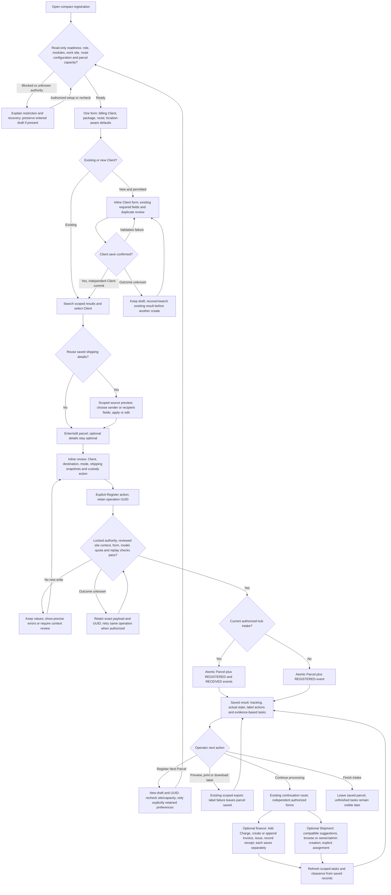
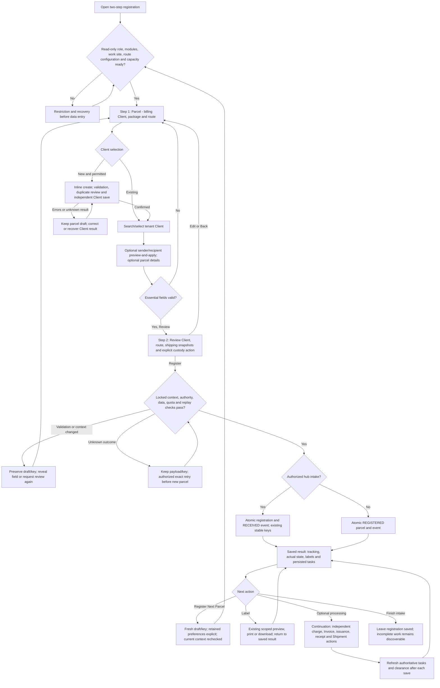

# Motionmate Logistics parcel registration: proposed workflow

**Recommendation: A — a compact registration form, an immediate saved result, and optional processing on the existing continuation route.** Keep review beside the save action, make hub receipt explicit in the action label, and make **Register Next Parcel** the primary action after a successful save. Use a two-step wizard only if user evaluation shows that a separate review screen prevents materially more mistakes.

Proposal date: **13 November 2026**. Source baseline: working tree based on `79f5dd4`, including the existing uncommitted templates and [current-state audit](logistics_parcel_registration_current.md). This document proposes behavior; none of it has been implemented or measured.

Read: root `AGENTS.md`, `.agents/skills/motionmate-ui/SKILL.md` in Audit/design mode, its Phoenix map, the current-state audit including F01–F18, and relevant code. The explicit request authorizes this proposal file as the sole new artifact. No application requests, Django commands, database operations, migrations, write-producing tests, commits, pushes, provider changes or deployments were performed. Existing working-tree changes and the current-state audit are preserved. Motionmate Services is outside the implementation scope described here.

## 1. Verified starting point and design boundaries

The following behavior was rechecked in current source rather than assumed from the audit:

| Current contract | Verified source | Design consequence |
| --- | --- | --- |
| The four entry steps are panels in one HTML form, not four server pages. Review is a JavaScript navigation safeguard. | `src/templates/logistics/parcel_form.html:28`; `src/static/assets/js/parcel-wizard.js:182` | Reduce panel changes and repetitive decisions; do not claim four HTTP pages disappear. Preserve an intelligible review before saving. |
| Both hub buttons register and receive; ordinary nonhub registration saves REGISTERED. Intake uses a separate stable receipt-event key inside the same atomic operation. | `src/apps/logistics/views.py:401`; `src/apps/logistics/parcel_services.py:168`; `src/apps/logistics/parcel_services.py:234` | Preserve those custody branches, event attribution, rollback and replay. No new hub pre-advice option is assumed. |
| Client selection loads all tenant Clients, including inactive ones; inline creation saves six required fields independently of the parcel. | `src/apps/logistics/forms.py:620`; `src/apps/crm/forms.py:494`; `src/apps/crm/views.py:1280` | Faster search can change presentation/query strategy, but not tenant scope, identity requirements or Client transaction semantics without separate decisions. |
| Sender/recipient are optional Parcel snapshots. Client prefill is explicit; labels do not substitute live Client details. | `src/apps/logistics/shipping_labels.py:42`; `src/apps/logistics/shipping_labels.py:58`; `src/apps/logistics/label_views.py:103` | Billing Client, sender and recipient need separate labels and separate copy/edit controls. |
| Staff origin is the active work site; remote tenant destinations do not confer operating access. | `src/apps/logistics/location_forms.py:96`; `src/apps/logistics/location_access.py:116` | Reuse existing defaults, explain them, and detect missing authority earlier. |
| Relevant capacity helpers can read limits and counts without writes; final guarded saves update applicable usage under lock. `refresh=True` in `monthly_usage` means reread the ledger, not update it. | `src/apps/businesses/utils.py:461`; `src/apps/businesses/utils.py:615`; `src/apps/businesses/usage_limits.py:110`; `src/apps/businesses/usage_limits.py:286` | A read-only readiness projection is possible. It cannot reserve capacity or replace final checks; distinguish unlimited, unavailable and monitoring budgets. |
| Charges, Invoice creation/append, issuance, receipts and assignment have distinct services and retry/locking rules. | `src/apps/logistics/billing_services.py:160`; `src/apps/logistics/billing_services.py:236`; `src/apps/billings/services.py:230`; `src/apps/billings/payment_services.py:343`; `src/apps/logistics/shipment_services.py:381` | Put forms together visually; retain independent actions and transactions. |
| Shipment suggestions match routes and stop at 25 but do not filter transport mode. Assignment validates mode but not route equality. | `src/apps/logistics/registration_views.py:94`; `src/apps/logistics/shipment_services.py:381`; `src/apps/logistics/shipment_transport.py:72` | Filter before limiting. Do not describe stricter route enforcement as an existing invariant or silently add it. |
| Payment decision is session navigation state; persisted workflow evidence already supplies tasks, balances, permitted actions and clearance. | `src/apps/logistics/registration_views.py:149`; `src/apps/logistics/registration_views.py:347`; `src/apps/logistics/workflow_summary.py:1211` | Use evidence for task indicators. Whether a user visited/skipped Payment must not decide completion or access to Shipment. |
| Staff financial scope is limited to complete authorized Parcel-only Invoices; clearance and action-specific credit are authoritative. | `src/apps/logistics/financial_access.py:107`; `src/apps/logistics/workflow_summary.py:730`; `src/apps/logistics/credit_services.py:287` | Never expose restricted amounts through a new summary/search/fragment or infer movement authority in JavaScript. |
| Issue Invoice does not send an email. Manual Logistics receipts record received money without collecting it; ONLINE in this form has no external verification field. | `src/apps/logistics/registration_views.py:163`; `src/apps/billings/payment_forms.py:31`; `src/apps/billings/views.py:832` | Keep **Issue Invoice**, **Send Invoice by email**, and **Record payment received** distinct. Preserve the manual receipt policy unless separately changed. |

### Shared rules for both alternatives

1. **Saving a parcel is sufficient to finish the intake interaction.** Charges, Invoice issuance, receipt recording and Shipment assignment remain optional at that moment. Missing financial obligations still cannot imply clearance, and later departure/delivery gates remain authoritative.
2. **Registration saved is the success state.** Display saved REGISTERED or RECEIVED and relevant remaining tasks. Do not label the entire financial/operational process “complete” because the entry form was submitted.
3. **One parcel, one registration operation.** Preserve the registration UUID, field payload, actor/site checks, generated tracking code and immutable event history. Register Next generates a new UUID only after the previous result is known.
4. **Keep existing forms/services as the data authority.** Preserve routes, methods, field names/prefixes, CSRF, retry/revision keys, validation, scopes and compatibility paths. New presentation hooks may supplement existing hooks; the form is not replaced by an unrelated client-side data model.
5. **Keep optional fields optional.** Empty shipping parties, weight, documents and value do not block registration. Warnings about label content are advisory. Any stricter customer or custody policy is an explicit business decision below.
6. **Review remains deliberate.** A shows Client, route, custody action, shipping-party summaries and optional-detail warnings beside Save; B gives the same information a separate review panel. Imported/reused details require an explicit apply/edit choice in both.

## 2. Alternative A — compact single-page registration

The page has a short essential section followed by optional shipping/parcel disclosures. A persistent review summary sits beside the form on desktop and immediately above its save controls on mobile. There is no empty Details step and no separate Review navigation step. The operator can inspect or edit everything before activating the explicitly labeled save button.

At a hub the primary button says **Register & receive at [hub]**. Elsewhere it says **Register Parcel**. A secondary action opens processing after the same registration commit: **Register, receive & process** at a hub, or **Register & process** elsewhere. These are wording/presentation choices over the existing custody and `continue_registration` branches, not a new transaction combining intake with finance.

Client recovery in A8 is a **new design safeguard**, not proof that current Client creation is idempotent. Until a durable replay mechanism is separately approved, do not automatically repeat Client creation after an uncertain response. Registration retry A16 reuses the existing parcel service contract; current permissions still apply.

**High-volume advantage:** subsequent parcels can start with an explicitly retained billing Client and destination/mode, while origin is always refreshed from live work context. The essential interaction becomes entering the new package details, reviewing the visible context, saving, then selecting Register Next. Shipping addresses are never silently carried forward.

## 3. Alternative B — a streamlined two-step wizard

Step 1, **Parcel**, contains the same Client/package/route layout and optional disclosures as A. Step 2, **Review & register**, displays the actual final values, shipping sources and custody meaning, with direct Edit links. Remove the current separate Route and empty Details transitions. Both panels remain one form; stepping forward/back does not save anything or regenerate retry keys.

B preserves a stronger visual separation between editing and review and is easier to explain to occasional operators. It still adds one forward action on every parcel. Its post-save processing design is identical to A; a shorter entry wizard alone would not fix the continuation's session gate, return navigation or financial form round trips.

## 4. Comparison and efficiency estimates

### 4.1 Counting assumptions

These are **design estimates, not measured timings or usability results**. A navigation action means activating Continue/Review/Save/Register Next or its current equivalent. Typing, dropdown selection, scrolling and printer dialogs are counted separately. The comparison assumes an existing Client, a valid current work location, no optional details, no validation failure and no financial processing.

For the current **ordinary primary-button path**, the count is three forward panel changes, Register & continue, and Register another Parcel for this Client on Charges: **5 navigation actions per repeated cycle**. An experienced operator can jump from valid earlier fields to Review, producing an optimized **3-action** cycle. The current default action already preselects the Client on its “register another” link, the current site already supplies origin, and a sole configured mode already defaults; these are not new savings attributed to A/B.

| Dimension | Current entry plus default continuation | A: compact form and saved result | B: two-step wizard and saved result |
| --- | --- | --- | --- |
| Entry panels before save | 4: Client/package, Route, Details, Review | 1 with inline review | 2: Parcel, Review |
| Repeated cycle, normal navigation estimate | 5 actions | 2: Save, Register Next | 3: Review, Save, Register Next |
| Action reduction estimate against normal path | Baseline | 60% | 40% |
| Against current optimized Review jump | 3 actions | About 33% fewer | About the same |
| HTML documents for first registration and result | Entry form then saved detail/continuation | Entry form then saved result | Entry form then saved result; steps remain client-side panels |
| Mandatory typing, first parcel | Client selection, description, route choices not defaulted | Same domain data; fewer navigation steps | Same domain data; fewer navigation steps |
| Consecutive same-Client/same-route parcels | Client may already be preselected; destination normally chosen again | Optional destination/mode retention can remove repeated selection; new description still entered | Same retention benefit, plus Review transition |
| Shipping address typing | Manual or explicit sender Client prefill | Confirmed sender/recipient reuse can reduce typing; no benefit assumed if parties change | Same as A |
| New Client | Modal plus six required fields and independent save | Same fields/transaction in initial scope; search-to-create and recovery reduce switching, not required data | Same as A |
| Error/mistake exposure | Errors can be hidden in another panel/tab; late site restriction; mistaken party fallback wording | Inline context/errors and explicit copy sources; greater stale-default risk if reuse is poorly designed | Separate review helps novices; stale defaults and hidden errors still require the same safeguards |
| Repetitive use | Repeated step controls and secondary navigation | Best expected throughput and keyboard predictability | Better than ordinary current path; extra action each parcel |
| Mobile | Small panels but more taps; optional details nested | Fewer taps; careful vertical ordering and disclosure needed to avoid a long form | Clear review boundary; modestly more tapping, potentially easier for occasional users |
| Initial UI implementation complexity | Existing baseline | Medium: reorganize one form, inline review, result, focus/error behavior | Low–medium: consolidate existing wizard and update navigation/error mapping |
| Common backend work | Existing limitations | Medium for readiness, scoped lookup/reuse, fragments, safe returns and task projection | The same backend work; two steps do not remove it |
| Primary implementation risk | Existing F01–F18 | Review visibility, accidental submit, carry-over, lost-response handling | Wizard state/error regressions plus carry-over; lower structural change to entry navigation |
| Schema requirement for entry simplification | None | None for core layout/result/readiness; durable Client replay and declared-value currency are separate decisions | Same |

Adding label printing adds at least one explicit label action and the device's printer interaction to either proposal. The estimated 2/3 actions do not include printing or imply automatic print success. Optional financial processing retains its service POST count; only unnecessary navigation/form loading can be reduced. No elapsed-time improvement is claimed from these counts.

### 4.2 Recommendation and selection rule

Choose **A** for the stated high-volume staff use case. Staff should finish intake without navigating a financial wizard, and the next new parcel should be one clear action away. Keep review visible, make copied values conspicuous, and provide clear Edit controls. Use one responsive layout rather than maintaining different transaction flows for desktop and mobile.

Evaluate B as a prototype alternative using the same task scenarios. Prefer B only if observed wrong-Client, wrong-destination or custody errors are lower enough to justify its extra step. Do not implement both production entry modes by default: that doubles behavior and regression coverage before the benefit is demonstrated. The targets in section 12 define how to assess A.

## 5. Proposed field layout and behavior

### 5.1 Essential area, in reading and keyboard order

| Area | Fields/control | Required/default/conditional behavior |
| --- | --- | --- |
| Work context, first | Current Business and work location; custody banner; readiness message | Read-only context. Staff must have current approved operating grant. At hub: “This action records physical receipt at [hub].” At nonhub: “Registers the parcel; does not record hub receipt.” Missing authority is explained before typing. |
| Billing Client | Searchable Client selector, selected identity/contact summary, Add Client | Existing `client` remains required. Label it **Billing Client** with help explaining the linked customer/account, without renaming the model/form field. Selecting it does not populate sender/recipient. Creation remains independently guarded. |
| Package | `package_description`; optional visible `weight_kg`; compact optional `internal_reference` | Description remains required/max1000. Weight remains optional/nonnegative with existing decimal precision. Reference remains optional/max100. New parcel operational quantity remains 1; no second price quantity is added. |
| Route | `mode_of_transport`, origin country/facility, destination country/facility | Mode required when configured; sole configured mode defaults as today. Origin defaults from current site and respects staff restriction. Route countries use existing operating-territory rules. Facilities remain optional except authoritative work-site rules. Destination supports facility-first selection and country-only routing. |
| Shipping parties | Separate **Sender** and **Recipient** summaries, each with Add/edit and Use saved details | All current shipping fields remain optional. Empty means “Sender not supplied” / “Recipient not supplied”; never “Client recipient” unless actual saved values were explicitly supplied. Preview source and fields before applying a copy. |
| Review and actions | Billing Client, origin→destination, mode, receipt location/action, party summaries, relevant optional flags | A displays this beside/above Save; B displays it in step 2. No global new checkbox or mandatory shipping field. Reused fields show source and an Edit/Clear option. Save requires deliberate activation; Enter in a search control selects a result rather than saving a parcel. |

Desktop uses Bootstrap columns, with essentials first and the review summary next to them. At 768px and below the reading order remains the same in one column; sticky save controls must not cover input/errors. Use Phoenix tokens, existing `form_field`/error includes, 44px touch targets, visible focus, label associations and reduced-motion behavior. Optional sections expand automatically when they contain validation errors. Implicit Enter from ordinary single-line data fields must not save a parcel; deliberate activation of the save control submits, while textareas retain normal newline behavior. No nested forms: the Client modal and financial forms keep their own form elements outside the unsaved registration form.

### 5.2 Optional disclosures and field precedence

| Disclosure | Fields preserved | Design behavior |
| --- | --- | --- |
| Sender / Recipient | Each side's name, contact, structured address lines/city/region/postal/country; sender tax ID | Prefer structured editing; allow global ISO party countries, independent of route territories. Keep legacy address visible under an explicit legacy-address disclosure when present. No CRM update or live synchronization. |
| Size and handling | `dimensions`, `length_cm`, `width_cm`, `height_cm`, `volume_m3`, `fragile_goods`, `biodegradable_goods`, `expiry_date`, `internal_notes` | Remain optional with current validators; no all-dimensions/expiry requirement. Group measurements logically. Do not calculate/store volume from dimensions or reinterpret free text without a separately approved calculation rule. |
| Customs/documents | `hs_code`, `marks_numbers`, `master_bl_no`, `house_bl_no`, `issue_date`, `declared_value`, `incoterms` | Remain optional. No fabricated catalogue validation or mandatory customs information. Sea-only bill-of-lading fields follow existing applicability. Declared value remains distinct from price. |
| Transport references | `origin_reference_code`, `destination_reference_code`, `vessel_name`, `voyage_no`, `imo_no`, `port_load_unlocode`, `port_discharge_unlocode` | Show only applicable new-entry controls; preserve historical values in edit flows. Use existing configured names and offline territory/mode-filtered reference choices. Explain route-reference versus loading/discharge fields; do not silently synchronize them. |

Changing mode/country must reveal conflicts and preserve entered draft values for correction. Existing nonapplicable controls can remain disabled during submission, as today, but the review must show when supplied values will be omitted. Do not silently overwrite a reference or erase historical metadata as a side effect of display changes. All ModelForm and domain validation remains authoritative on POST.

Declared value continues to display current Business currency for new entry. No new auto-reuse of that monetary field is proposed. Historical records have no reliable saved declared-value currency, so do not present a new UI label as recovered original currency. A saved-currency field/backfill would be separately approved schema work (F18).

### 5.3 Existing/new Client interaction

- **Existing:** one search control accepts name/company/email, with a short result list and keyboard selection. For large tenants, propose a paginated server lookup rather than rendering all Clients. Use the same resolved Business and parcel-role/module policy as current Client selection; do not accidentally require CRM read access just to choose an existing billing Client. Return only the minimal identity information already permitted for selection. Address prefill still requires its existing CRM read authority.
- **Search correctness:** cancel/ignore stale responses; maintain a selected Client even if it is outside the current search page. A submitted Client ID must be independently validated against the tenant, not trusted because it appeared in a prior response. Inactive Clients remain explicitly labeled/selectable until a changed policy is approved; do not silently change current eligibility.
- **New:** place Add Client beside search, retain typed parcel values, and open the existing scoped modal/fragment workflow with prefix `new_client-`. Return directly to the chosen Client and next relevant field after a confirmed save. First/last/company/email/phone/street remain required in this proposal's initial scope. Do not fabricate company names or placeholder addresses for individual customers.
- **Potential duplicates:** show same-tenant likely matches by entered email/phone/name for operator selection. These are suggestions, not global uniqueness, identity proof or an automatic merge. A Client can remain saved even if the operator abandons the parcel; make that clear after creation.
- **Uncertain Client save:** retain the draft and show “Client save could not be confirmed — check existing results before creating again.” Offer scoped recovery search; do not automatically repeat the create POST. Durable exact replay requires a separate persisted idempotency design/approval, not merely a disabled button, signed token or cache lock.
- **Identity policy extension:** a genuine Company/Individual creation variant and geographic Client input could improve F08, but it changes required/default behavior in a shared model/form. Decide it explicitly, scope any form branch to Logistics, and retain all Services behavior. It is not smuggled into a presentation-only phase.

## 6. Safe reuse and consecutive registration

### 6.1 Retention/copy rules

| Data | Next parcel default | Explicit reuse path |
| --- | --- | --- |
| Business, actor, origin/work location and custody branch | Resolve again from current authority; never copied as an authorization decision | A changed site/context requires review before save; current origin rules still apply. |
| Billing Client | Fresh entry blank unless existing entry link supplies a Client; repeat mode can retain after explicit opt-in | “Keep this Billing Client for next parcels” is an operator preference visible on every new draft; clear/end batch at any time. Revalidate each save. |
| Destination country/facility and configured transport mode | Reset unless repeat preference explicitly chosen; single-mode default remains existing behavior | “Keep this route for next parcels” displays the retained destination/mode and an Edit/Reset control. Revalidate current configuration and active facilities. |
| Sender | Empty for each new parcel | Use Billing Client details or an accessible saved Parcel's sender; preview/apply chosen fields for this parcel. No silent automatic copy. |
| Recipient | Empty for each new parcel | Select an accessible saved Parcel recipient, preview/apply for this parcel, or type manually. No inference from Client, destination facility or last recipient. |
| Package description, reference, weight, dimensions, value, dates, customs/transport refs, handling flags and internal notes | Reset | No blanket “duplicate previous parcel.” Deliberate manual entry or later explicitly scoped template proposal; financial value/reference/note retention is excluded from initial repeat mode. |
| Tracking code, parcel ID, status, registration/event keys, event attribution/times | Never copied | Server creates the next identity/history. No cloning or resetting existing records. |
| Charges, Invoice choices, receipt amount/method/reference/key, settlement, credit, Shipment association | Never copied or automatically executed | Separate authorized post-save forms; a preferred service may be suggested but must be reviewed and explicitly saved as a new charge. |

Retained Client/route preferences are conveniences, not persisted task completion, draft storage or permissions. Core design needs no new preference model. A short-lived signed context can carry only selected Client/facility IDs, mode and opt-in flags through POST/redirect/GET and the Next link, bound to the actor and Business. Every referenced record and current permission is revalidated; the token never grants access. A new batch starts with retention off, and Clear/End batch removes the context. This also avoids losing preferences at the first redirect. Any broader cross-tab/session persistence and retention period require a separate decision. Do not put shipping addresses, financial values or bearer tracking codes in navigation URLs or long-lived browser storage.

### 6.2 Copy confirmation contract

1. Resolve the source through current Business and actor access. Existing Client prefill retains CRM read checks. New prior-Parcel reuse uses the current parcel read scope and, initially, the same billing Client to reduce cross-customer mistakes. A source no longer readable must not be returned from a cache or stale result.
2. Show **source type, source identity, party role and values**. “Use Billing Client as Sender” is distinct from “Use previous Parcel's Recipient.” No combined “same as customer” toggle updates all three identities.
3. Default to copying empty fields only. Show exactly what will be applied; replacing entered values requires an explicit overwrite choice with a visible diff. A field the operator edited is not refreshed behind their back.
4. Apply a snapshot to ordinary form fields. The operator can edit or clear it before save. Changing Billing Client marks copied-source context for review without erasing independent typed shipping values or rewriting the source record.
5. A fresh proposal copies only eligible current values: invalid historical references/modes/route choices must be corrected or omitted through explicit review. Historical edit compatibility is not blanket permission to copy an invalid legacy value onto a new record.
6. Save through the existing registration service, with accepted field values included in the retry payload. There is no new live relationship from Parcel sender/recipient to Client or another Parcel. Existing audit history remains untouched; durable copy-source provenance beyond the saved actor/snapshot would be a separate audit-data requirement.

### 6.3 Save/result/next contract

- **Before save:** keep the operation UUID stable through field edits, validation errors, inline Client creation and panel changes. Show the work site/custody meaning in review. Proposed server context comparison checks that the reviewed site and receipt branch still match under the existing locks before any new creation; a signed/read-only context value is not permission to operate.
- **While saving:** prevent a second UI submission. If an enhanced request times out, keep the form and exact attempted payload/key. Do not clear fields, start the next parcel, issue a new key or change an uncertain save's payload. Recheck authority and retry/reconcile the same operation. Do not claim recovery across a closed tab without an approved durable draft mechanism.
- **After confirmed success:** use POST/redirect/GET and show tracking, actual persisted status and “Registered at [time] / received at [hub, time]” only where event evidence supports it. Result can be a focused top section of existing detail; optional processing uses the existing continuation route with the same saved-result header.
- **Register Next Parcel:** an explicit navigation action opens a fresh form and fresh UUID, rechecks readiness, applies only chosen repeat preferences, and focuses description if Client/route are retained; otherwise focus Client search. It creates nothing until the next save. Keep the last saved parcel link distinct so operators can reprint without saving again.
- **Labels:** Preview, Print and Download use the existing scoped label routes. Print is an explicit action; successful generation is not evidence that hardware printed. A 422/error leaves registration saved and offers Edit shipping details/Reopen label. Do not automatically move to the next parcel when printing fails or when a print dialog closes.

## 7. Fast-path and full-processing journeys

### 7.1 Fast path: many parcels for an existing Client

1. Open registration. Readiness identifies the authorized site and remaining parcel allowance; use the correct work-location flow first if blocked.
2. Select Billing Client, describe the package and select destination. Origin and sole configured mode use existing defaults. Optionally opt to retain Billing Client and route for the next parcel.
3. Leave optional details empty or supply separate sender/recipient snapshots. Review the visible Client/route/custody summary. At hub, activate Register & receive at [hub]; outside hub, Register Parcel.
4. Read the confirmed tracking/state result. Print/download the label if needed. A label with missing optional parties is not described as fully addressed; party warnings do not prevent registration.
5. Select Register Next Parcel. The new draft has fresh identity/key, current origin, explicitly retained Client/route and cleared package/party/financial fields. Enter new description, review context and save. Any sender/recipient reuse is a separate preview/apply choice for this parcel.
6. End the batch without completing finance/transport. Each saved parcel remains findable through existing lists/detail and its persisted remaining-task indicators. No skip-payment record or artificial “fully complete” status is created.

With B, insert Review between steps 2/3 and save; the rest is identical. With a new Client, use the modal first; retain parcel draft and do not merge Client creation with parcel/finance transactions.

### 7.2 Full processing: save, charge, invoice, record receipt, assign

1. Save the parcel using either entry layout. Secondary Register & process navigates directly to the processing area after that same commit; the header still confirms the parcel already exists.
2. Add a charge in place, choosing an active BusinessService or custom description/price and the billing quantity. Each Add Charge is its own POST to the existing endpoint/service. After success, display the saved charge and refresh the Invoice selector; another charge remains an explicit operation with its own key/occurrence rules.
3. Review/select pending charges, optionally combining authorized same-Client parcels, and create an Invoice or append to an authorized draft. Current Parcel inclusion, sibling scope, currency/tax and immutable bindings remain enforced. An Invoice failure leaves a successful earlier charge visibly saved.
4. Review the saved Invoice and explicitly Issue Invoice. Show **Issued** separately from payment status; protect lines and snapshots. Email is a separate authorized action with submission feedback; no send/collection occurs because the Invoice was issued.
5. If money was actually received, select the related eligible Invoice and record the receipt with the shared form. Display the full shared Invoice balance where authorized and any existing allocation fields. Preserve current CASH/BANK_TRANSFER/ONLINE behavior, reference/retry validation and authority. If not recording money now, simply leave that task unresolved; a navigation preference must not fabricate paid/unpaid evidence.
6. Independently assign an eligible existing Shipment, browse with return context, or let owner/admin create one with the Parcel fixed. No payment-step visit is required to view this area; assignment is still not permission to depart. New Shipment plus assignment retains its existing atomic transaction; assignment failure rolls back that new Shipment, not the earlier registered parcel.
7. Refresh the scoped task/clearance projection and optionally return to Register Next. Partial receipts, unissued drafts, missing obligations, unassigned transport and review cases stay visible. Later movement, cancellation, refunds and credit approvals remain separate operational/accounting workflows.

### 7.3 Combine presentation without merging writes

| Proposed visible area/action | Existing authoritative operation retained | Failure/retry behavior |
| --- | --- | --- |
| Charge editor beside charge list and Invoice selection | `add_charge` | Reuse exact charge key; logical duplicate protection remains. A saved charge is not rolled back because a later Invoice fails. |
| Invoice selection and saved Invoice review in the same area | `invoice_charges` | Preserve selected-charge/current-Parcel requirement, active bindings, same Client/currency/tax, protected lines and draft append. |
| Issue button beside saved draft | `change_invoice_status(..., SENT)` | Explicit separate POST; do not silently “create and issue,” mutate protected totals or send email. |
| Receipt form beside an issued Invoice | `PaymentReceiptForm`, `invoice_settlement`, `record_invoice_payment` | Separate receipt POST; full Invoice basis/allocations; no overpayment or invented payment. Clear receipt fields only after confirmed success. |
| Shipment picker beside route/remaining tasks | `assign_parcel`; existing create-and-assign operation for new Shipment | New assignment POST/revision/key; server final authority. Existing freight coverage never expands by attachment alone. |
| Label and next actions beside saved result | Existing label GETs; fresh registration GET | No financial/status/assignment write from exporting or preparing the next form. |

The UI can refresh fragments after each operation, but the server must rebuild authorized data/actions rather than let JavaScript calculate balances or mark tasks done. Disable only the action being saved, preserve unrelated drafts, and say precisely which operation succeeded. A native full-page POST/redirect fallback remains available; fragment support is backend presentation work, not “CSS only.”

## 8. Earlier restrictions, Shipment suggestions and safe returns

### 8.1 Readiness before typing

Propose one read-only registration-readiness projection shared by entry rendering and an optional refresh endpoint. It returns **ready / blocked / unable to verify**, a safe reason, the relevant work site/custody branch, and authorized recovery links. Resolve current membership, vertical, module write access, assignment review/current operating grant, owner/admin work-context requirements, available operating territories/configuration and applicable hard parcel capacity. Existing login/module/role redirects and denials remain enforced; this projection does not admit a denied actor to the registration form.

Show Client capacity only when Add Client is requested; reaching it must not stop selection of an existing Client. Show Invoice/Shipment capacity in their optional areas; neither automatically blocks parcel registration. Use `resolve_business_plan_limit` and existing usage semantics, not `limit=None => zero` or `None => always available`. Preserve legacy/unlimited contracts. Event/email monitoring budgets are not new hard gates. No counter update, fixture, reservation or lock-held draft is created by preflight.

Refresh on site/context changes, returning to the tab, opening a new draft and after each save. Freshness is a usability hint, not an authorization token: the existing final services recheck authority/capacity under lock. If the last slot is consumed concurrently, preserve the attempted data and report the failure. Do not allow an early “ready” result to authorize a later write, or automatically downgrade a reviewed hub receipt into plain registration after context changes.

### 8.2 Shipment filtering and route-policy decision

Apply eligibility filters **before** sorting/limiting/pagination: current Business, actor-visible and writable operating scope, modules/assignment role, DRAFT/READY Shipment, unassigned REGISTERED/RECEIVED Parcel, saved-charge Client compatibility, and the existing known-mode compatibility rule. Apply the current conservative route suggestion predicate as well. Then offer a short searchable result list with pagination instead of treating the first 25 as the complete universe.

Known mode mismatch must not be suggested. Unknown historical modes should be labeled for review and omitted from one-click quick suggestions, while existing broader authorized paths remain available unless policy is explicitly tightened. Do not normalize ambiguous historical route text into invented facility matches. A country-only route is not proof of compatibility with every company facility in that country.

**F01 needs a business decision:** whether a Shipment always represents the same complete origin→destination leg as each Parcel, or may represent an intermediate consolidation/transport leg. Until that is decided, route equality remains a suggestion criterion and the UI must not claim the service enforces it. Do not silently remove an authorized existing cross-route grouping path. If strict equality is approved, define one canonical route policy and enforce it under lock in every assignment entrypoint, including direct service calls and new-Shipment creation; UI filtering alone would not fix F01. An exception/override workflow would need its own authorization/audit decision.

### 8.3 Preserve return context

Use a fixed route identifier plus scoped Parcel ID and an allowlisted section, not an arbitrary `next` URL. Build on the existing `registration_parcel` concept and `?registration=1`; carry the same context through browse pagination/filtering, Shipment detail/assignment/create, parcel edit and label actions. On success or Cancel return to that Parcel's processing/result section. Revalidate the context on every GET/POST; a hidden ID/signed context is not access authority.

Entering registration from a Shipment screen may retain that Shipment as a **proposed later selection**, but must never auto-attach cargo during initial save. Display the source context, then require an explicit authorized assignment after registration. Directly opened old routes keep their current return behavior when no new fixed context is supplied. Changed/revoked or foreign Parcel context fails closed without becoming an open redirect.

## 9. Incomplete-task indicators from persisted evidence

Replace the compulsory five-step progress path with a saved-record overview and independent task areas. The same scoped projection should feed the saved result, continuation and relevant existing detail/list indicators. Base it on `resolve_parcel_workflow`, existing financial coverage and shared Invoice presentation; do not create another settlement calculator or completion model.

| Indicator | Evidence and display | Cannot be inferred from |
| --- | --- | --- |
| Registration | Saved Parcel and valid REGISTERED event/operational evidence | A visited panel, selected Client, issued UUID or loading spinner |
| Physical receipt | Saved RECEIVED/history evidence and current state, with authorized location/time | A hub default, selected origin or successful registration alone |
| Charges | Authorized active/frozen charge coverage: recorded, pending invoicing, or missing/review | Declared value, a service selected in an unsaved form, zero visible amounts |
| Invoice | Related authorized active bindings and actual lifecycle: draft/unissued, issued, cancelled/review | Payment choice or email submission |
| Customer payment | Authoritative presentation: unpaid/partial/paid/no payment required/review; full shared-Invoice basis where allowed | Stored PAID alone, a blank reference, clicking continue, credit approval or assumed collection |
| Movement clearance | Existing movement-specific settlement/credit/evidence projection; explain restricted review safely | Entry success, assigning a Shipment or an aggregate green progress bar |
| Shipment | Actual current `Parcel.shipment` and actor-visible Shipment; unassigned means “Unassigned — optional at intake” | Browse context, a preferred Shipment, or an Assign later navigation choice |
| Label information | Saved snapshot presence, with explicit preview/render errors where known | Live Client address or assumed hardware printing |

Use action labels such as **Review charges**, **Issue draft Invoice**, **Record payment received**, **Review accounting evidence**, **Assign Shipment**. Label monetary tasks only for authorized detailed finance; restricted users receive the existing safe clearance/review wording and permitted actions. Do not send hidden amounts/Invoice identities to the DOM and hide them with CSS.

Session keys may retain a harmless focus preference for compatibility, but cannot hide debt/tasks, declare completion or prevent viewing independent transport work. “Continue without recording a payment” is optional navigation, not a durable task state. If the business later wants an auditable decision to defer billing/payment or a task owner/due date, that is new workflow data and policy, not something this design invents from sessions.

No charge/no known obligation must remain review/uncleared under existing policy; do not add a “free parcel” toggle to bypass financial evidence. Zero-value/credited obligations, refund liability and scoped credit remain distinct outcomes of current services.

## 10. UI-only work versus backend and policy changes

All entries below describe **future implementation**, not work performed for this proposal.

| Change | Classification | Proposed scope and boundaries |
| --- | --- | --- |
| A's compact grouping/inline review, or B's two panels; Phoenix disclosures and focus/error treatment | UI-only presentation | Logistics templates/assets; preserve existing form fields/CSRF/hooks and edit/update consumers of `parcel_form.html`. Do not collapse tracking-update or edit semantics into new registration behavior. |
| Explicit custody labels, separate Billing Client/Sender/Recipient wording, no false Client-recipient fallback | UI-only presentation from existing context | Render current intake context and actual values; no status or required-field change. |
| Saved-result prominence, direct existing label actions and Register Next with current Client link | Mostly UI-only initial slice | Reuse detail/continuation and existing `?client=`; route retention, context guards and enhanced response/recovery require backend work below. |
| Remove payment-panel navigation dependency; display independent existing tasks | UI and Logistics view composition | Stop treating a session decision as progress. Reuse graph/presentation; preserve old decision POST aliases/routes without making them completion evidence. |
| Early readiness and refreshed limits | Backend read projection plus UI | Resolve permissions/site/configuration/applicable capacity with existing read helpers; final locks/guards unchanged. No schema or quota reservation. |
| Server Client lookup and selected-ID validation | Backend read endpoint/form integration plus UI | Tenant-scoped paginated results with current selection authority and minimal fields; retain native fallback and current eligibility until policy changes. No global catalogue/new CRM app. |
| Prior-Parcel copy preview, repeat preferences and reviewed-site comparison | Backend read/form context integration plus UI | Scoped source allowlist, eligible fields, stale-source/context checks; normal registration payload and fresh next key; no new party relations or automatic data writes. No persisted draft promise. |
| Reusable processing fragments in one area | Backend presentation adapters/includes plus UI | Existing endpoints/services and independent POSTs, full-page fallback, per-operation errors/success; no aggregate transaction or rewritten financial model. |
| Mode-compatible paginated Shipment suggestions | Backend query/policy reuse plus UI | Known-mode matching before result limit; respect historical/unknown and existing scopes; no automatic assignment. |
| Safe return navigation | Backend context validation plus template links | Fixed named-route/Parcel/section contract; preserve existing query parameters and default destinations for old direct callers. |
| Strict route equality/exception policy | Business-process decision then backend service policy/tests | Can reject currently permitted assignments; requires approval and coverage of every assignment path. Not classified as a UI fix. |
| Durable Client-create idempotency | Separate backend persistence design, potentially schema | Existing Client has no verified durable request-key contract. Scope key/payload/actor/Business, transactional result binding and conflict replay; signed tokens/cache/advisory search alone are insufficient. Do not reuse unrelated import/subscription records as a shortcut. |
| Individual Client fields/geographic defaults/inactive eligibility | Explicit identity policy and Logistics-scoped backend/form work | Retain existing Client model/architecture and Services contracts. Any schema/backfill is a separate reviewed authorization. |
| Declared-value currency history | Separate monetary metadata policy/schema | No currency inference, conversion or mass backfill. Follow nullable/incremental verified migration rules if later authorized. |

Primary future files: `src/templates/logistics/parcel_form.html`, `src/templates/logistics/parcel_detail.html`, `src/templates/logistics/parcel_registration.html`, Logistics includes and `src/static/assets/js/parcel-wizard.js` / `logistics-workflows.js`; Logistics registration/views/forms/query adapters for backend composition. Reuse Phoenix grid/forms/disclosure patterns from the read-only reference library; no new frontend framework or dependency is required.

Assess shared consumers before any future edit to `apps.crm`, shared billing, dashboard inheritance or shared field includes. Default to Logistics-specific includes/adapters or explicit vertical branches. Preserve Services form labels, defaults, validation, routes, billing/booking behavior and assets. No alteration to `src/staticfiles/` or Phoenix reference sources is proposed.

## 11. Risks and business decisions requiring approval

This table records decisions for a later implementation brief. **No approval is requested during this design-only task, and this proposal is not implementation authorization.**

| Decision / risk | Recommended position for initial implementation | Approval boundary |
| --- | --- | --- |
| Separate review screen versus inline review | A with visible summary and explicit save/custody action; validate errors and accidental-submit behavior | Product acceptance of A's review interaction; retain B if evaluation favors it. |
| Hub pre-advice versus physical intake | Preserve current hub registration+receipt and use explicit button wording | A registration-only option at the same hub requires separate operational policy; never silently add it. |
| Same-leg versus intermediate-leg Shipment | Conservative compatible suggestions now; preserve broader authorized paths | Decide canonical route invariant/overrides before tightening service assignments (F01). |
| Saved details/Client/route retention | Opt-in Client/route preference; per-parcel party preview/apply; reset measurements/value/references/finance | Approve any broader copy defaults, cross-session storage, retention or shared-device recovery. |
| Client identity, required six fields and geography | Preserve required fields; improve inline speed/clarity without invented placeholders | Decide truthful Individual creation, company/address requirements and country default/input in a separate Logistics-scoped specification (F08). |
| Inactive Clients | Show explicit inactive status while retaining current selection eligibility | Exclusion, warning confirmation or reactivation requirement changes policy (F16). |
| Client duplicate/retry safety | Duplicate suggestions and uncertain-result recovery; state residual duplicate risk | Durable request-result persistence requires design approval and any separately authorized schema; do not claim F03 fully fixed beforehand. |
| Manual ONLINE receipts and evidence | Keep current receipt form/service behavior and accurate “records money received” wording | Stronger proof/approval/reconciliation policy changes finance operations and is outside layout work (F07). |
| Missing shipping parties or label details | Optional; advisory presence/render warnings; explicit printing | Making addresses/weight mandatory or auto-printing/auto-advancing requires a business decision (F15). |
| Declared-value original currency | Exclude monetary copy defaults and retain current new-entry currency label | Approve saved currency/backfill policy before claiming historical monetary fidelity (F18). |
| Durable drafts and abandoned Client records | Preserve in-page state and explicit recovery; independent saved Client remains | New persisted drafts, retention/deletion, abandoned-Client cleanup and cross-device unsaved recovery need their own requirements (F03/F17). |
| Deferred task ownership/deadlines | Show factual unresolved records, no invented deferral | Auditable “billing deferred,” assignees, due dates and durable skip decisions require new process/data policy (F12/F13). |

Other implementation risks are stale permissions/capacity, copy mistakes, partial saves, cross-tenant or financial leakage, stale search results and return-context tampering. The acceptance criteria below address them without changing settlement/clearance policy. Existing receipt, charge, Invoice, event and Shipment history must remain immutable; corrections continue through existing guarded workflows.

### F01–F18 disposition

| Finding | Proposed response | Residual/approval-dependent part |
| --- | --- | --- |
| F01 route equality advisory | Section 8 shared route-policy decision and honest suggestion wording | Strict service rule awaits business definition. |
| F02 incompatible suggestions/25 cap | Mode/scope/client/state/route filters before pagination | Unknown/legacy routes need explicit review. |
| F03 independent non-idempotent Client create | Inline state retained, duplicate suggestions, unknown-result recovery | Durable replay not solved by UI; separate persistence decision. |
| F04 both hub buttons receive | Explicit site/custody wording; reviewed-context comparison | No new pre-advice branch. |
| F05 obsolete browser expectations | Repair scripts as part of later implementation validation | Historical pass reports are not current evidence. |
| F06 late site/quota failures | Readiness before entry and action-specific quota displays | Save-time races remain guarded; readiness is not a reservation. |
| F07 self-reported ONLINE receipts | Accurate receipt wording and unchanged ledger/scope | External verification/custody policy remains separate. |
| F08 business-style Client creation/default geography | Fast inline modal, distinct roles, source preview | Reduced/Individual fields and country policy need approval. |
| F09 empty step/review navigation | A removes step navigation; B reduces it to one forward transition | Explicit review remains, and efficiency must be measured. |
| F10 repeated processing form round trips | One processing area with existing separate operations/fragments | Write count and transaction boundaries retained. |
| F11 lost return/association context | Validated fixed Parcel return context; proposed Shipment shown for later choice | No initial automatic attachment. |
| F12 session-specific progress | Evidence-based tasks and independent sections | No new auditable deferral state is inferred. |
| F13 commented tasks/false completion | Prominent “Registration saved” plus unresolved factual tasks | Intake success and full operations remain distinct. |
| F14 duplicate field representations | Group/describe precedence; structured shipping first, legacy retained | No silent conversion, synchronization or financial calculation. |
| F15 optional parties/label readiness | Honest empty-party text and nonblocking label warnings | Printing/mandatory data policy unchanged. |
| F16 full Client list/inactive rows | Scoped server lookup, minimal results and explicit inactive label | Inactive exclusion is a policy decision. |
| F17 no durable draft/retry recovery | In-page retention, known-result next action and exact-key parcel retry | No offline queue/closed-tab recovery promise; new keys can still represent duplicates. |
| F18 unsnapshotted declared currency | No automatic monetary reuse; honest labels | Historical currency recovery/schema remains separate. |

## 12. Proposed implementation sequence and measurable acceptance criteria

### 12.1 Sequence for a separately authorized implementation

1. **Settle the brief and baseline.** Choose A/B and explicitly record review, route, Client identity/retry, copy/storage and custody decisions. Record representative current task timings/navigation, existing failure baselines and source/static revision. Preserve the current dirty worktree; no proposal text authorizes implementation, fixture creation, migrations or deployment.
2. **Ship the smallest presentation slice first.** Reorganize only Logistics new-parcel entry, preserve edit/update form consumers, show inline review and truthful custody labels, and promote existing saved tracking/label/next actions. Keep existing service/transaction behavior. This slice can use existing local Client search until server lookup arrives, without claiming F16 solved.
3. **Add readiness and safe consecutive use.** Introduce read-only readiness, scoped context comparison, explicit repeat preferences and known-result next-key handling. Keep locked final checks. Exercise stale-site/quota/lost-response branches before promoting repeat use.
4. **Add lookup and confirmed reuse.** Implement scoped paginated Client search, selected-ID validation, minimal source previews and explicit apply/overwrite handling. Preserve independent Client save. Complete durable Client retry/identity work only if separately approved; otherwise retain conservative uncertain-result recovery and document residual risk.
5. **Improve optional processing.** Recompose the existing continuation into independent task areas, safe return links and separately saving financial/Shipment forms. Remove session-only progression gating; reuse persisted graph/presentation and current financial visibility. Filter suggestions before pagination; tighten route services only after the approved route policy exists.
6. **Repair and validate relevant tests.** Replace stale browser controls identified by F05, retain existing service/replay/clearance regressions, add only tests that establish changed contracts, and validate the acceptance matrix below. Write-producing automated/browser checks require a separately authorized disposable environment with target settings/database identified first. No ordinary/Test Lab/staging/production fixtures are assumed.
7. **Evaluate throughput and review errors.** Compare A with baseline and B prototype scenarios; adjust layout/focus/copy behavior from results. Any rollout, migration, commit, push or deployment is another explicitly authorized action; do not perform one as part of validating this proposal.

Core simplification does not require schema changes. Approval-dependent durable Client replay or declared-value currency work must be isolated from presentation delivery; it cannot be hidden in an “audit fix” migration.

### 12.2 Acceptance criteria for future review

All numeric thresholds below are **proposed targets, not achieved results**. Efficiency ratios use section 4's explicit counting model. Collect performance/user evidence only in an authorized evaluation setting; do not log customer addresses, bearer tracking codes or financial payloads for timing.

| ID | Measurable criterion | Evidence required later |
| --- | --- | --- |
| AC01 | A has one entry panel, no compulsory empty Details/Review transition, and a visible review adjacent to Save. Repeated minimal cycle requires at most Save + Register Next, excluding data entry/printing. B requires at most Review + Save + Register Next. | Browser interaction count against the stated normal 5-action and optimized 3-action baselines; distinguish panels from HTTP pages. |
| AC02 | In a matched high-volume scenario, target at least 20% lower median active intake time for A versus ordinary current flow, with p95 no worse. Record optimized-current results separately. | Counterbalanced evaluation proposal: at least five representative operators, twenty parcels per operator per compared workflow; same Client/route mixes, labels and device conditions; report actual timings and spread. |
| AC03 | Wrong Client/destination corrections do not increase versus baseline; zero wrong-custody events or duplicate parcels caused by UI double submission in controlled scenarios. | Observed task errors plus service/browser assertions. If inline review underperforms B, revise recommendation before release. |
| AC04 | Existing-Client initial response does not embed the full tenant catalogue after server lookup phase. Suggested target: <=20 results/page and lookup p95 <=300ms server time against a controlled 10,000-Client disposable dataset; typing debounce about 250ms and stale results never replace newer selections. | Query/response-size/performance evidence with environment and cold/warm conditions stated; keyboard and native fallback checks. No guarantee derived from this document. |
| AC05 | Missing current site/review/operating grant, disabled modules, unavailable route configuration and exhausted applicable parcel capacity are explained before new typing. Client/Invoice/Shipment limits block only their relevant creation actions. | Role/configuration/quota matrix, including unlimited legacy and monitoring-only budgets; no domain write from readiness requests. |
| AC06 | Final save rejects revoked authority, a consumed last slot, or changed reviewed custody context without creating partial Parcel/history or silently switching intake meaning. | Direct POST/service checks and PostgreSQL races under existing lock order; preserved safe draft/error behavior. |
| AC07 | Identical permitted registration retry/concurrent duplicate POST yields one Parcel, one REGISTERED event, and exactly one additional RECEIVED event for hub intake; no duplicate usage increment or rewind after later movement. | Existing plus targeted row-lock/replay tests; changed-payload/actor/key conflicts still rejected. No new next key while outcome is unknown. |
| AC08 | Every confirmed new parcel has a new UUID/tracking identity. Repeat mode carries only opted-in Client/route preferences; origin is revalidated and party/measurement/value/reference/finance fields reset. | Twenty-parcel repeated-entry browser scenario, context switches, two tabs, changed Client and invalidated source permissions; same-UUID retry distinguished from intentional next registration. |
| AC09 | Sender, recipient and Billing Client remain independent. A copy does not alter source records or override typed fields without confirmation; current labels/PDF use saved snapshots after later Client changes. | Snapshot/source-diff assertions, cross-tenant/revocation denial, empty-party registration, preview and edit checks. No new mandatory shipping field. |
| AC10 | An uncertain Client-create response cannot trigger an automatic second create. If durable replay is later promised, concurrent same-key retries return one Client and changed payload conflicts transactionally. | Recovery UX and duplicate-suggestion checks initially; durable replay claim only after the separately approved persistence contract passes appropriate tests. |
| AC11 | Charge, Invoice, issuance, receipt and assignment operations retain their independent commit/retry boundaries. A later failure accurately reports earlier successful records; new Shipment+assignment remains atomic. | Injected failure/retry cases, protected line/snapshot/history preservation, no aggregate form replay creating duplicates. |
| AC12 | Financial indicators/receipt amounts/Invoice references are returned only after scope checks. Read-only/unassigned staff and viewers gain no new write; staff do not gain Shipment management or broad accounting visibility. | Direct endpoint/service/HTML-fragment matrix for owner/admin/staff/accountant/viewer, tenant/site/revocation states; inspect DOM/JSON as well as visible UI. |
| AC13 | Task indicators for the same saved evidence/actor agree in a new session and after reload, regardless of prior Payment visits or skip choices. Missing obligations/manual PAID remain review/uncleared; valid scoped credit remains action-specific. | Graph/presentation integration assertions; shared Invoice, partial/fully paid, draft/cancelled, refund/credit, unassigned and restricted states. Departure/delivery services remain authoritative. |
| AC14 | Known incompatible modes never occupy quick suggestions. A compatible older candidate beyond the previous first 25 is discoverable. Direct assignment behavior matches the approved route policy, not merely a filtered picker. | Filter-before-pagination, billed-Client/state/site races, unknown modes/route ambiguity, direct POST and create-with-Parcel cases. |
| AC15 | Browse/filter/pagination/assignment/create/edit/label return to the same scoped Parcel/section when context is supplied; old direct routes still work. No foreign/malformed context or external URL can broaden access or redirect externally. | Success/Cancel/error-path navigation and tampering checks; no initial automatic Shipment assignment. |
| AC16 | Saved result exposes tracking and explicit label/next actions. Print/generation failure never triggers another registration, loses the saved parcel, marks it physically printed or grants financial clearance. | Label 422/network/print-dialog scenarios and correct last-saved link. No automatic email/payment-provider call. |
| AC17 | At 390/768/1440 widths in light/dark and supported RTL, long labels/errors do not create page overflow beyond 1px; essential touch actions are at least 44px, controls have labels/focus and keyboard operation, and reduced motion is respected. | Actual browser/visual/keyboard evidence; error disclosures reopen and sticky controls do not cover focused fields. |
| AC18 | Existing named routes, methods, CSRF, form fields/prefixes, UUIDs/revisions, permission guards and normal POST/redirect fallback remain valid. No Services behavior or data contract changes. | Targeted compatibility/Services regressions in an authorized disposable environment; scoped asset/consumer review. Test execution is future work, not a result here. |

## 13. Design verification performed

- Re-read the requested instructions/audit and checked relevant current routes, forms, Client/Parcel fields, custody/replay services, work-location and capacity helpers, financial services/visibility/clearance, suggested assignments, return paths, labels and browser-test selectors. F01–F18 remain an appropriate design basis; current receipt and credit services are treated as authoritative.
- Consulted the read-only Phoenix wizard/form reference sources and existing application include/asset conventions. No prototype application or screenshot was generated, and no browser/layout/performance pass is claimed.
- Statically checked the new document's source references, required sections, Mermaid node/block structure and whitespace. Confirmed that pre-existing changed files/current-state audit hashes remain unchanged and the only new task artifact is this proposal.
- Stopped at design. No application code, Services files, database state, migrations, write-producing tests, commits, pushes or deployments were changed/performed.
