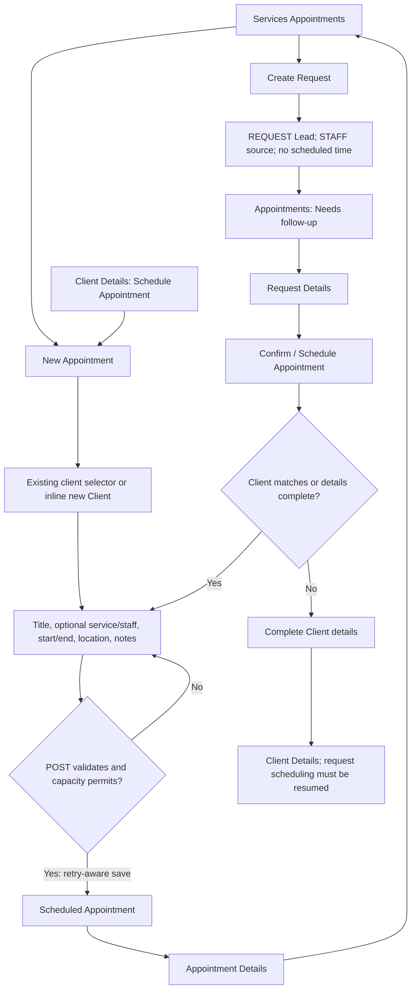
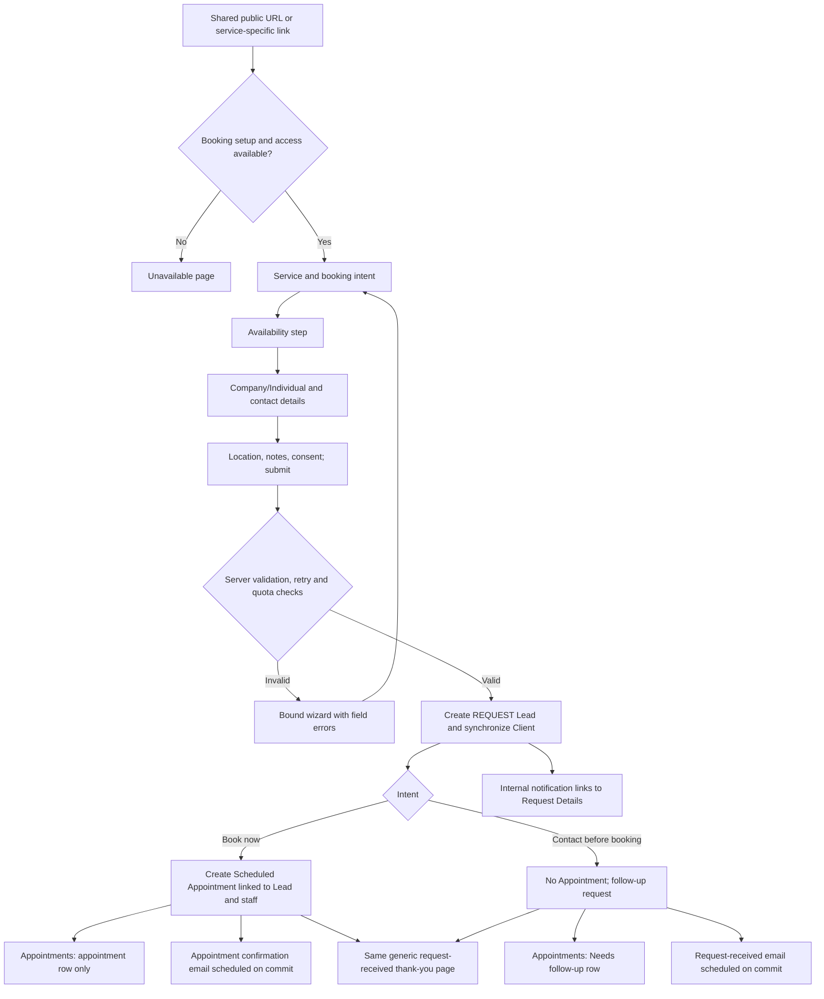
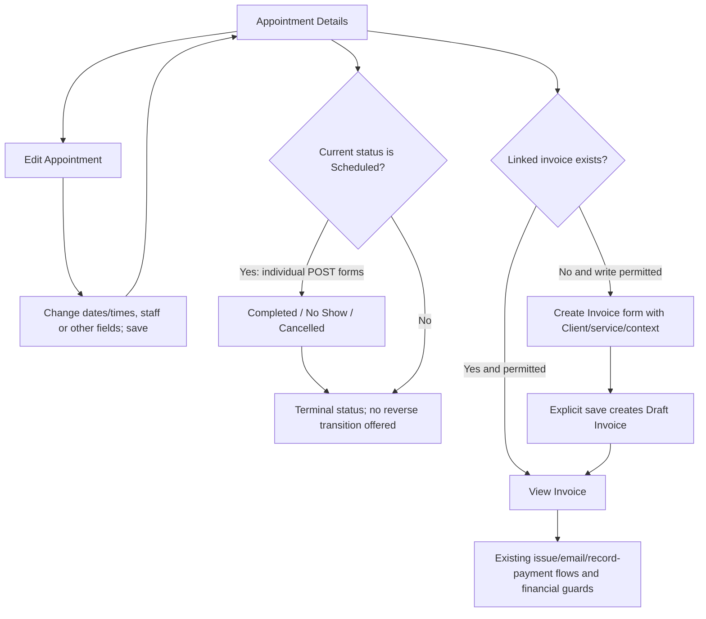

# Motionmate Services — Appointments & Bookings audit

**16 November 2026 · Step 1 audit · Services only · No implementation**

Appointments already combines scheduled bookings and unscheduled follow-up in one operational workspace. Internal **New Appointment** and public **Book an appointment now** both create existing `Appointment` records directly. **Create Request** and **Contact me before booking** create REQUEST Leads that appear in Appointments as **Needs follow-up** until scheduled. The main redesign needs are clearer outcome terminology, consistent timezone presentation, usable mobile records/actions, accessible forms, and a more direct follow-up journey.

Only this report is authorized for writing. The approved dashboard, application sources, dependencies, data, running services and deployment environments were left unchanged. Recommendations below are proposals, not approved process changes.

## 1. Scope, method and evidence

Primary routes: `/appointments/`, appointment creation/detail/edit/status routes, `/book/<business_slug>/`, and the existing Services request detail/conversion and Booking Settings destinations. Billing and client screens were traced only at their appointment-related entry points. Logistics is outside the audit; shared dependencies are identified solely to protect its existing behavior.

Reviewed root [AGENTS.md](../../../AGENTS.md), the [Motionmate UI skill](../../../.agents/skills/motionmate-ui/SKILL.md), [DESIGN](../motionmate-design-system/DESIGN.md), [COMPONENTS](../motionmate-design-system/COMPONENTS.md), [VERTICALS](../motionmate-design-system/VERTICALS.md), [preview workflow](PREVIEW-WORKFLOW.md), [reproducibility](REPRODUCIBILITY.md), [preservation/reproducibility report](09-reproducibility-and-preservation.md), and the relevant earlier audit/integration reports. Also reviewed [Services workflow documentation](../../services_unified_appointments.md), [invoice/payment vocabulary](../../invoice_payment_terminology.md), the existing [Appointments lab demonstration](../../../ui-lab/services-appointments/README.md), and the read-only Phoenix 1.23.0 table/form reference library. No design system was recreated.

Evidence labels used throughout:

- **Verified source:** behavior or markup directly traced in the current working tree. This establishes what the inspected code does, not ordinary-runtime/deployment health.
- **Existing visual evidence:** an already saved screenshot inspected during this audit; its original screen/date/context remain explicit.
- **Inferred risk:** likely user impact or a conditional edge case derived from source, requiring rendered/task validation.
- **Recommendation:** proposed future work, with functional decisions separated from presentation.

Starting repository state was clean on `experiment/motionmate-ui-redesign`, HEAD `74f84fc`. No Django initialization, database connection, test runner, browser script, login, form submission, fixture creation, migration, build, package installation, provider call or preview lifecycle command was run.

### Browser boundary

Existing loopback listeners and preview metadata were inspected without sending HTTP requests. The retained real Django pair is a frozen dashboard comparison, not a newly captured Appointments BEFORE. The historical `/tmp/taskio-unified-appointments-browser` screenshot directory is absent. The available Appointments browser script is a `StaticLiveServerTestCase` that creates records, submits forms and writes screenshots; it is not a read-only screen viewer ([script](../../../scripts/unified_appointments_browser_check.py#L26)).

Navigation itself is not uniformly read-only: scheduling from a request can create/synchronize a Client before rendering its GET form, and Booking Settings uses `get_or_create` on GET ([appointment view](../../../src/apps/appointments/views.py#L208), [settings view](../../../src/apps/businesses/views.py#L491)). No current authenticated, write-free browser inspection was established. Under this task's report-only boundary, source inspection and existing images were used instead of starting or altering an environment. **There is no fresh Appointments/public-booking screenshot, measured overflow/contrast result, accessibility pass or interactive BEFORE capture in this audit.** These remain required before a later implementation review.

## 2. Current implementation map

Paths and line references below refer to the inspected working tree. Runtime asset delivery, database migration state and provider behavior were not verified.

### Routes, views and templates

| Surface / named route | Method and actual path | Implementation and dependencies |
| --- | --- | --- |
| Unified Appointments / `appointment_list` | GET `/appointments/` | [views.py:221](../../../src/apps/appointments/views.py#L221), [workspace.py:140](../../../src/apps/appointments/workspace.py#L140), [workspace.html](../../../src/templates/appointments/workspace.html). Independent request/appointment read entitlements; tenant-scoped projection, six filters, 50 rows/page. |
| Internal creation / `appointment_create` | GET/POST `/appointments/create/`; optional `client_id` | [views.py:264](../../../src/apps/appointments/views.py#L264), [AppointmentForm](../../../src/apps/appointments/forms.py#L17), [form.html](../../../src/templates/appointments/form.html), [operations.py:44](../../../src/apps/appointments/operations.py#L44). Existing operation key, fingerprint and quota lock. |
| Schedule request / `appointment_create_from_request` | GET/POST `/appointments/create/from-request/<lead_id>/` | [views.py:300](../../../src/apps/appointments/views.py#L300), same form/template. Matches/prepares Client, infers a valid service or a unique category match, prefills request context and links `source_lead`. GET can write Client data. |
| View/edit appointment / `appointment_detail`, `appointment_update` | GET `/appointments/<appointment_id>/`; GET/POST same + `edit/` | [detail view:235](../../../src/apps/appointments/views.py#L235), [update:351](../../../src/apps/appointments/views.py#L351), [detail.html](../../../src/templates/appointments/detail.html). Rescheduling is editing the existing start/end fields. |
| Appointment status / `appointment_change_status` | POST `/appointments/<appointment_id>/change-status/` | [views.py:389](../../../src/apps/appointments/views.py#L389), three CSRF forms in [detail.html:152](../../../src/templates/appointments/detail.html#L152). Authoritative allowed transition map at [views.py:32](../../../src/apps/appointments/views.py#L32). |
| Public booking / `public_booking` | GET/POST `/book/<business_slug>/`; optional `service` | [root URLs:139](../../../src/taskio/urls.py#L139), [CRM view:1029](../../../src/apps/crm/views.py#L1029), [PublicBookingForm:717](../../../src/apps/crm/forms.py#L717), [public_booking.html](../../../src/templates/crm/forms/public_booking.html). Four-step customer wizard; server-provided slot data plus inline JS. |
| Public outcome / `public_booking_thank_you` | GET `/book/<business_slug>/thanks/` | [view:1155](../../../src/apps/crm/views.py#L1155), [thank-you template](../../../src/templates/crm/success_fail/public_booking_thank_you.html). Receives Business only, not the submitted booking outcome. Unavailable template handles access/setup failures. |
| Internal request / `staff_lead_create`, `staff_lead_update`, `staff_lead_detail` | GET/POST `/crm/staff/leads/create/` and `/<lead_id>/edit/`; GET `/<lead_id>/` | [create:1172](../../../src/apps/crm/views.py#L1172), [detail:1596](../../../src/apps/crm/views.py#L1596), [update:1628](../../../src/apps/crm/views.py#L1628), [PrivateLeadForm:517](../../../src/apps/crm/forms.py#L517), [lead_create.html](../../../src/templates/crm/forms/lead_create.html), [lead_detail.html](../../../src/templates/crm/main/lead_detail.html). REQUEST default, STAFF source on creation; compatibility INTEREST remains. |
| Request history / `staff_lead_list` | GET/POST `/crm/staff/leads/`; workspace link uses `?status_group=all` | [view:1212](../../../src/apps/crm/views.py#L1212), [lead_list.html](../../../src/templates/crm/main/lead_list.html). Separate historical filters `status_group`, `status`, `lead_type`, `q`; List.js pagination of rendered records. This screen calls itself Bookings. |
| Client completion / `staff_lead_convert_to_client` | GET/POST `/crm/staff/leads/<lead_id>/convert-to-client/` | [view:1661](../../../src/apps/crm/views.py#L1661), [conversion form](../../../src/templates/crm/forms/request_convert_to_client.html), [matching/sync services](../../../src/apps/crm/services.py#L116). Success goes to Client Details. |
| Inline Client / `staff_client_quick_create` | POST `/crm/staff/clients/quick-create/` | [view:1353](../../../src/apps/crm/views.py#L1353), [QuickClientForm:494](../../../src/apps/crm/forms.py#L494), [draft_client_modal.html](../../../src/templates/crm/includes/draft_client_modal.html), [draft-client.js](../../../src/static/assets/js/draft-client.js). `new_client-` prefix; JSON response selects Client or fills request draft. |
| Appointment invoice / `invoice_create_from_appointment` | GET/POST `/billings/from-appointment/<appointment_id>/` | [view:719](../../../src/apps/billings/views.py#L719), [_invoice_create_response:532](../../../src/apps/billings/views.py#L532), [invoice_create.html](../../../src/templates/billings/invoice_create.html), [billing service:79](../../../src/apps/billings/services.py#L79). Reuses linked invoice or opens a prefilled draft form; save creates Draft. |
| Request invoice shortcut / `staff_lead_create_invoice` | GET `/crm/staff/leads/<lead_id>/create-invoice/` | [view:1712](../../../src/apps/crm/views.py#L1712). Redirects to client invoice creation or client completion; its detail-page action is inside an HTML comment. |
| Booking Settings / `business_booking_settings` | GET/POST `/businesses/settings/booking/` | [view:480](../../../src/apps/businesses/views.py#L480), [forms:453](../../../src/apps/businesses/forms.py#L453), [booking_settings.html](../../../src/templates/businesses/booking_settings.html). Rules, sharing and single/bulk weekly availability; `form_kind` distinguishes submissions. Deactivation is POST to the existing availability route. |
| Legacy public intake | GET/POST `/crm/public_request/<business_slug>/`; authenticated `/crm/public_request/` entry | [views:960](../../../src/apps/crm/views.py#L960), [CRM URLs:101](../../../src/apps/crm/urls.py#L101). Legacy GET redirects to public booking; old embedded POST remains accepted. Do not remove compatibility routes. |

All appointment URL names are defined in [appointments/urls.py](../../../src/apps/appointments/urls.py); CRM and billing paths retain their existing root prefixes. No calendar, drag-to-reschedule, public self-service management or replacement booking entity was found in this route set. The vendor calendar asset's presence does not establish an Appointments calendar workflow.

### Models, permissions, assets and navigation

| Dependency | Verified responsibility / redesign boundary |
| --- | --- |
| [Appointment](../../../src/apps/appointments/models.py#L13) | Business and protected Client FK; optional Service, staff and source Lead; service-name snapshot; start/end, location, notes; four statuses; operation key/fingerprint. Validates tenant relationships and active staff membership. |
| [Lead](../../../src/apps/crm/models.py#L318), [Client synchronization](../../../src/apps/crm/services.py#L196) | REQUEST versus INTEREST; New/Contacted/Invoiced/Closed; optional requested service/preferred time. Requests have no durable Client FK. Synchronization is tenant-scoped and backfills existing Client fields without downgrading Active classification. |
| [Workspace projection](../../../src/apps/appointments/workspace.py#L53) | Includes all entitled appointments plus only active New/Contacted REQUEST Leads with no linked appointment of any status. Unique same-tenant email match supplies request classification/Client link; ambiguous matches remain Unknown. All matches are materialized/sorted before pagination. |
| [Business utilities](../../../src/apps/businesses/utils.py#L55), [context processor](../../../src/apps/businesses/context_processors.py#L28) | Existing active-Business resolver, membership, roles, capabilities, plan/subscription read/write gates. Appointment/request writes: Owner/Admin/Staff; Accountant/Viewer can read under entitlement. Services billing reads include all five roles; writes include Accountant as well as Owner/Admin/Staff, subject to remaining checks. |
| [Workspace parent](../../../src/templates/inheritance/dashboard_parent.html#L263), [workspace navigation](../../../src/templates/appointments/includes/workspace_navigation.html) | Phoenix sidebar collapse: Appointments → All Bookings & Requests / Needs follow-up / guarded Booking Settings. Mobile uses the same navigation collapse. Dashboard and Client Details also link into existing routes. No workspace switcher is introduced. |
| Workspace styles/scripts | Parent loads `theme.min.css` or RTL counterpart, then `user.min.css`/RTL, config, Bootstrap, Phoenix, icons and general vendor scripts. Unminified [user.css:117](../../../src/static/assets/css/user.css#L117) documents broad light-mode overrides; the light card override also exists in the served `user.min.css`. Appointments has no dedicated CSS/JS import. |
| Public styles/scripts | [split_forms_parent.html](../../../src/templates/inheritance/split_forms_parent.html) uses Phoenix auth/split-form composition and Nunito Sans, not the separate Silicon marketing theme. Booking markup contains inline slot CSS and wizard/address/slot JS ([public_booking.html:283](../../../src/templates/crm/forms/public_booking.html#L283)). Data arrives through `json_script`; slots are not live-fetched. |
| Approved dashboard | [agent_dashboard.html:4](../../../src/templates/crm/agent_dashboard/agent_dashboard.html#L4) alone imports [services-dashboard.css](../../../src/static/assets/css/services-dashboard.css) and JS with Services scoping. Manrope, calm semantic surfaces, readable records and explicit business-local timezone are already implemented there. Other appointment screens retain the older shell composition. Preserve these approved files. |
| Shared feedback / finance | [notifications/emails.py](../../../src/apps/notifications/emails.py#L291), appointment email templates, [quota middleware](../../../src/apps/businesses/quota_middleware.py), billing services and authoritative invoice presentation. UI must not infer email delivery, accepted work, payment or settlement. |

## 3. Existing workflow diagrams

Diagrams describe current source behavior, not a proposed replacement. Guards, validation and quota checks apply before authorized writes.

### Internal appointment and request intake

Inline creation saves the Client immediately while preserving the appointment/request draft; canceling the outer draft does not delete that saved Client. Direct internal appointments do not need a Lead. Internal requests do not automatically become appointments; choosing compatibility INTEREST opens its historical detail instead of the operational queue.

### Public online booking

For Book now, staff, date and time are required; duration comes from service/default settings. The server checks the workspace timezone, notice/window, same-day duration, availability and scheduled staff conflicts. Without appointment write entitlement the public form offers contact-before-booking only. Both intents still require public-booking readiness, including an active weekly availability block. No invoice is created by public booking.

### Managing scheduled work and invoicing

Rescheduling uses the general edit form; it does not reopen terminal appointments. The inspected edit/status writers do not send reschedule/cancellation notifications or change invoices/payments. A cancelled linked appointment continues to exclude its source request from Needs follow-up. These are existing semantics, not proposed automatic rebooking, refunds or credits.

## 4. Differences from the intended booking workflow

The instruction “online bookings and internal bookings lead directly into Appointments” has two distinct meanings: entering the **operational workspace**, and creating a **scheduled Appointment row**. The former is substantially implemented; the latter intentionally depends on booking intent. A request without an agreed time must not acquire an invented appointment date during visual work.

| Entry / state | Current source behavior | Assessment against intention |
| --- | --- | --- |
| New Appointment / Client scheduling shortcut | Creates Scheduled Appointment and opens Appointment Details. | Matches direct scheduled intake. |
| Public Book now | Creates Lead + Client + Scheduled Appointment atomically; list suppresses the linked Lead row. | Matches direct scheduled intake. No staff confirmation transition is required afterward. |
| Public Contact before booking | Creates Lead + Client; normally undated Needs follow-up row in Appointments. | Matches a unified work queue; does not create a scheduled Appointment. Preserve this deliberate distinction unless the product brief explicitly changes it. |
| Internal Create Request | Creates REQUEST Lead and returns to Appointments; scheduling is a subsequent action. | Appropriate for follow-up; misleading if staff interpret its “booking” copy as scheduled work. The form has category rather than service/staff/time fields. |
| Public success/settings copy | Says the team will review/confirm later, even when Book now has already created Scheduled Appointment and a scheduled email. | **Verified discrepancy.** Current code/test expectations take precedence over older request-first wording; do not restore obsolete behavior from copy. |
| Staff notification for a Book now submission | Links to Request Details, then a separate View Confirmed Appointment action. | Extra operational navigation despite an existing appointment. A future destination change requires explicit functional scope. |
| Client completion during request scheduling | Saves/matches Client and opens Client Details; does not resume the source-request scheduling form. | Handoff loses scheduling context. Generic client scheduling can omit `source_lead`, leaving the original follow-up separately visible. |
| Cancelled/completed/no-show linked work | Source request remains historical and does not re-enter Needs follow-up. | Current contract; any rebook/reopen policy is undecided, not implied by unified intake. |
| Historical/legacy records | Closed/inactive/INTEREST Leads remain in Request history; unknown appointment provenance remains Unspecified. | Preserve history and truthful unknowns; do not backfill classifications or origins as part of redesign. |

The explicit Book now and Book later expectations are also present in [PublicBookingTests:3074](../../../src/apps/crm/tests.py#L3074) and [workspace retry tests:296](../../../src/apps/appointments/test_workspace.py#L296). An older test named “creates request lead and client but no appointment” uses the other booking path; its name alone does not establish that all bookings are request-first.

## 5. Ranked UI/UX findings

Severity describes task impact: **Critical** means a demonstrated blocker or serious harm requiring immediate intervention; **High** affects core booking/scheduling understanding or task completion; **Medium** adds friction or inconsistency; **Low** is a smaller clarity/polish issue. No Critical defect was established in this source-only audit. Conditional impacts are identified as risks rather than observed incidents.

### High

**H1 — Booking outcomes contradict the language customers and staff see.** **Verified source.** The public introduction promises review, the submit action says Send booking request, and the shared thank-you says the business will confirm later. Settings also claims manual confirmation is the only behavior, while Book now creates Scheduled immediately. `confirmation_mode` and `requires_manual_confirmation` are not consulted by the inspected booking writer/form. This can leave a customer unsure whether the selected slot is secured and staff unsure whether another confirmation is needed. Evidence: [public template:17](../../../src/templates/crm/forms/public_booking.html#L17), [submit:268](../../../src/templates/crm/forms/public_booking.html#L268), [thank-you:16](../../../src/templates/crm/success_fail/public_booking_thank_you.html#L16), [settings:29](../../../src/templates/businesses/booking_settings.html#L29), [settings help:512](../../../src/apps/businesses/forms.py#L512), [writer:1066](../../../src/apps/crm/views.py#L1066). **Recommendation:** agree on scheduled versus contact-request vocabulary first; design outcome-specific summaries and next steps. Passing a truthful submission outcome to the success screen is functional work, not just CSS.

**H2 — The same appointment can show different clock times across screens.** **Verified source; runtime presentation not measured.** Appointment inputs explicitly parse/prepare in the Business timezone; list/detail/request templates use ordinary `date` filters without that override or a zone label. Default settings are UTC, with no Business timezone middleware in the inspected configuration. The approved dashboard and email formatter explicitly use Business time. For a UTC−04:00 workspace, a 09:00 local appointment can therefore appear as 13:00 on the list/detail while edit/dashboard/email show 09:00. Evidence: [AppointmentForm:64](../../../src/apps/appointments/forms.py#L64), [workspace time:69](../../../src/templates/appointments/workspace.html#L69), [detail:119](../../../src/templates/appointments/detail.html#L119), [settings:69](../../../src/taskio/settings.py#L69), [dashboard timezone](../../../src/templates/crm/agent_dashboard/includes/services_overview.html#L2), [email formatter:122](../../../src/apps/notifications/emails.py#L122). **Recommendation:** make the workspace zone explicit and align display with input semantics; preserve stored instants and availability rules. Verify daylight-saving ambiguity and cross-date cases in an authorized environment.

**H3 — The main work list and detail actions lack a deliberate mobile composition.** **Verified markup; overflow and task cost inferred.** The list retains nine columns, nowrap times and actions inside a generic horizontal table wrapper. All six filters precede records. Appointment Details places up to six navigation/action links in one non-wrapping flex group. There is no Appointments-scoped mobile treatment comparable to the approved dashboard; request detail already has some wrapping/grid improvements. Evidence: [workspace:34](../../../src/templates/appointments/workspace.html#L34), [table:53](../../../src/templates/appointments/workspace.html#L53), [detail action bar:23](../../../src/templates/appointments/detail.html#L23), [request detail styles:5](../../../src/templates/crm/main/lead_detail.html#L5). **Recommendation:** prioritize identity/time/state/actions, retain every field in a semantic responsive list/card treatment, disclose secondary filters, and wrap/stack action groups. Confirm exact behavior at 390/768/1440px and 320px reflow; no overflow measurement is claimed here.

**H4 — Public wizard accessibility and failure fallback need attention before visual polish.** **Verified markup/JS; assistive-technology impact untested.** Below `md`, step labels are hidden and the icon-only tab links have no explicit accessible names. Tabs use roving `tabindex` but have click handlers without a corresponding arrow-key handler; pane changes do not deliberately move focus. Slot selection replaces the clicked date/time button through full grid reconstruction and encodes selection by CSS classes without `aria-pressed`/equivalent state. The final submit starts hidden and later panes are inactive; there is no `noscript` or complete non-JS form fallback. A script failure can block completion. Evidence: [wizard tabs:57](../../../src/templates/crm/forms/public_booking.html#L57), [footer:261](../../../src/templates/crm/forms/public_booking.html#L261), [activation:533](../../../src/templates/crm/forms/public_booking.html#L533), [slot controls:738](../../../src/templates/crm/forms/public_booking.html#L738), [listeners:918](../../../src/templates/crm/forms/public_booking.html#L918). **Recommendation:** specify named mobile steps, correct keyboard/selection semantics, focus preservation and a usable failure fallback. These interaction changes require explicit implementation scope and real browser/AT review.

**H5 — Cancellation/status actions are immediate and terminal, while Edit remains available.** **Verified source.** Scheduled can become Completed, No Show or Cancelled by a single form submission; no confirmation, reason, undo or reverse transition is present. Edit is still available afterward, so changing a cancelled appointment's times does not make it Scheduled again. Neither cancellation nor edits send a change notice through these writers. Evidence: [transition map:32](../../../src/apps/appointments/views.py#L32), [update:359](../../../src/apps/appointments/views.py#L359), [status POST:397](../../../src/apps/appointments/views.py#L397), [detail actions:152](../../../src/templates/appointments/detail.html#L152). **Recommendation:** clearly distinguish rescheduling from status changes and explain consequences before terminal actions. Confirmation, reopening, change notifications and rebooking must be separate functional decisions; do not add undo that the server cannot honor.

**H6 — Booking-rule controls promise spacing the scheduling checks do not enforce.** **Verified source.** Settings exposes `buffer_minutes` as reserved spacing, and services expose an optional booking buffer. The inspected slot generation and server conflict checks compare actual start/end windows without either buffer; confirmation controls are similarly disconnected as described in H1. Internal AppointmentForm validates ordering/tenant/staff but has no public availability, notice or staff-overlap check. Evidence: [settings help:517](../../../src/apps/businesses/forms.py#L517), [service help:1282](../../../src/apps/crm/forms.py#L1282), [slot calculation:670](../../../src/templates/crm/forms/public_booking.html#L670), [public conflict check:1036](../../../src/apps/crm/forms.py#L1036), [internal clean:140](../../../src/apps/appointments/forms.py#L140). **Recommendation:** document which controls are effective and decide the buffer/internal-override policies separately. Do not imply internal validation parity, enforce new restrictions or remove stored settings during presentation work.

### Medium

**M1 — The follow-up journey can lose its source context.** **Verified source; duplicate-work impact inferred.** Incomplete requests need Client completion, but Save and Continue opens Client Details. Returning through generic Schedule Appointment uses `client_id`, not the original Lead link. Scheduling GET can also create a Client before the appointment is saved. Evidence: [scheduling:308](../../../src/apps/appointments/views.py#L308), [completion redirect:1699](../../../src/apps/crm/views.py#L1699), [client-based initial data:171](../../../src/apps/appointments/views.py#L171), [GET-write test:706](../../../src/apps/appointments/tests.py#L706). **Recommendation:** design a visible resume path retaining the request context, and state what has already been saved. A return parameter/redirect or mutation-boundary change requires functional approval.

**M2 — “Internal” does not include direct internal appointments in the source filter.** **Verified source.** Source is derived from `source_lead.request_source`; a direct New Appointment has no source Lead and appears as Unspecified. The Internal filter therefore finds staff-entered requests and appointments linked to them, not every appointment created by staff. The request row's Staff value is also Unassigned, although its model has no actual assignment field. Evidence: [source expression:99](../../../src/apps/appointments/workspace.py#L99), [row projection:151](../../../src/apps/appointments/workspace.py#L151), [creation operation:54](../../../src/apps/appointments/operations.py#L54), [staff cell:68](../../../src/templates/appointments/workspace.html#L68). **Recommendation:** explain provenance and assignment limits in the brief. Preserve Unspecified and Unknown; do not guess historical origin or convert free-text preference into an assignment.

**M3 — Filters and ordering obscure daily scheduled work.** **Verified source; scale impact unmeasured.** Requests always sort before appointments; appointments include historical/terminal work in ascending start order. There is no date range/today control or result count, and the list materializes all filtered matches before slicing 50/page. Applying Staff deliberately removes requests; applying Service does not match category-only requests. All six fields remain expanded. Evidence: [filters:72](../../../src/apps/appointments/workspace.py#L72), [filter semantics:158](../../../src/apps/appointments/workspace.py#L158), [ordering/pagination:201](../../../src/apps/appointments/workspace.py#L201). **Recommendation:** first improve filter hierarchy, applied-state explanation and empty recovery without changing queries. Date filtering, default ordering and database-level pagination are separate functional/performance proposals; no latency claim is made.

**M4 — Booking, Request, Lead and appointment statuses compete.** **Verified source.** Create Request leads to Booking Details copy and a Request Type selector including INTEREST. Request history is titled Bookings and offers Create Booking. Needs follow-up is a projection over New/Contacted, not a stored appointment status. A linked Lead can remain New after an appointment is Scheduled. Evidence: [lead form:19](../../../src/templates/crm/forms/lead_create.html#L19), [history:72](../../../src/templates/crm/main/lead_list.html#L72), [Lead choices](../../../src/apps/crm/models.py#L318), [projection:61](../../../src/apps/appointments/workspace.py#L61), [retry assertions:304](../../../src/apps/appointments/test_workspace.py#L304). **Recommendation:** use one operational vocabulary with clearly labeled request state versus appointment state and client classification; preserve enums, history and compatibility choices.

**M5 — Request follow-up promises an invoice action that is not interactive.** **Verified source.** Request detail describes invoice creation as an available next step, but its guarded Create Invoice anchor is inside an HTML comment. Users must use Client Details or Appointment Details. Book now staff email also takes a detour through the request despite an existing appointment. Evidence: [lead detail:175](../../../src/templates/crm/main/lead_detail.html#L175), [commented action:208](../../../src/templates/crm/main/lead_detail.html#L208), [staff notification destination:1118](../../../src/apps/crm/views.py#L1118). **Recommendation:** make help text match available controls; decide separately whether to restore the shortcut or change notification destinations. Preserve explicit draft invoice creation and existing billing checks; no automatic invoice is recommended as a visual fix.

**M6 — Internal forms make requirements/errors harder to discover.** **Verified markup.** Request and conversion form labels mostly lack `for` associations. Appointment forms have associated labels but no linked error summary or consistent required/optional markers; its title and both timestamps require manual entry, and the service choice does not autofill title/end time in this form. Client and staff selectors are native full lists. The six-field quick-Client dialog always requires company name, while public booking explicitly supports Individual. Evidence: [request labels:43](../../../src/templates/crm/forms/lead_create.html#L43), [conversion labels:56](../../../src/templates/crm/forms/request_convert_to_client.html#L56), [appointment fields:74](../../../src/templates/appointments/form.html#L74), [QuickClientForm](../../../src/apps/crm/forms.py#L494). **Recommendation:** group tasks, connect labels/errors, state requirements and saved-draft behavior. Defaults, searchable selectors or Individual support in internal creation are functional enhancements, not permission to relax validation or replace existing forms.

**M7 — Public contact-request mode retains unnecessary steps and hidden scheduling values.** **Verified source; conditional validation risk inferred.** Contact-before-booking still visits an Availability pane that only explains later contact. Changing from Book now hides its controls without clearing/disabling their values. The server still validates a supplied service/date/time combination even for Book later. A stale choice can therefore trigger notice/availability/conflict errors in a request mode where those choices are hidden. The public page also requires active weekly availability before either intent is available. Evidence: [availability pane:109](../../../src/templates/crm/forms/public_booking.html#L109), [toggle:882](../../../src/templates/crm/forms/public_booking.html#L882), [form clean:941](../../../src/apps/crm/forms.py#L941), [availability gate:303](../../../src/apps/crm/views.py#L303). **Recommendation:** specify mode changes, retained values, back navigation and empty-slot recovery in the brief. Skipping steps or changing stale-value/readiness rules needs functional approval and a targeted regression.

**M8 — Feedback is uneven across save, submit and sharing states.** **Verified source.** Normal form errors preserve bound values and successful appointment operations redirect with Django messages. The inline Client dialog disables submit, retains the outer draft, focuses errors and announces success: preserve this useful pattern. Main appointment/public submits have no explicit pending state; server retry protection already exists for creation. Quota failures replace the form with a generic 409 screen, and rate limiting returns plain 429 text. Booking Settings' share Copy action has no success/denial feedback; the approved dashboard has its own improved sharing treatment. Email failure is logged and swallowed; saved booking success does not prove delivery. Evidence: [draft-client.js:23](../../../src/static/assets/js/draft-client.js#L23), [operations:33](../../../src/apps/appointments/operations.py#L33), [quota middleware](../../../src/apps/businesses/quota_middleware.py), [429:1033](../../../src/apps/crm/views.py#L1033), [share include:15](../../../src/templates/businesses/includes/public_booking_share_card.html#L15), [email errors:79](../../../src/apps/notifications/emails.py#L79). **Recommendation:** design accurate pending/success/error/retry states and copy feedback; preserve operation keys and fail-closed limits. Do not claim delivery or invent async loading for the server-rendered list.

**M9 — Visual hierarchy and shell affordances diverge from the approved dashboard.** **Verified source and existing dashboard images.** Appointments does not load the dashboard's scoped Manrope/surface composition. Detail labels use `fs-10` (0.64rem), while the approved system calls for readable 14px metadata; pages start at `h2` without a page `h1`. Older cards use shared light-only shadow/border overrides and a mix of filled/outline/Phoenix action variants. On mobile, Appointments inherits a search trigger targeting `#searchBoxModal`, which is absent from these templates; the approved dashboard explicitly omits that trigger. Evidence: [detail labels:68](../../../src/templates/appointments/detail.html#L68), [theme sizes:11609](../../../src/static/assets/css/theme.css#L11609), [parent search:320](../../../src/templates/inheritance/dashboard_parent.html#L320), [dashboard override:13](../../../src/templates/crm/agent_dashboard/agent_dashboard.html#L13). **Recommendation:** reuse the approved typography, spacing and action language through a Services-scoped proposal; inspect both themes and contrast in-browser. A page override may avoid shared-shell changes; do not edit the dashboard or global tokens by implication.

### Low

**L1 — Smaller detail and navigation cues obscure context.** **Verified source.** View/Edit buttons repeat without record-specific accessible labels; list/detail/history links generally return to an unfiltered workspace. Appointment notes use a plain paragraph, which collapses the line breaks used by generated request context. Appointment detail emphasizes Created/Updated alongside schedule information. Evidence: [workspace actions:79](../../../src/templates/appointments/workspace.html#L79), [detail notes:135](../../../src/templates/appointments/detail.html#L135), [back links:29](../../../src/templates/appointments/detail.html#L29). **Recommendation:** improve names, preserve multiline readability and subordinate audit metadata. Retaining list-query context through new parameters is a separately scoped navigation enhancement.

**L2 — History has an apparent Export action without an implementation.** **Verified markup.** The visible Export button has no form, destination or matching handler in the inspected history template/script path ([lead_list.html:95](../../../src/templates/crm/main/lead_list.html#L95)). **Recommendation:** clarify or remove the unsupported affordance only in approved Services history scope; do not build an export workflow as incidental polish.

## 6. Desktop, tablet, mobile and theme observations

These Appointments observations are source-based expectations, not screenshots or rendered measurements.

| Area | Desktop | Tablet / mobile | Theme / accessibility implication |
| --- | --- | --- | --- |
| Workspace | Six filters use three columns from `xl`; nine independent table columns compete with long names. | Two filter columns from `sm`, one below; table remains scrollable instead of becoming an operational record layout. | Textual badges and associated filter labels are strengths. Add one page `h1`, meaningful table naming/action names and measured control sizing in later design. |
| Detail | Main details and Actions split at `lg`; unrelated navigation, invoice and edit actions share one top row. | Cards stack, but the top action group lacks wrapping; status controls occur after the details block. | Uppercase `fs-10` labels are below approved metadata size. Contrast, focus and actual touch sizes remain unmeasured. |
| Create/edit | Main form and a separate Status card split at `xl`; three main sections. | Main fields stack; Status explanation and bottom save controls follow all main content. | Inputs have labels and server errors, but optionality/error focus need consistency. Preserve native controls and inline Client modal. |
| Public wizard | Auth/split-form decoration competes with the booking task. | Inline title area has `min-height:640px`; form wrapper remains `col-8`. Phoenix makes the title box full width below `md`; this creates a source-based risk of a long introduction followed by a narrow form. | Both theme images/token support exist. Step names disappear below `md`; slot controls have a useful 2.75rem minimum height. Confirm actual width/scroll/focus before accepting a design. |
| Settings/history | Settings combines sharing/rules and single/bulk availability; history has a different table/filter composition. | Headers still contain several side-by-side links; history table is horizontally scrollable. | Settings feedback exists; copy feedback and clear effective-rule wording need work. Staff availability scope must remain intact. |

Public layout references: [public_booking.html:5](../../../src/templates/crm/forms/public_booking.html#L5), [Phoenix auth layout:37160](../../../src/static/assets/css/theme.css#L37160). These CSS/template facts do not establish a measured document overflow or a browser-specific failure.

### Existing images inspected safely

The following saved **real Django Services dashboard** images were viewed as the approved visual reference. They are historical dashboard captures with synthetic data from the earlier review, **not current Appointments or public-booking screenshots**. Their work-first hierarchy, clear local-time rail, readable dark surfaces and mobile action placement provide the consistency target; their capped dashboard disclosure policy should not be copied into the full Appointments list.

| Reference | Existing screenshot |
| --- | --- |
| Dashboard AFTER, 1440px, light | [Desktop reference](screenshots/real-django/step8-after-1440-light-viewport.png) |
| Dashboard AFTER, 390px, dark | [Mobile reference](screenshots/real-django/step8-after-390-dark-viewport.png) |

Provenance remains in [essential-screenshots.json](essential-screenshots.json) and [Step 8](08-real-application-preview.md). The existing [Appointments demonstration](../../../ui-lab/services-appointments/README.md) is a reusable composition reference only: its filters, loading/error states, actions and data are synthetic. Its prior browser results do not validate the Django booking journey. No screenshots were generated/copied and no prototype was built for this audit.

## 7. Recommended improvements and protected functionality

### Presentation proposals for a later scoped design

1. Keep one Appointments workspace with unmistakably separate scheduled work and Needs follow-up states. Lead with search/state and a clear New Appointment action; retain independently guarded Create Request and Request history.
2. Reuse the approved Motionmate visual language: Manrope, restrained indigo, calm surfaces, readable metadata, explicit timezone, 4px spacing scale, 44px project control targets, semantic badges and both themes. Retain Phoenix in the application; Tailwind/DaisyUI remain isolated design tools.
3. Design a coherent list/detail/form family: grouped identity/service/staff, time and state, visible next action, responsive records and action groups. All nine existing information subjects must remain available.
4. Improve field grouping, requirements, label/error association, focus and save feedback while preserving submitted drafts and existing inline Client behavior. Keep destructive status actions distinguishable from navigation and editing.
5. Specify truthful public wording, step labels, mode explanations, booking summary, empty slots and recoverable errors. Copy can be proposed now, but outcome-specific rendering and wizard behavior are functional work.

### Functional proposals requiring separate decisions/authorization

| Decision | Required boundary |
| --- | --- |
| Confirmation semantics, effective settings and booking buffers | Decide policy against current Book now/Book later behavior; change authoritative server/slot logic only with explicit scope. Do not silently return everything to request-first. |
| Internal conflict/availability rules | Decide whether staff have a deliberate scheduling override and how to explain it. Do not copy public checks into internal forms automatically. |
| Reschedule/cancel communication and terminal-state protection | Agree on confirmation, notification/retry semantics, reopen/rebook behavior and history. Do not couple appointment status to settlement or refunds. |
| Client completion and provenance | Preserve source-request linkage and resume context; decide whether GET-side synchronization should change. No inferred historical backfill or new model is authorized. |
| Search/date filters, ordering, pagination | Preserve existing parameters and fail-closed validation first. New date views/query behavior and performance work need their own requirements. |
| Invoice entry and notification destinations | Decide exact guarded destinations and truthful help text. Keep explicit invoice draft review; no auto-issue/send/payment or subscription-billing changes. |
| Wizard fallback, state selection/focus, stale hidden values | Review keyboard/no-JS/mode-change behavior and server parity together. Preserve operation keys, server validation and tenant-scoped choices. |

### Protected contracts and cross-vertical risks

| Protected area | What later work must preserve |
| --- | --- |
| Tenant and access | Existing Business resolver/membership; independent request versus appointment entitlements; role/module/subscription/write and quota checks on the server. Request-only users must not gain appointment rows/details; appointment-only access must not reveal requests/history. |
| Forms and routes | Named routes/methods, `client_id`/`service` entry context, six GET filters, historical `status` alias, page/query retention, CSRF, `operation_key`, fingerprints, `new_client-` prefix, `form_kind`, validation and return paths unless specifically approved otherwise. |
| DOM and drafts | `data-unified-workspace`, `data-entry-kind/id`, `id_client`, `draftClientModal`, draft status/errors, wizard pane/tab/slot/address hooks and modal targets. Inline Client save must retain the outer draft and accurately state persistence. |
| Domain history | REQUEST/INTEREST distinction, scheduled versus preferred time, service snapshots, Client classifications, Unknown/Unspecified states, legacy null-category compatibility and historical multiple appointments per Lead. No replacement CRM/billing models or duplicate operational records. |
| Finance | Invoice Draft/Issued/Cancelled versus recorded-payment/credit/refund/review indicators. Reuse authoritative services and financial access. Appointment cancellation/completion is not invoice cancellation or evidence of payment. |
| Shared shell/assets | `dashboard_parent.html`, split-form/success parents, `user*.css`, Phoenix, logo, config/theme keys, context processors and draft-Client include have other consumers. Future changes need a Services-only rendering/selector boundary; shared changes require both verticals' regression evidence. |
| Logistics and approved dashboard | No Logistics redesign or policy transfer. Preserve its locations, staff grants, parcel/shipment/manifests, financial restrictions and navigation. Preserve approved dashboard sources, local font, frozen design references and existing evidence. |
| Providers/data | Preserve existing transactions, post-commit notifications, retry/quota rules and external integrations. No ordinary/Test Lab records, credentials, uploads, database migrations or deployment changes are authorized. |

## 8. Existing coverage and validation gaps

Existing tests were inspected, **not executed**:

- [appointments/tests.py](../../../src/apps/appointments/tests.py): model/form tenant rules, snapshots, internal creation/edit/status, scheduling/client completion, role/plan access and invoice navigation. The Client-on-scheduling-GET behavior has an explicit existing test.
- [appointments/test_workspace.py](../../../src/apps/appointments/test_workspace.py): combined rows, no linked-request duplication, historical multiple appointments, classification/source/filter behavior, retry, independent entitlements, read-only roles, subscriptions, domain-record preservation, pagination and Logistics exclusion.
- [CRM PublicBookingTests](../../../src/apps/crm/tests.py#L2413): readiness/service/staff isolation, timezone/notice/availability/conflict validation, Company/Individual handling, Book now/Book later, emails/failure tolerance and later internal scheduling.
- [unified_appointments_browser_check.py](../../../scripts/unified_appointments_browser_check.py): real creation/inline Client draft preservation and workspace filter/follow-up/invoice/request-only journeys at 1440 and 390px. It writes fixtures and screenshots; it must only run in an explicitly authorized disposable environment.

The historical Services workflow document records past passing runs. This audit makes no new test-pass claim, and a source test name is not evidence that its runtime assertion currently passes. Existing browser checks do not establish the full 768px/light-dark/keyboard/AT/no-JS/public wizard matrix needed here.

Before implementation review, authorize and identify a suitable disposable environment under the established workflow. Capture current working-tree Django BEFORE; cover 390/768/1440px, 320px reflow, light/dark, long names/notes, populated/empty/invalid/restricted states, all affected roles/entitlements, both public intents, mode changes, availability/conflict errors, inline drafts, rescheduling/terminal statuses and guarded invoice navigation. Keep provider/email delivery and ordinary-runtime health separate from isolated evidence. Shared changes additionally need Logistics regressions. No environment setup or such validation is authorized by this report.

## 9. Proposed Step 2 — Design Brief

Prepare a Services-only brief, after approval, with these concrete outputs:

1. **Vocabulary/outcome contract:** distinguish scheduled appointment, unscheduled contact request, request status and Client classification; decide how public/settings language reflects actual behavior. Record unresolved functional policies rather than designing them as if approved.
2. **Screen scope and task priorities:** Appointments list/filter/navigation, Appointment Details and existing create/edit/from-request form first; then the related request detail/completion handoff and public booking/outcome screens. Treat Booking Settings/history as supporting surfaces with explicit inclusion decisions. The approved dashboard is a reference, not a redesign target.
3. **Responsive compositions:** desktop operational table, tablet/mobile record treatment, deliberate detail actions, compact form grouping and a task-focused public form. Reuse the existing design system and Appointments demonstration without treating its simulated actions as implemented Django behavior.
4. **State/permission matrix:** Owner/Admin/Staff versus Accountant/Viewer, request-only/appointment-only/read-only/unavailable, assigned/unassigned and unknown classifications, all four appointment statuses, both public intents, invalid/no-slot/rate/quota/email-failure communication. Include focus, named controls, errors and pending states.
5. **Implementation boundary proposal:** identify exact Services templates/assets and any necessary view/context changes. Prefer page-scoped Phoenix composition; separately list shared dependencies and functional work. Do not authorize a framework migration, database/schema change or billing automation by visual approval.
6. **Review acceptance criteria:** trustworthy booking outcome/timezone; essential work and actions usable without horizontal document scrolling; all existing record subjects/guards preserved; accessible labels, keyboard/focus and measured contrast; existing drafts/retries/workflow behavior retained; Logistics and dashboard preservation evidence. Define later interactive BEFORE/AFTER work and its disposable setup authorization separately.

**Audit completion:** only this report was added. Final checks are document-link/location consistency, whitespace and repository scope inspection. No application code, ordinary or disposable database, Logistics implementation, approved dashboard, dependency, deployment environment or running preview was changed. No commit, push, merge or deployment occurred. **Stop here; Step 2 awaits human approval.**
