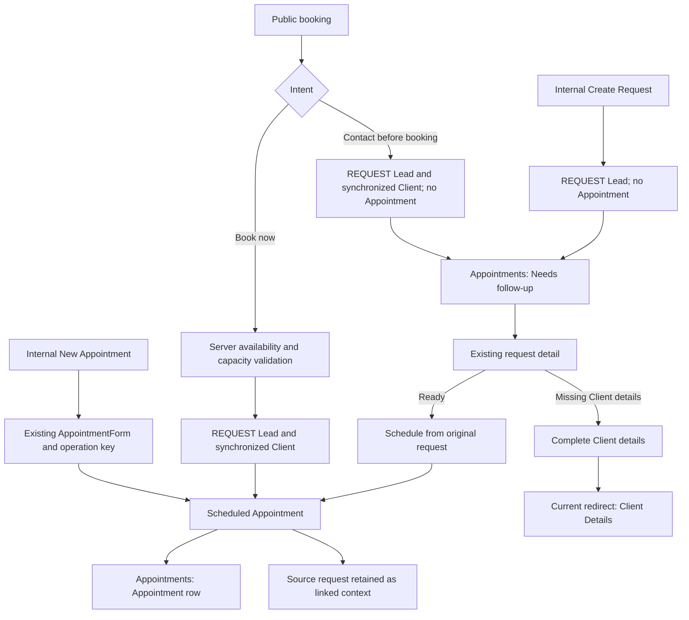
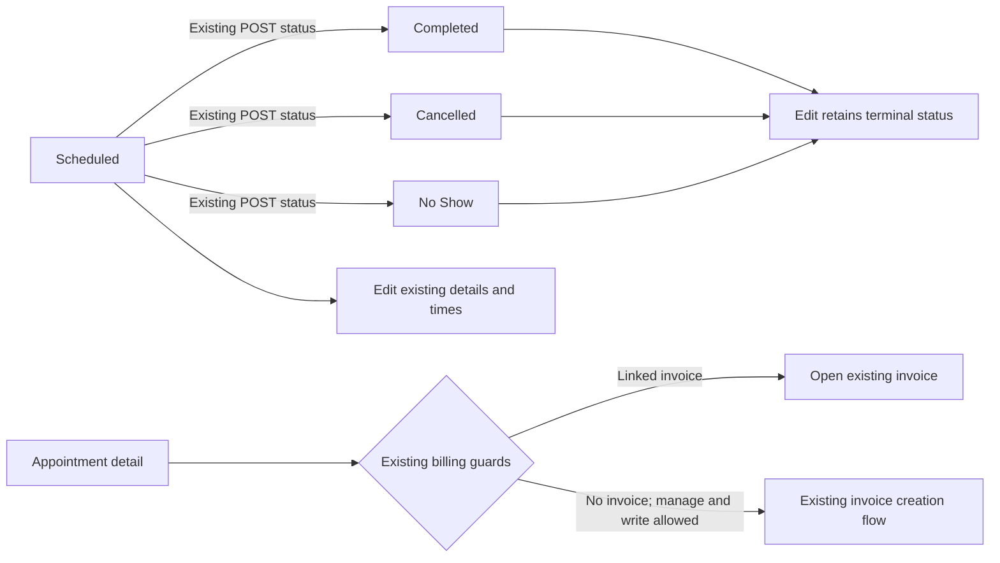

# Motionmate Services — Appointments & Bookings production integration audit

**Step 4 · 16 November 2026 · Audit and implementation proposal only**

The five approved compositions can be integrated incrementally into the existing Django/Phoenix application. Use Services-scoped templates, CSS and small interaction enhancements; retain the existing booking writers, forms, authorization and billing services. No frontend framework migration is needed.

**Approval boundary:** the user has approved Step 3's appearance and demonstrated interactions. That supersedes the earlier reports' pending *visual* review language. It does not approve notifications, reopening, booking buffers/conflicts, request linkage changes, wizard fallback behavior or server outcome rendering. This report proposes an implementation boundary; it does not implement or authorize it. Full prototype parity depends on decisions that remain open, especially D4–D6.

**Work performed:** source/documentation inspection, consumer mapping, Git/worktree inspection and read-only hashing. Only this requested report was written. No Django initialization, database connection, browser session, fixture creation, tests, dependency installation or environment setup was performed. The user's explicit report request supplies the exception to the UI skill's default response-only Audit mode.

## 1. Evidence, baseline and limits

Read [AGENTS.md](../../../AGENTS.md), the [Motionmate UI skill](../../../.agents/skills/motionmate-ui/SKILL.md) and Phoenix map; the approved [design system](../motionmate-design-system/DESIGN.md), [components](../motionmate-design-system/COMPONENTS.md) and [vertical contracts](../motionmate-design-system/VERTICALS.md); [preview workflow](PREVIEW-WORKFLOW.md), [reproducibility](REPRODUCIBILITY.md), dashboard [integration](07-services-dashboard-integration.md) and [real application review](08-real-application-preview.md). The local Phoenix 1.23.0 reference is present and remains read-only.

The screen specification is [Step 1 audit](10-appointments-bookings-audit.md), [Step 2 brief](11-appointments-bookings-design-brief.md), [Step 3 review](12-appointments-bookings-prototype-review.md), and the current [prototype source](../../../ui-lab/services-appointments/README.md). Also consulted [Services appointments](../../services_unified_appointments.md), [Business Settings](../../unified_business_settings.md), [service pricing](../../service_pricing_and_imports.md) and [invoice/payment terminology](../../invoice_payment_terminology.md). Source controls where documentation or old interface copy disagrees.

| Evidence class | What is established | Limit |
| --- | --- | --- |
| **Verified source** | Routes, form fields, view context, transitions, query projection, inheritance, asset order and current test assertions described below. | No claim about current ordinary-database contents, actual runtime rendering or provider delivery. |
| **Retained Step 3 evidence** | Its [summary](../../../ui-lab/services-appointments/evidence/step3/summary.json) records 62 render cases, 166 task assertions, 14 supplementary states/assertions, zero axe violations and two contrast-incomplete cases. All **17 recorded source/build hashes** match the files inspected for this audit. | Synthetic Chromium evidence; no Django or production-integration pass. No evidence was regenerated. |
| **Recommendations** | Scoped architecture, closed file manifest, sequencing and acceptance tests below. | Proposed work only. |
| **Unverified** | Other Codex/IDE activity, ordinary-runtime health, browser/AT behavior after integration and live notifications. | Must be reassessed at the relevant later implementation/review boundary. |

Existing visual evidence remains available in the [152-image gallery](../../../ui-lab/services-appointments/evidence/step3/gallery.html), including [desktop workspace](../../../ui-lab/services-appointments/evidence/step3/screenshots/workspace-1440-light-viewport.png) and [terminal dialog](../../../ui-lab/services-appointments/evidence/step3/screenshots/terminal-dialog-1440-light-viewport.png). These are prototype observations, not newly captured production screens. Step 3 explicitly leaves Firefox/WebKit, screen readers, real devices, native zoom, RTL and exhaustive normal-motion checks unverified; its two contrast incompletes require fresh evaluation in Bootstrap dialogs.

### Working tree and concurrent-work boundary

At inspection, branch `experiment/motionmate-ui-redesign`, HEAD `74f84fcd1f33185b110c6d3770570aa1a7c8d672`, one Git worktree. There were no tracked application edits. Existing changes belong to Step 1–3 and must be preserved:

- Modified: `ui-lab/services-appointments/README.md`, `src/app.js`, `src/fixtures.js`, `src/input.css` within that package.
- Untracked reports: `10-appointments-bookings-audit.md`, `11-appointments-bookings-design-brief.md`, `12-appointments-bookings-prototype-review.md` in this directory.
- Untracked prototype files: `review_evidence.py`, `src/journey.js`, `supplement_contrast.py`, `validate_states_step3.py`, `validate_step3.py` within `ui-lab/services-appointments/`.

The approved prototype therefore includes working-tree and untracked bytes; HEAD alone is insufficient to preserve it. Ignored builds, screenshots, shared lab assets and Phoenix references are not disposable. A read-only preservation baseline covered **12,767 files**, combining tracked/nonignored files with appointment builds/evidence, dashboard builds and shared design-system files, excluding only this new report. Aggregate SHA-256: `2f2db2857730bbfc703fc5c85535347048f93f6adfa0802bc683f078f3346dd3`.

No other agent was listed in this conversation; that does not establish that other editor sessions or Codex threads are idle. Re-read status and target-file hashes immediately before later edits. Preserve unexpected changes and reconcile ownership rather than resetting, cleaning, checking out over them or rebuilding approved evidence.

## 2. Current production map and five-composition mapping

All paths below refer to the actual Django application. `/book/…` is registered in [taskio/urls.py:139](../../../src/taskio/urls.py#L139); appointment routes in [appointments/urls.py](../../../src/apps/appointments/urls.py); CRM routes in [crm/urls.py:104](../../../src/apps/crm/urls.py#L104). None needs changing for the presentation integration.

| Approved composition | Production route / method / view | Templates and authoritative data | Proposed integration and limits |
| --- | --- | --- | --- |
| **A. Appointments workspace** | `/appointments/` GET; `appointment_list`, [views.py:221](../../../src/apps/appointments/views.py#L221). | [workspace.html](../../../src/templates/appointments/workspace.html); [workspace.py:140](../../../src/apps/appointments/workspace.py#L140) supplies `workspace_form`, paginated mixed rows and independent entitlements. | Approved header/actions, search/state plus secondary-filter disclosure, desktop table/mobile records, local-time labels, empty/restricted states. Keep all nine information subjects and existing links. No dashboard-style three-record cap. |
| **B. Appointment details** | `/appointments/<id>/` GET; `appointment_detail`, [views.py:235](../../../src/apps/appointments/views.py#L235). `/change-status/` remains POST-only. | [detail.html](../../../src/templates/appointments/detail.html); tenant Appointment with Client, service snapshot, optional staff/source Lead; `available_statuses`, optional `linked_invoice`. | Schedule/status first; related actions and billing link retain guards; approved terminal-action confirmation wraps existing POST forms. Editing and rescheduling continue through Edit. No reopening, financial operation or new notification. |
| **C. Create/edit appointment** | `/appointments/create/`, `/<id>/edit/`, `/create/from-request/<lead_id>/` GET/POST; [views.py:264](../../../src/apps/appointments/views.py#L264), :300, :351. | [form.html](../../../src/templates/appointments/form.html); [AppointmentForm](../../../src/apps/appointments/forms.py); [operations.py](../../../src/apps/appointments/operations.py). Existing QuickClientForm/modal/JSON endpoint. | Approved grouping, source context, explicit requirements, inline Client creation, error summary, status-on-save and responsive actions. Preserve native selects and explicit title/start/end. No service-driven autofill or cross-navigation draft store. |
| **D. Public booking and confirmation** | `/book/<business_slug>/` GET/POST; [crm/views.py:1029](../../../src/apps/crm/views.py#L1029). `/book/<slug>/thanks/` GET; :1155. | [public_booking.html](../../../src/templates/crm/forms/public_booking.html), [PublicBookingForm:717](../../../src/apps/crm/forms.py#L717), server slot JSON. [thank-you template](../../../src/templates/crm/success_fail/public_booking_thank_you.html) currently receives Business only. | Four named steps, keyboard/focus improvements, responsive slot controls, Company/Individual and compact pre-submit review. Preserve slot rules and original inputs. **Distinct post-submit Scheduled/request outcomes are held under D6**; the existing thanks view/template is excluded from the initial manifest. |
| **E. Request follow-up** | `/crm/staff/leads/<id>/` GET; [crm/views.py:1596](../../../src/apps/crm/views.py#L1596). Create/edit GET/POST :1180/:1636; convert-to-client GET/POST :1670; scheduling uses composition C. | [main/lead_detail.html](../../../src/templates/crm/main/lead_detail.html), [forms/lead_create.html](../../../src/templates/crm/forms/lead_create.html), [request_convert_to_client.html](../../../src/templates/crm/forms/request_convert_to_client.html). Existing REQUEST Lead, matched Client, missing fields, latest linked Appointment. | Clear unscheduled versus linked state, completion guidance and existing scheduling handoff. Keep completion's current Client Details redirect and original request identity. Do not implement the prototype's direct-resume candidate. Preserve INTEREST/legacy behavior in shared CRM templates. |

### Dependencies and reusable production components

| Existing component | Reuse / contract |
| --- | --- |
| [dashboard_parent.html:69](../../../src/templates/inheritance/dashboard_parent.html#L69) | Existing `page_assets`, `page_body_attributes` and `services_mobile_search` blocks support the new staff pages. Retain Phoenix navigation, existing 992px collapse behavior, module/role gates and script order. No shared-dashboard-parent edit proposed. |
| [split_forms_parent.html:38](../../../src/templates/inheritance/split_forms_parent.html#L38) | Phoenix public form foundation. Currently lacks head/body extension blocks. One narrowly defined shared-file exception is proposed in P20 below; no replacement shell. |
| [workspace_navigation.html](../../../src/templates/appointments/includes/workspace_navigation.html) | Existing Appointments, Needs follow-up and Booking Settings links, collapse IDs and onboarding hooks. Preserve unchanged; no new Bookings queue or workspace switcher. |
| [draft_client_modal.html](../../../src/templates/crm/includes/draft_client_modal.html), [draft-client.js](../../../src/static/assets/js/draft-client.js), [quick-create view:1353](../../../src/apps/crm/views.py#L1353) | Reuse unchanged. Keep `draftClientModal`, `data-draft-client-*`, destination, `id_client`, `new_client-` prefix, CSRF/AJAX JSON contract, validation and draft preservation. Client creation saves a real Client immediately in the eventual real application. |
| Phoenix Bootstrap components | Existing forms, native selects, modal/offcanvas, alerts and buttons. Reuse Bootstrap modal lifecycle for confirmations and focus handling; do not transplant the lab's shell or native-dialog controller. |
| [local Manrope](../../../src/static/assets/fonts/manrope/manrope-latin-wght-normal.woff2) and [license](../../../src/static/assets/fonts/manrope/OFL.txt) | Already in application assets. Reference these existing files; no download, duplicate font, package install or external font request is needed for the new content. Existing parent font loading remains unchanged. |
| [services-dashboard.css](../../../src/static/assets/css/services-dashboard.css), [services-dashboard.js](../../../src/static/assets/js/services-dashboard.js) | Read-only visual precedent: approved semantic colors, density and Manrope. Do not import their dashboard-specific layout or modify them to serve this redesign. |
| [Business localization](../../../src/apps/businesses/localization.py), CRM address formatting and existing billing destinations | Keep authoritative country/address, currency and invoice behavior. Do not substitute prototype USD prices, synthetic staff, fixed slots or locally calculated financial state. |
| [invoice creation:728](../../../src/apps/billings/views.py#L728), [billing presentation](../../../src/apps/billings/presentation.py) | Leave untouched. Preserve existing-invoice reuse and the linked-invoice/create-invoice branches, with their original role/module/write guards. An invoice status is not a settlement calculation. |

## 3. Actual workflows and preserved behavior

The combined workspace removes an eligible request row when **any tenant-scoped Appointment links to it**, without creating a replacement Lead or deleting history. Multiple legitimate linked appointments survive. Open follow-up means active REQUEST with NEW/CONTACTED status and no linked Appointment; it is not every historical Lead. See [workspace.py:53](../../../src/apps/appointments/workspace.py#L53).

The transition whitelist is [appointments/views.py:32](../../../src/apps/appointments/views.py#L32). Edit and status changes currently do not send cancellation/rescheduling notifications, cancel invoices or issue refunds. Preserve this behavior and avoid delivery promises in confirmation copy.

### Differences that integration must not conceal

1. **The principal direct flow already matches the intention.** Internal New Appointment and public Book now save Scheduled appointments directly; there is no required intermediate manual-confirmation queue. Contact before booking and internal Create Request intentionally remain unscheduled.
2. **Copy contradicts that flow.** The current public thanks page says the business will “review and confirm your appointment,” even for an already Scheduled booking. Request details also use “Confirm / Schedule” and “Confirmed Appointment.” Safe request/detail labels can become “Schedule Appointment” / “View Appointment” using existing context. The outcome-specific thanks repair needs D6; retaining the old thanks page in the first phase is a known remaining discrepancy, not full design parity.
3. **Client completion is a detour.** [crm/views.py:1678](../../../src/apps/crm/views.py#L1678) and :1699 redirect matched/saved Clients to Client Details. The prototype's direct scheduling resume is only a candidate. Preserve the existing redirect and explain it truthfully; keep the original request URL available before submission without inventing a new return contract.
4. **Scheduling GET can write.** [appointments/views.py:208](../../../src/apps/appointments/views.py#L208) prepares a Client via existing synchronization when enough request details exist. Do not run this journey against ordinary data during audit/review. Changing synchronization timing, matching or durable linkage is D4, outside this plan.
5. **Public intent switching differs from the prototype.** Current [template:882](../../../src/templates/crm/forms/public_booking.html#L882) hides the availability section but retains date/time values; [form:945](../../../src/apps/crm/forms.py#L945) validates supplied slot values even for contact intent. The prototype clears them. Do not copy that clearing/disable behavior or promise an undated payload merely because fields are hidden. Keep four steps and existing server acceptance under D5.
6. **Public contact readiness still depends on availability setup.** [crm/views.py:303](../../../src/apps/crm/views.py#L303) requires public-booking entitlement, enabled settings, a bookable service and active weekly availability. Do not loosen readiness or skip server validation to match a prototype state.
7. **Historical provenance and matching are deliberately limited.** An internal direct Appointment without source Lead displays Unspecified, not inferred Internal. Request classification is a unique tenant-email display projection, not a durable Client relationship or authority to link records ([workspace.py:99](../../../src/apps/appointments/workspace.py#L99)). Preserve Unknown/Unspecified.
8. **Billing/email shortcuts are not all active.** The request's invoice action is HTML-commented despite surrounding guidance; staff booking emails still link to request detail even for Book now ([crm/views.py:1118](../../../src/apps/crm/views.py#L1118)). Do not restore the shortcut or retarget notifications as part of visual integration.

## 4. Proposed Phoenix-compatible architecture

### Services scope and inheritance

Add an appointment staff base using the existing dashboard extension blocks. Its assets and page marker apply only to resolved `Business.vertical == SERVICE`; retain `block.super` defaults for other contexts. Override the unsupported mobile search trigger only for these target pages, following the existing dashboard technique. Do not edit the dashboard, its navigation include, logo, theme controller or global parent.

The CRM lead detail/form templates also serve legacy INTEREST records. Keep their current parent and preserve their legacy branch; apply the new asset include, body/content marker and composition only to the Services REQUEST branch. For the private form, use the bound `lead_type` value where available and its existing REQUEST default, preserving the visible type/status controls and invalid POST values. Do not hide the INTEREST option, coerce it to REQUEST or change its redirect. Test legacy GET and invalid POST explicitly. Client completion is already REQUEST-scoped by its view and can use the new staff base.

For public booking, add a child base of `split_forms_parent.html`. Add only two default-preserving extension blocks to that existing parent: an empty `page_assets` block after existing theme/RTL initialization, and a `page_body_attributes` block whose default emits the current empty attributes. Only the Services public-booking child fills these blocks. Keep the parent's background, logo, vendor imports, scripts and default markup. Do not make the parent select a vertical or change booking eligibility.

**Shared-parent impact assessment:** direct consumers found were `crm/forms/public_booking.html`, legacy `crm/forms/public_request.html` and `logistics/application_form.html`. The latter two must receive identical rendered markup/assets with the default blocks. This is the sole proposed shared production edit, not authorization to redesign Logistics. If review cannot establish default-output equivalence, omit/defer this public phase and revise the plan; do not duplicate the full parent or broaden the shared change. The separate `success_fail_parent.html` and its public/legacy result consumers remain untouched.

### Typography, tokens and responsive composition

- Add one page-scoped stylesheet with `--mm-sb-*` semantic aliases mapped to the **existing approved** light/dark values; use Phoenix semantic variables where they already match. Do not change `:root`, `--phoenix-*`, lab tokens or dashboard `--mm-sd-*` definitions. Give all selectors a Services booking page/content or modal ancestor.
- Reference the existing local variable Manrope with `font-display: swap` and system fallbacks. Apply it to target content, inputs and dialogs. Keep global navigation typography and the dashboard's font-family identity unchanged. Verify glyph fallback and long names.
- Implement the approved 32/40px desktop and 28/34px mobile title, 20/28px sections, 15–16px body, 14px metadata and minimum 16px inputs; 4px spacing scale, 20/16px panels and 12/8/6px radii. Use restrained borders, visible focus and 44px controls/label targets.
- Keep Phoenix's actual shell breakpoint rather than the lab's 1200px drawer. Use page-local table/record breakpoints, logical spacing for RTL, natural wrapping, stacked/equal actions, dark tokens and reduced motion. Prefer one semantic record tree; do not duplicate actionable controls or IDs into simultaneous desktop/mobile forms.
- Preserve the current Phoenix `data-bs-theme` state. Do not copy lab `data-theme`, query-driven themes or `mm-services-lab-theme` storage. Do not load Tailwind preflight, DaisyUI, lab CSS/JS, Silicon public-site styles or a new icon/dependency bundle into Django.

### Presentation helpers and interaction boundaries

Add a small pure template-tag module for business-local display and accessible bound-field rendering. Resolve the zone from the **already supplied Business** with the existing safe default-timezone fallback; never activate a process/global timezone, query a different Business or alter stored instants/form parsing. Display a readable zone label and business-local 24-hour times consistently across target records and request context. Test invalid zones, midnight/date boundaries and DST. Keep native `datetime-local` input preparation in AppointmentForm unchanged. Field helpers may merge label/help/error ARIA attributes, preserving widget IDs, values, names, required flags and all existing widget hooks; they must not alter validation or submitted data.

The staff script enhances disclosures, error focus and approved status confirmations inside the marker only. Reuse original POST forms and hidden status values. Confirm exactly once using the original submitter/form semantics; do not bypass browser/form events with `form.submit()`, add POST fields or disable successful fields before serialization. A modal's explanatory text must identify the actual appointment and state that the action does not itself modify invoices/refunds or send change notifications. Terminal transitions remain server-authoritative.

Extract the existing public inline JavaScript into a dedicated scoped asset before changing its interaction presentation. Replace Django-interpolated element IDs with data attributes carrying the **same** IDs; retain JSON script IDs `public-booking-slot-data` / `public-booking-address-data`, `data-booking-wizard-*`, slot hooks and named native fields. Preserve availability computation, server-supplied duration/range/notice/conflict data, country rules, Company/Individual clearing already supported by the server and event initialization order. Remove the old initializer only when the extracted version is in use. Add accessible step navigation, selected-slot/focus state and a compact **local pre-submit review** in step four, with edit controls returning to existing steps. That review is not a receipt or guarantee of availability.

Keep original CSRF and `operation_key` values. [operation_fingerprint](../../../src/apps/appointments/operations.py#L24) includes the path, user and every POST key/value except CSRF/key; seemingly cosmetic renaming, added named controls, disabling inputs or reserializing the payload can break retries. Preserve existing legacy no-key compatibility, duplicate-result handling, quota/rate-limit responses and uncertain-save wording. No new automatic retry, polling, notification or client-side success assumption.

## 5. Exact proposed file-change manifest

**Future implementation allowlist: 29 files — 17 additions, 12 modifications.** No deletion or rename. P01–P20 are production presentation/support files; Q01–Q09 are validation/tooling. This audit changes **only this report**, which is not an implementation-file authorization. New paths below are proposed, not existing deliverables. Additional files or server behavior require a revised reviewed manifest.

### Production presentation/support: 20 files

| ID | Action | Exact path | Proposed change / constraint |
| --- | --- | --- | --- |
| P01 | Add | `src/templates/appointments/base.html` | Services-only staff assets/body marker and mobile-search block through existing dashboard hooks. |
| P02 | Add | `src/templates/appointments/public_base.html` | Services-only public assets/body marker through P20; preserve Phoenix public shell. |
| P03 | Add | `src/templates/appointments/includes/services_booking_assets.html` | Single explicit static CSS/deferred staff script include; public child additionally loads P10. No remote imports. |
| P04 | Add | `src/templates/appointments/includes/form_field.html` | Bound labels, requirements, help/error IDs and original widgets; no hidden business controls. |
| P05 | Add | `src/templates/appointments/includes/error_summary.html` | Accessible bound-form/non-field errors linking to real field IDs. |
| P06 | Add | `src/templates/appointments/includes/status_confirmation.html` | Bootstrap confirmation markup for existing permitted terminal forms; no new fields/transitions. |
| P07 | Add | `src/templates/crm/includes/public_booking_review.html` | Compact final-step review of current inputs; display-only values and type=button edit actions. |
| P08 | Add | `src/static/assets/css/services-bookings.css` | Scoped approved tokens, existing Manrope, typography, responsive records/forms/dialogs, light/dark/RTL/reduced motion. |
| P09 | Add | `src/static/assets/js/services-bookings.js` | Scoped filter/action disclosure, errors and terminal confirmation enhancements; no local data store, writer or policy. |
| P10 | Add | `src/static/assets/js/services-public-booking.js` | Extract existing public logic; add approved keyboard/focus/review interaction while preserving payload and slot rules. |
| P11 | Add | `src/apps/appointments/templatetags/__init__.py` | Register the new presentation-tag package only. |
| P12 | Add | `src/apps/appointments/templatetags/services_bookings.py` | Pure business-local display/zone and accessible widget helpers; no model writes, queries or validator changes. |
| P13 | Modify | `src/templates/appointments/workspace.html` | Composition A, same GET form/filter names/query/pagination and row hooks, preserved guards. |
| P14 | Modify | `src/templates/appointments/detail.html` | Composition B, same links and guarded status POST forms, P06 confirmations. |
| P15 | Modify | `src/templates/appointments/form.html` | Composition C, same POST/CSRF/key/widgets/modal, explicit terminal status-on-save. |
| P16 | Modify | `src/templates/crm/main/lead_detail.html` | Composition E only for Services REQUEST; preserve legacy branch, scheduling conditions and hidden invoice shortcut. |
| P17 | Modify | `src/templates/crm/forms/lead_create.html` | REQUEST create/edit subview, bound fields and existing Client modal; preserve INTEREST branch/type/status/redirect contracts. |
| P18 | Modify | `src/templates/crm/forms/request_convert_to_client.html` | Completion subview, errors, truthful saved-Client/next-destination copy; same POST and Client Details redirect. |
| P19 | Modify | `src/templates/crm/forms/public_booking.html` | Composition D's four-step form/review, existing payload/JSON hooks; move inline scoped CSS/JS into P08/P10. No thanks-page change. |
| P20 | Modify | `src/templates/inheritance/split_forms_parent.html` | Only the two empty/default-preserving extension blocks specified above; prove legacy/Logistics consumer equivalence. |

### Validation/tooling: 9 files

| ID | Action | Exact path | Purpose / safety boundary |
| --- | --- | --- | --- |
| Q01 | Add | `src/apps/appointments/test_services_bookings_ui.py` | Business-local display, real template/form/guard/retry contracts, responsive-data completeness, shared-parent and legacy defaults. Pure helper tests plus disposable-only render/workflow fixtures. |
| Q02 | Add | `src/apps/crm/test_services_public_booking_ui.py` | Public wizard render/hooks, unchanged POST acceptance, mode switching, Company/Individual, server errors and unchanged generic outcome route. |
| Q03 | Modify | `src/apps/crm/tests.py` | Only obsolete presentation assertions such as “Online Booking Form” / “Confirm / Schedule Appointment”; retain all permission, record, redirect and notification assertions. |
| Q04 | Modify | `scripts/unified_appointments_browser_check.py` | Update changed heading/control locators (“Actions”, “Confirm / Schedule Appointment”) to approved semantic names; preserve real workflow/data assertions. |
| Q05 | Add | `scripts/services_bookings_ui_browser_check.py` | Real Django Chromium task/accessibility/visual comparison cases and server-test fixtures, following existing browser-check structure. |
| Q06 | Add | `scripts/ui_preview/appointments_fixtures.py` | Dedicated synthetic Services review tenants/records/accounts and detailed inventory; no ordinary data import. Separate from existing dashboard tenants. |
| Q07 | Modify | `scripts/ui_preview/fixtures.py` | After existing seed data, call Q06 within the already verified seed phase; return a separate `appointments_review` account/inventory section. Keep existing dashboard accounts, per-tenant records and IDs unchanged; do not append review accounts to the dashboard validator's account list. |
| Q08 | Add | `scripts/ui_preview/appointments_checks.py` | Explicit session-based appointment test/browser adapter reusing ownership/source/identity checks and sanitized child environments. No new launcher or weakening of network/financial guards. |
| Q09 | Modify | `scripts/ui_preview/test_tooling.py` | Focused negative ownership/source/database tests for Q08 and proof existing dashboard fixture/account contracts remain unchanged. |

Q06/Q07 supplement **new, separately authorized disposable sessions only**; do not reseed an existing review pair or reset human review records. Both frozen sides receive identical synthetic supplements. The new adapter is invoked explicitly through its module entrypoint using a validated session path, not by repurposing `--route` or silently widening the current dashboard command. It must verify identity before Django setup, seeding or test-database creation. The existing CLI/runtime/launcher/guard/core files are excluded from modifications.

### Explicitly excluded / held files

- All `src/apps/logistics/`, `src/templates/logistics/`, Logistics assets and operational data.
- `src/templates/inheritance/dashboard_parent.html`; `crm/agent_dashboard/` templates; `services-dashboard.css` / `.js`; dashboard views and approved evidence.
- Appointment/CRM views, forms, models, operations, workspace queries, URL modules; all billing writers/presentation/routes; business membership/subscription/quota logic, middleware and configuration.
- `src/templates/crm/success_fail/public_booking_thank_you.html`, `src/templates/inheritance/success_fail_parent.html`, unavailable/legacy public-request pages and result views. No D6 outcome rendering in the initial phase.
- Shared `draft_client_modal.html`, `draft-client.js`, navigation, global fonts/theme/user/RTL files, vendor bundles, collected `src/staticfiles/`, PWA assets, dependencies/locks and migrations.
- All `ui-lab/`, Step 1–3 reports/evidence, design-system definitions and ignored Phoenix reference files. Use as read-only inputs; do not rebuild or reformat them.

## 6. Functional decision register — separate approval required

The register retains the Step 2 identifiers. Approval of terminal confirmation interactions is already acknowledged; no second visual-approval gate is being invented.

| Decision | Current contract and approved interaction | Still unapproved / excluded |
| --- | --- | --- |
| **D1 notifications** | Keep public appointment/request email selection and existing staff destination; preserve edit/status save behavior without new email. | Cancellation/reschedule triggers, recipients, retry/failure handling and delivery feedback. Do not touch email services or notification links. |
| **D2 reopening** | **Approved I:** terminal-action confirmations, Escape/cancel/focus return. Existing Scheduled → Completed/Cancelled/No Show only. | Reopening, new transitions/rebooking policy, status reset on edit or cancellation reason fields. |
| **D3 scheduling policy** | Public server availability/notice/window/staff conflicts remain authoritative; internal form keeps its existing rules. | Effective buffers, manual-confirmation settings, internal overlap checks, overrides and capacity-policy changes. Never introduce a manual gate between Book now and Appointments. |
| **D4 request/Client handoff** | Restyle existing request, completion and scheduling pages; preserve matched Client/source Lead and existing redirects. | Direct resume after completion, changed matching/linkage, suppression/replacement of GET synchronization, request reassignment and durable return context. No duplicate appointment to imitate resume. |
| **D5 wizard/fallback** | **Approved I:** four named steps, keyboard navigation, review/edit, selection/focus feedback. | Clearing/disabling stale slot values on intent change, step skipping, changed readiness, non-JS/progressive fallback or uncertain-result recovery/retry semantics. Current defects remain documented. |
| **D6 server outcomes** | Approved designs describe separate Scheduled and Request received outcomes. Local pre-submit review can be implemented independently. | Tenant-safe authoritative post-redirect context, retry/expiry/refresh/direct-GET behavior and outcome templates. Never trust `?result=`, a referrer, local storage or browser state as proof of successful scheduling. Whole thanks-page integration is held. |
| **D7 finance/destinations** | Existing invoice and Client destination links only; clear misleading request copy where current context permits. | Restoring the commented invoice shortcut, changing staff email targets, financial automation or new invoice presentation requiring additional server context. |
| **D8 query/return behavior** | Same six filters, historical `status` alias, 160-character search, result ordering and page size 50; browser back remains native. | New date views, search fields, default ordering, database pagination, `next`/return parameters or durable cross-page draft/context storage. |
| **D9 Client/defaults** | Existing QuickClientForm requirements, native selectors and explicit title/start/end fields. | Internal Individual/company parity, enhanced selector dependencies, service-derived defaults or changed Client requirements. |

**Implementation consequence:** the initial presentation can be reviewed across all five compositions, but public post-submit outcomes and direct Client-completion resume will remain visibly different from the prototype. A complete end-to-end design sign-off must record these held portions or wait for their functional decisions. Do not describe a partial integration as full parity.

## 7. Implementation phases and dependencies

All phases below are **proposed**, not executed or authorized by this audit.

| Phase | Files / sequence | Exit evidence |
| --- | --- | --- |
| **0. Approve boundary and preserve BEFORE** | Review the 29-file plan and D1–D9 exclusions. Recheck working-tree ownership/hashes and the 17 approved prototype hashes. Before presentation edits, use existing `motionmate_preview.py capture` on actual working-tree runtime bytes. | Identifiable current BEFORE snapshot; protected dashboard/lab/Logistics hashes; no reliance on historical Step 7 commit as this screen's BEFORE. Explicit disposable-environment/test-data authorization before setup. |
| **1. Prepare isolated validation** | Q01/Q02 initial contract tests, Q05–Q09 adapter/fixture support. Run the same additive synthetic fixture set for both actual Django copies. Existing unit/browser checks establish baseline behavior before presentation edits. | Verified owned clusters/settings, identical per-side fixture inventories, independent cookies, captured baseline failures and original forms/redirects. Old dashboard fixture identities/counts unaffected. |
| **2. Scoped foundation and workspace** | P01, P03–P05, P08/P09, P11/P12, P13. Build pure formatting/field helpers before consumers. | Workspace filters, invalid filters, pagination, entitlements, nine data subjects, local-time labels and themes pass; dashboard assets/content unchanged. |
| **3. Appointment detail and forms** | P06, P14/P15; refine scoped assets. Reuse draft Client include/script unchanged. Update Q03/Q04 only for actually changed visible locators/copy. | Create/edit/reschedule/status/Client/invoice navigation and retry/CSRF tests pass; terminal edits do not reopen; confirmations make one original POST. |
| **4. Request follow-up** | P16–P18 and associated Q01/Q04/Q05 cases. Gate REQUEST branches before rearranging shared CRM markup. | Internal/public follow-up, matched/missing/linked/closed requests and legacy INTEREST pass; current Client Details redirect and original linkage preserved. |
| **5. Public form** | P20 default hooks first, P02, P10, P07, P19; Q02 plus browser parity. Extract current script, establish behavioral parity, then add approved wizard/review presentation. | Both intents, Company/Individual, address variations, availability/errors/retries pass; legacy public-request and Logistics application defaults unchanged. No thanks-view/template change. |
| **6. Real AFTER and human review** | Refresh AFTER only with existing tooling; run the full relevant matrix and compare equivalent fixture contexts. No new production files beyond the allowlist. | Actual interactive BEFORE/AFTER URLs and source/fixture identities, screenshots, raw failures/incompletes and explicit deferred differences. Leave review data independent; no automatic reset. Stop for human implementation review. |

No schema change is needed. Disposable setup may apply **existing** migrations to empty owned test databases after authorization; it must not generate migrations, alter ordinary schemas or contact ordinary databases. If “no migrations” remains absolute for the later environment as well, use an already authorized verified disposable environment and report missing setup rather than bypassing the restriction. Release, staging, commits, pushes and deployment remain separate decisions after implementation review.

## 8. Regression and accessibility validation plan

### Environment and tooling preconditions

Use the existing project `.venv/bin/python -B`, Playwright and locally available browser/axe assets. No installation is part of the proposal. Reuse [PREVIEW-WORKFLOW](PREVIEW-WORKFLOW.md) and [REPRODUCIBILITY](REPRODUCIBILITY.md), including current-working-tree capture, separate sources/clusters, live PostgreSQL directory/system-identifier verification, sanitized environment without ordinary `.env`, disabled providers/real email, loopback restrictions and isolated session/CSRF cookies. Use the same clock and complete synthetic fixture inventory on both sides; never clone customer records.

The existing `--route /appointments/` changes a launch destination only; `validate` is dashboard-oriented ([REPRODUCIBILITY.md:145](REPRODUCIBILITY.md#L145)). Q08 must supply the new five-composition adapter. It must reuse existing ownership/source checks before any write, run test settings `taskio.services_test_settings` only against the verified disposable cluster and `test_services_rollout`, and enforce the existing loopback/provider restrictions. Fail closed on wrong port, source, directory, owner, DB identity or ordinary environment. A non-5432 port alone is insufficient evidence.

Keep interactive preview financial-write/DDL guards intact. Review invoice **links and seeded read states** there; do not weaken guards to create invoices/payments interactively. Validate actual appointment-to-invoice POST behavior only in the separately owned disposable test harness, using captured/local email and blocked provider networking. Those tests establish server contracts, not live financial/provider success.

### Required checks

| Area | Test cases / acceptance |
| --- | --- |
| **Creation / retries** | Internal blank/source-Client/source-request creation; complete and incomplete inline Client; existing draft values survive modal success/error/cancel and theme change. Original field names/IDs, prefixes, CSRF and operation keys remain present. Same key/same payload returns same record; changed payload preserves existing rejection. One deliberate second booking is not collapsed into the first. No new retry loop. |
| **Public direct workflow** | Book now creates one Scheduled Appointment with existing source Lead/Client and removes the linked request from follow-up projection. Contact intent creates no Appointment and appears as Needs follow-up. Duplicate submission, quota/rate limit, inactive business/service, subscription restriction, unavailable booking and nonbookable service retain existing outcomes. No manual confirmation stage. |
| **Availability / payload parity** | Staff-specific/business-wide fallback, durations, notice/window, no slots, scheduled overlap, timezone/date/DST and boundary cases. Compare actual posted name/value sets before/after, including Book now → contact with populated date/time. Preserve existing stale-value behavior; expose the limitation rather than writing a test that assumes clearing is approved. |
| **Company / addresses** | Public Individual clears stale company according to current server rules; Company requires it. Country/district/postal formats and bound invalid values remain. Internal QuickClientForm keeps its current required company/contact/address fields and existing validation. |
| **Updates / terminal statuses** | Valid edit/reschedule with unchanged status; terminal record edit stays terminal. Only available server transitions rendered; Enter/Space/confirm/cancel/Escape/focus return; one POST with original hidden status. Invalid/forbidden transitions and wrong HTTP methods still fail. No new email, invoice mutation or refund after editing/status actions. |
| **Requests / legacy data** | Active unlinked NEW/CONTACTED requests; linked/multiple appointments; closed/inactive history; missing and matched Client; ambiguous email; null/historical category compatibility. Original request preserved through scheduling. Completion still returns to Client Details. Shared INTEREST GET/edit/invalid POST and type selection remain supported. |
| **Workspace query contracts** | `q`, `state`, `source`, `classification`, `staff`, `service`, historical `status`; invalid IDs fail closed. Staff filtering excludes requests; category-only requests do not masquerade as service matches. Existing request-first and appointment chronological ordering; page 2 of >50 with filter preservation. Unspecified provenance remains Unspecified. No List.js client-side refiltering of a partial server page. |
| **Permissions / isolation** | Owner/Admin/Staff manage versus Accountant/Viewer read as allowed by current role checks; invoice-management roles independently assessed. Anonymous, inactive membership and other-tenant IDs rejected. Request-only, independent appointment entitlement, locked module, grace/read-only and unavailable subscription states. Reuse existing tests for entitlement combinations not sold as an actual catalog plan; do not invent a purchasable plan to match a fixture. |
| **Billing / integrations** | Existing linked invoice takes precedence over create; authorized create route retains original Client/service and existing-invoice protection. No unauthorized invoice control/data; no UI financial calculations. Capture existing mail counts/destinations separately from save success. Assert no new notifications from ordinary update/status paths. Providers remain disabled. |
| **Desktop / tablet / mobile** | All five eligible compositions at 1440, 768, 390 and 320px, both themes; long titles/names/addresses, empty, filtered-empty, restricted, validation, loading and error states. All nine record subjects accessible; no document overflow, clipped actions, accidental duplicate controls or lost server errors. Preserve native input/browser behavior. |
| **Accessibility** | Semantic page headings, labels/help/errors, error-summary focus and links, visible focus, selected-slot state, tab/step names and keyboard order, disclosure and Bootstrap dialog lifecycle, 44px targets, 200% text/400% reflow, reduced/normal motion and RTL. Preserve raw axe violations/incompletes; manually inspect the two prior dialog contrast cases in their actual new surfaces. Keyboard plus available screen-reader review; record unavailable browser/AT checks explicitly. |
| **Cross-page defaults** | Approved Services dashboard data, onboarding, assets, navigation and layout unchanged at representative widths/themes/roles/subscriptions. No bookings assets on Client/invoice/other Services pages. For P20, compare default rendered output for legacy public request and Logistics application form, both themes/RTL and validation states. Check Logistics workspace/navigation/module/location states stay unchanged; no Logistics code or fixture account alteration. |

Existing coverage to retain/run in the authorized harness: [appointments/tests.py](../../../src/apps/appointments/tests.py), [test_workspace.py](../../../src/apps/appointments/test_workspace.py), CRM public-booking/scoping/onboarding tests, [unified appointments browser checks](../../../scripts/unified_appointments_browser_check.py), [draft Client checks](../../../scripts/draft_client_browser_check.py), invoice workflow/terminology checks and protected dashboard contracts. Q01–Q09 supplement these; they must not replace authoritative server assertions with markup-only tests.

Record initial failures and compare identities after changes. Historical dashboard documentation reports a non-green broader suite and a local debug-allocator workaround for an unresolved segmentation fault; these are **documented prior limitations**, not newly reproduced findings. A debug-allocator pass does not establish ordinary-runtime stability or release readiness. Do not mask the issue, repair unrelated suites or label old passes as new results. Stop runtime validation safely if the verified environment cannot start and record the missing evidence.

## 9. Risks, conflicts and acceptance gates

Severity below ranks **integration risks**, not newly observed production incidents. No new Critical defect was established by this source-only audit.

| Severity | Risk / dependency | Mitigation and acceptance condition |
| --- | --- | --- |
| **High** | Prototype outcomes/resume/cleared slots can silently alter policy if its controller is copied. | Translate composition only; keep D4–D6 excluded and original server contracts. No import of `app.js`, `journey.js`, fixture reducers or query-result receipt logic. |
| **High** | Shared public parent can affect Logistics or legacy public requests. | P20 permits two default-preserving blocks only. Unchanged consumer output/assets required; otherwise defer phase 5. No Logistics source edits or shared theme changes. |
| **High** | Form reordering, dialogs or busy states can change successful POST fields/fingerprint and break retry safety. | Preserve field names/values/CSRF/keys and submitter semantics; compare real POST payloads and record counts, including double submission. No named review inputs or new hidden policy values. |
| **High** | REQUEST templates also handle INTEREST; entitlement/financial controls differ by route. | Explicit REQUEST/Service gating, retain legacy branch, original conditional blocks and server role/module/write checks. Test independent entitlements and financial links. |
| **High** | Time labels can imply a different schedule from existing input parsing, especially DST/invalid zones. | Pure already-resolved-Business formatter, explicit zone, safe fallback and boundary tests; no global timezone activation or stored-time change. |
| **High** | Ordinary runtime has a previously documented unresolved crash; synthetic evidence cannot resolve it. | Diagnose readiness only in authorized isolation; report ordinary-allocator failure separately. Do not claim deployment readiness from prototype or workaround results. |
| **Medium** | Dashboard integration changed shared hooks, views/tests and has established preservation checks. | Reuse its hooks and existing font read-only. Do not edit dashboard views/templates/assets or protected evidence. Q03 assertion changes must be narrowly scoped; recheck ownership before writing. |
| **Medium** | New fixture/check adapter could disturb dashboard review accounts or bypass existing guards. | Add separate synthetic tenants and account section after old seed; preserve old account IDs/data. Negative identity/network tests; no CLI/runtime/guard changes. No reseeding of existing sessions. |
| **Medium** | Phoenix and scoped CSS/script ordering can cause theme flashes, modal conflicts or double wizard initialization. | Load page assets after existing overrides, preserve theme initialization and Bootstrap order; one public initializer, Service markers and no global selector leakage. Check CSP/console/static URLs. |
| **Medium** | Mobile table/card transformation loses semantics/content; browser draft memory in prototype overpromises persistence. | Retain a semantic record tree and full server page; test keyboard/AT/reflow. Preserve inline modal draft only; no new browser PII persistence or return parameters. |
| **Medium** | Current fallback, thanks copy and Client redirect remain imperfect after scoped integration. | Show these explicitly in human review; seek the separate functional decisions before claiming full journey parity. No concealed partial completion. |
| **Low** | Manrope Latin coverage/font failure and copy-name changes affect wrapping and old test locators. | Existing licensed local asset/system fallback; long/non-Latin content and unavailable-font tests; update only proven presentation assertions. |

Before implementation, approve the **29-file scope**, the two-block shared-parent exception and the intentional D4–D6 visual differences. Separately authorize the concrete disposable setup/test/evidence operations required for real BEFORE/AFTER review; none ran during this audit. After implementation, require human review of identifiable real Django sources/fixtures and retained limitations. No release action follows automatically.

## 10. Audit completion and stop point

This report is the sole new audit deliverable. Existing prototype source/build hashes were verified without rebuilding; application and protected-tree preservation were checked with read-only hashes and Git diff/status. The final **12,767-file aggregate exactly matches the baseline in section 1**, and the only added status entry is this report. Its 29 unique manifest paths have the expected existing/new status; all local links resolve, whitespace checks pass and the index remains unchanged. No implementation test or actual runtime/provider pass is claimed.

Application code, appointment/booking/Client/invoice records, ordinary and disposable databases, Logistics, approved dashboard and prototype artifacts, dependencies and deployment environments were untouched. No staging, commit, push, merge or deployment occurred.

**Stop here. Await approval of this implementation plan and the applicable isolated validation setup before modifying application code.**
